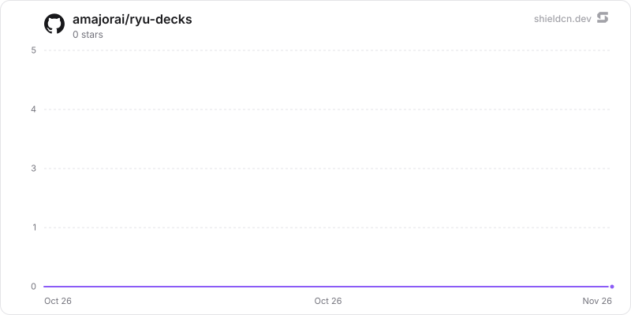

<p align="center">
  <picture>
    <source media="(prefers-color-scheme: dark)" srcset="./icon-dark.png" />
    
  </picture>
</p>

<div align="center">

# Decks

</div>

Hardware control decks for Ryu: drives Elgato Stream Deck, Ulanzi D200, Work Louder Creator Micro 2 / OpenAI Codex Micro, Loupedeck / Razer Stream Controller and Mirabox / Ajazz decks over USB and the MacBook Pro Touch Bar, paints each key, and turns presses into app events and agent requests, with a Companion and one SQLite store.

> **The public home of `ryu-decks`.** Source, builds, and releases live here —
> binaries for every platform are attached to each release.
>
> This tree is generated from the Ryu monorepo, so commits pushed here
> directly are replaced on the next sync. **Pull requests are welcome** —
> open them here and they are ported into the monorepo, then flow back out.
> Ryu as a whole: https://github.com/amajorai/ryu

## Install

**App:** [Install](ryu://apps/@ryu/decks) (opens the Ryu desktop app and asks you to confirm)

**CLI:**

```bash
ryu apps add @ryu/decks
```

**From source:**

```bash
cargo build --release --manifest-path backend/Cargo.toml
```

Prebuilt binaries for every platform are attached to [each release](https://github.com/amajorai/ryu/releases).

## License

Apache-2.0 — see [LICENSE](./LICENSE).

## Supported decks

Keys and dials in this README are numbered from 1, as Decks shows them
("Key 1"). The `key` and `dial` fields of `@ryu/decks#key.pressed` and
`@ryu/decks#dial.turned` count from 0, so key 1 here is `key: 0` in an event.
Bits, bytes, LEDs and device ids keep the numbering of their protocol.

| Family | Models | Keys | Faces |
| --- | --- | --- | --- |
| Elgato | Stream Deck (2017, 2019, MK.2, scissor keys, modules), Mini (+ MK.2, Discord), XL (+ rev. 2, module), Neo, +, + XL, Studio, Pedal | 3–36 | Per-key screens (none on the Pedal) |
| Corsair | Galleon 100 SD keyboard's Stream Deck panel (1b1c:2b18, HID interface 0) | 12 | Per-key screens (160 x 160 JPEG, not mirrored); the 720 x 384 screen above the keys shows two strip keys, one under each dial; the two dials' four-LED rings are the dial lights |
| Ulanzi | D200, D200H, D200X | 13 | Per-key screens; the status window shows a clock |
| Work Louder | Creator Micro 2, OpenAI Codex Micro | 6 agent keys | Per-key RGB light |
| Loupedeck / Razer | Loupedeck Live, Live S, CT; Razer Stream Controller, Stream Controller X | 15–32 | Touch keys drawn on the screen; round buttons lit; the Live's and CT's side strips show six strip keys; the CT wheel's screen shows one more |
| Mirabox / Ajazz | AKP153 (E, R, rev. 2), HSV293S (+ V3), AKP815, AKP03 (E, R, rev. 2), N3, AKP05 (E, E Pro, CN Pro), N4 (E, Pro, Pro E), Stream Dock 293 V3, Stream Dock XL, M18, N1, and rebrands (Mars Gaming MSD-ONE/TWO/Pro, Soomfon, VSDInside, Redragon SS-551/SS-552, TreasLin, Risemode, Womier, TMICE, Mad Dog, Monstargear, Streonor) | 9–32 | Per-key screens; the AKP03's three lower buttons have none; the AKP05 strip shows its four strip keys; the N1's two buttons and knob have small screens |
| Mirabox-based | Redragon Streamcraft SS550 (+ v3), Womier DUO87 screen module, MagTran M3 (ActionRing, VSD Inside) | 12–15 | Per-key screens; the DUO87 is repainted after its screensaver |
| Infinitton | iDisplay (ffff:1f40, 1f41) | 15 | Per-key screens (raw BGR, two pages a key) |
| X-keys | XK-24, XK-24M-RGB, XK-80, XKE-128, XK-16 LCD (keys only), XK-12 Jog-Shuttle, X-blox XBK-4x6, XBK-3x6, XBK-16x6, XBA-4x3 Jog-Shuttle | 12–128 | Per-key backlight: blue/red banks on legacy panels, RGB on the XK-24M-RGB and X-blox |
| Contour | ShuttleXpress, ShuttlePro v1 and v2 | 5–15 | None; the jog wheel and shuttle ring are dials 1 and 2 |
| Griffin | PowerMate, USB (077d:0410; 077d:04aa, which Linux calls the SoundKnob) | 0 | None; the knob is dial 1 (push and turn); the blue base light is the deck light, its level from the colour's brightest channel and the brightness. On Linux it is reached through its input event node, not hidraw. Untested on hardware |
| Novation | Launchpad Mini MK3 (1235:0113), Launchpad X (1235:0103), Launchpad Pro MK3 (1235:0123), over USB MIDI | 80 / 80 / 105 | None; every pad and button is a key with an RGB light (7 bits a channel), the logo is the deck light, and brightness scales the colours. Found by MIDI port name, never by USB id. Untested on hardware |
| Novation | Launchpad MK2 (1235:0069, or up to 0078 with a bootloader device id), over USB MIDI | 80 | None; every pad and button is a key with an RGB light (6 bits a channel), and brightness scales the colours. No logo light. Found by MIDI port name, never by USB id. Untested on hardware |
| Novation | Launchpad Pro (2015, before the MK3; 1235:0051), over USB MIDI | 96 | None; every pad and round button is a key with an RGB light (6 bits a channel), the logo is the deck light, and brightness scales the colours. Found by its Standalone MIDI port name, never by USB id. Untested on hardware |
| Novation | Dicer (a chained pair, 1235:0015), over USB MIDI | 10 | None; buttons 1 to 5 of each unit are keys A1 to A5 (deck A) and B1 to B5 (deck B) in every mode and shift layer, each with a green or orange light, dim or bright (blue dropped); brightness picks the dim light or turns it off. Found by MIDI port name, never by USB id. Untested on hardware |
| Novation | Launchpad (original, 1235:000e), Launchpad S, Launchpad Mini MK1/MK2, over USB MIDI | 80 | None; every grid, scene and top key is a key with a red/green light (four levels each, blue dropped), and brightness scales the levels. Found by MIDI port name, never by USB id. Untested on hardware |
| Novation | Launch Control XL MK1/MK2 (1235:0061), Launch Control (1235:0034), over USB MIDI | 24 / 12 | None; the track buttons and pads are keys with a red/green light (four levels each, blue dropped), the arrows and side buttons are on/off lights, and brightness scales the levels. Knobs and faders are dials (32 / 16); the XL's 24 knob lights take dial colours. Found by MIDI port name, never by USB id. Untested on hardware |
| Novation | Launch Control XL 3 (1235:0148 to 014f), Launch Control 3 (1235:0157 to 015e), in DAW mode over USB MIDI | 26 / 9 | The 128 x 64 OLED is the info screen, in one colour (brightness 0% blanks it); the buttons are keys with an exact RGB light (7 bits a channel), Shift (and the XL 3's logo button) none, and brightness scales the colours. The encoders (relative) and the XL 3's faders are dials (32 / 16); each encoder's light takes its dial colour. Only the DAW port is opened; found by MIDI port name, never by USB id. Untested on hardware |
| Novation | Launchkey Mini 25 / 37 MK4 (1235:0141, 0142), Launchkey 25 / 37 / 49 / 61 MK4 (1235:0143 to 0146), in DAW mode over USB MIDI | 25 / 33 / 42 | None driven (the OLED keeps the keyboard's own display); the 16 pads are keys with an exact RGB light (7 bits a channel), Scene Launch, Function, the fader buttons and Arm/Select take the nearest of 128 palette colours, the other buttons one colour at a brightness, Shift none, and brightness scales the colours. The knobs (relative) and the 49's and 61's faders are dials (8 / 17). Only the DAW port is opened; found by MIDI port name, never by USB id. Untested on hardware |
| Novation | SL MkIII 49 and 61 (1235:0101, one model for both), in InControl view over USB MIDI | 61 | None driven as key screens; the 16 pads and 44 buttons are keys with an RGB light (7 bits a channel) and Shift is a key with no light. No brightness command: Ryu scales the colours. Soft buttons 1-8 show their label (nine characters) on the screen column above them. The eight knobs (lit as their screen column's knob colour) and the eight faders (lit by their LEDs) are dials (16). The user switches the deck to InControl view; only the InControl port is opened; found by MIDI port name, never by USB id. Untested on hardware |
| Novation | Launchkey Mini, first generation (1235:0035), in InControl mode over USB MIDI | 22 | None; the 16 pads and the round Scene Launch and Stop All Clips buttons are keys whose light mixes red and green at four levels each (blue dropped; brightness steps the levels down), and the Track Left / Right and Scene Up / Down arrows are unlit keys. The 8 knobs are dials with no light, counted from where each was first touched. Only the InControl port is opened; found by MIDI port name, never by USB id. Untested on hardware |
| Novation | Launchkey 25 / 49 / 61 MK2 (1235:7b7a, 7c7a, 7d7a or 007b, 007c, 007d), in InControl mode over USB MIDI | 26 / 35 / 35 | None; the 16 pads and the round Scene Launch and Stop All Clips buttons are keys whose light takes the nearest of 128 palette colours, the 49's and 61's fader buttons are on or off, the track, scene and transport buttons are unlit, and brightness scales the colours. The knobs (and the 49's and 61's faders) are dials (8 / 17). Only the InControl port is opened; found by MIDI port name, never by USB id, and an unsized name is taken to be the 25. Untested on hardware |
| Novation | Launchkey Mini MK3 (1235:0102), Launchkey 25 / 37 / 49 / 61 MK3 (1235:0134 to 0137), in DAW mode over USB MIDI | 23 / 33 / 42 | None; the 16 pads and the scene, arrow and fader buttons are keys whose light takes the nearest of 128 palette colours, the other lit buttons are off, half or full, and brightness scales the colours. The knobs (and the 49's and 61's faders) are dials (8 / 17). Only the DAW port is opened; found by MIDI port name, never by USB id (the ids are unconfirmed). Untested on hardware |
| Akai Professional | APC mini MK2 (09e8:004f), over USB MIDI | 81 | None; the 64 pads are keys with an RGB light (8 bits a channel), the eight scene buttons (green) and eight track buttons (red) are on/off lights, Shift has none, and brightness scales the colours. The eight faders and the master fader are dials (9). Only the Control port is opened; found by MIDI port name, never by USB id. Untested on hardware |
| Akai Professional | APC40 MKII (09e8:0029), over USB MIDI | 120 | None; the 40 clip pads and 5 scene buttons are keys with an RGB light (the nearest of the deck's 128-colour palette), clip stop, track select, Master, mute, solo, arm, device and mode/transport buttons and Bank are on/off lights, the eight A/B crossfade buttons show A or (for a blue key) B, and Stop All Clips, the bank arrows, Shift, Tap Tempo, Nudge and the foot pedal have none. No brightness. The 16 ringed knobs, Tempo, Cue, eight channel faders, master and crossfader are dials (28). Found by MIDI port name (`APC40 mkII`, any case), never by USB id; Ableton mode is set by the identity request and introduction. Untested on hardware |
| Akai Professional | APC40 (MK1) (09e8:0073), over USB MIDI | 112 | None; the 40 clip pads are keys whose light shows off, green, red or amber (the nearest to the key's colour), the five scene launch and eight clip stop buttons (green) and track select, Master, activator, solo, arm, the eight device buttons, Pan, Send A-C, Play, Stop and Record are on/off lights, and Stop All Clips, the arrows, Shift, Tap Tempo, Nudge and the two footswitches have none. No brightness; the knob rings are kept off. The 16 knobs, Cue, eight channel faders, master and crossfader are dials (27). Found by MIDI port name (`APC40`, never an MKII, any case), never by USB id; Ableton mode is set by Akai's introduction, sent without waiting for a reply. Untested on hardware |
| Akai Professional | APC20 (09e8:007b), over USB MIDI | 88 | None; the 40 clip pads are keys whose light shows off, green, red or amber, the scene launch and clip stop buttons (green) and track select, Master, activator, solo and arm are on/off lights, and Shift and the foot pedal have none. No brightness. The eight channel faders (in any slider mode), master and Cue are dials (10). Found by MIDI port name (`APC20`, any case), never by USB id; Ableton mode is set by Akai's introduction. Untested on hardware |
| Akai Professional | APC mini (MK1) (09e8:0028), over USB MIDI | 81 | None; the 64 pads are keys whose light shows off, green, red or yellow (the nearest to the key's colour), the eight scene buttons and eight track buttons (red) are on/off lights, Shift has none, and there is no brightness. The eight faders and the master fader are dials (9). Found by MIDI port name (`APC MINI`, never an MK2), never by USB id. Untested on hardware |
| Akai Professional | APC Key 25 (MK1) (09e8:0027), over USB MIDI | 57 | None; the 40 clip pads are keys whose light shows off, green, red or amber (the nearest to the key's colour), the five scene buttons (green) and eight track buttons (red) are on/off lights, and Stop All Clips, Play, Record and Shift have none. No brightness. The eight knobs are dials (8). The piano keys share the port on another MIDI channel and are ignored. Found by MIDI port name (`APC Key 25`, not `mk2`, any case), never by USB id. Untested on hardware |
| Akai Professional | APC Key 25 MK2 (09e8:004e), over USB MIDI | 57 | None; the 40 clip pads are keys with an RGB light (the nearest of the deck's 128-colour palette), the five scene buttons (green) and eight track buttons (red) are on/off lights, and Stop All Clips, Play, Record and Shift have none. Brightness shows the pads at full or half. The eight endless knobs are dials (8). Only the Control port is opened, never the Keys port; found by MIDI port name, never by USB id. Untested on hardware |
| Akai Professional | MIDImix (09e8:0031), over USB MIDI | 27 | None; the eight Mute and eight Rec Arm buttons and Bank Left and Bank Right are keys with a single-colour on/off light, the Mute buttons pressed while SOLO is held are eight more keys (Solo 1-8, whose lights are assumed to show on the Mute buttons while SOLO is held), and SOLO is a key with no light. No brightness. The 24 knobs, eight channel faders and master fader are dials (33). Found by MIDI port name (`MIDI Mix`, any case), never by USB id. Untested on hardware |
| Akai Professional | LPD8 (MK1) (09e8:0075), over USB MIDI | 8 | None; the eight pads are keys with a single-colour on/off light, shown only while the deck is on PROG 1 in PAD mode (Ryu re-sends them every 300 ms), and there is no brightness. The eight knobs are dials (8). Expects PROG 1's factory settings. Found by MIDI port name (`LPD8`, not `mk2`, any case), never by USB id. The LPD8 MK2 is not supported. Untested on hardware |
| Akai Professional | Fire (09e8:0043, not confirmed), over USB MIDI | 84 | 128 x 64 monochrome OLED as the info screen (key 85), redrawn every couple of seconds so it does not sleep; the 64 pads are keys with an RGB light (7 bits a channel), the 20 buttons are keys whose light shows the nearest of its own fixed colours (red, green or orange, or red/orange or green/orange), dim or bright, and the knob-mode (Bank) button has none. No brightness command: Ryu scales the pads, dims the buttons and blanks the screen at 0%. Volume, Pan, Filter, Resonance and the Select encoder (whose push presses it) are dials (5). Found by MIDI port name (`FL STUDIO FIRE` or `Akai Fire`, any case), never by USB id. Untested on hardware |
| Akai Professional | MPK mini IV (09e8:005d) and MPK mini Plus II (USB id not known), through their DAW port over USB MIDI | 25 | None (the colour screen shows three fixed lines: "Ryu", the model and "Connected"); the eight pads in one bank and again in the other (the deck's bank buttons switch them) are keys whose light is the nearest of the deck's palette, -, +, Tap Tempo, Undo, Loop, Play, Record and Overdub are keys with a single-colour on/off light, and Shift is a key with no light. No brightness command: the brightness picks one of six light levels, and 0% turns every light off. The eight knobs and the main encoder (with its push) are dials with no light (9). Input is ignored while the deck is in plugin mode. Found by MIDI port name (the `DAW Port`, never the keybed's `MIDI Port`), never by USB id. Untested on hardware |
| Akai Professional | MPK mini Plus, first generation (09e8:0054), over USB MIDI | 5 | None; the five transport buttons (Rewind, Fast Forward, Stop, Play and Record) are keys with a single-colour on/off light (Ryu re-sends them every 300 ms), and there is no brightness. The pads, knobs and keybed are not driven. Found by MIDI port name (`MPK mini Plus`, not `Plus II` or `mk`, any case), never by USB id. The MPK mini Plus II is a separate entry. Untested on hardware |
| Ableton | Push, 1st gen (09e8:0015, Akai-built), over USB MIDI | 127 | None (the 4 x 68 character display shows fixed text, "Ryu", and is cleared on release); the 64 pads and the lower button row are keys whose light takes the nearest colour of Live's 128-entry palette, the upper button row and scene column are red/amber/yellow/green lights (dim or full), the other 39 buttons single-colour lights at off, dim or full, and there is no brightness command. The User button is never a key. The eleven encoders and the touch strip are dials (12). Only the User port is opened and the mode is never switched; found by MIDI port name, never by USB id. Untested on hardware |
| Ableton | Push 2 (2982:1967), over USB MIDI | 128 | None driven (the 960 x 160 display is libusb bulk, not MIDI, and stays dark); the 64 pads and 30 coloured buttons are keys whose light takes the nearest colour of the device's 128-entry palette, the other 34 buttons are white lights at the nearest level, and brightness sets the global LED level (the firmware caps it at 8 of 127 on USB power alone). The User button is never a key. The eleven encoders and the touch strip are dials (12). Only the User port is opened, in User mode; found by MIDI port name, never by USB id. Untested on hardware |
| Behringer | X-Touch Mini (1397:00b3, not confirmed), over USB MIDI | 18 | None; the 16 buttons and Layer A and Layer B are keys with a single-colour on/off light, and there is no brightness. The eight encoders (pushing one presses its dial) are dials whose ring lights in full for any dial colour, and the fader is a ninth dial with no light (9). Driven in MC (Mackie Control) mode, set at open. Found by MIDI port name (`X-TOUCH MINI`), never by USB id. Untested on hardware |
| Behringer | BCR2000, BCF2000 (both 1397:00bc), over USB MIDI | 20 | None; the two rows of eight buttons and the four buttons at the lower right are keys with a single-colour on/off light, and there is no brightness. The eight push encoders (any of their four groups; pushing one presses its dial) are dials 1 to 8, then the BCR2000's 24 lower encoders (32) or the BCF2000's eight motor faders (16), all with no light; Ryu never moves the faders. Ryu writes its own preset into the edit buffer at open, never stored. Found by MIDI port name (`BCR2000` or `BCF2000`, first port only), never by USB id. Untested on hardware |
| Behringer | X-Touch One (1397, product id not known), over USB MIDI | 36 | None driven as a key screen: the LCD's backlight takes the deck light (the nearest of its eight colours, white with none set) and shows Ryu's name, and the 7-segment display is blanked. The 35 buttons are keys with a single-colour on/off light, in the deck's own button order on a 6 x 6 grid, and touching the fader is key 36, with no light. No brightness. The encoder, jog wheel and motor fader are dials with no light (3). Needs the deck's MIDI CC mode, chosen on the deck. Found by MIDI port name (`X-Touch One`, any case), never by USB id. Untested on hardware |
| Korg | nanoKONTROL2 (0944:0117), over USB MIDI | 35 | None; the S, M and R buttons of the eight strips, Cycle and the transport are keys with a single-colour on/off light, and Track ◀ ▶ and Marker Set ◀ ▶ are keys with no light. No brightness. The eight knobs and eight sliders are dials with no light (16). Driven in KORG native mode, entered at open and left on letting go, so no KONTROL Editor setup is needed. Found by MIDI port name (`nanoKONTROL2`, any case), never by USB id. Untested on hardware |
| Korg | nanoKONTROL Studio (0944, product id not known), over USB MIDI | 45 | None; the Solo, Mute, Rec and Select buttons of the eight strips, Track, Cycle, Marker and the transport are keys with a single-colour on/off light (inferred from the nanoKONTROL2: KORG does not document the Studio's), and the Scene button is a key with no light. No brightness. The eight knobs, eight sliders and the jog wheel are dials with no light (17). Driven in KORG native mode like the nanoKONTROL2. USB only, not Bluetooth. Found by MIDI port name (`nanoKONTROL Studio`, any case), never by USB id. Untested on hardware |
| Korg | padKONTROL (0944:0105), in KORG native mode over USB MIDI | 37 | None (the 3-character display is blanked); the 16 pads and 19 buttons are keys with a single-colour on/off light, and touching the X-Y pad and a pedal switch in the PEDAL jack are keys with no light. No brightness. The data-entry wheel (relative), Knob 1 and 2 and the X-Y pad's X and Y (absolute, counted from where each was first touched) are dials with no light (5). Native mode is entered at open and left on letting go. Only the Native Mode port is opened (Port 2: PORT A in, CTRL out); found by MIDI port name, never by USB id. Untested on hardware |
| Arturia | BeatStep (1c75:0206), over USB MIDI | 19 | None; the 16 pads are keys whose light is red, blue or both (pink), the nearest to the key's colour, with no dimming, and Shift, Stop and Play are keys with no light. No brightness. The 16 encoders and the large encoder are dials with no light (17). Ryu writes its own mapping to the deck's working memory about a second after open (never to a preset; Recall restores the user's). Found by MIDI port name (`Arturia BeatStep`, never a BeatStep Pro), never by USB id. Untested on hardware |
| Arturia | MiniLab 3 (1c75:220b), in its DAW program over USB MIDI | 22 | None (the OLED shows a fixed "Ryu" / "Connected" message); the eight pads in bank A and again in bank B (the deck's bank button switches them) and Loop, Stop, Play, Record and Tap are keys with an RGB light (7 bits a channel), and Shift is a key with no light. No brightness command: Ryu scales the colours, and 0% turns every light off. The eight encoders (realigned to 64 once still), the main encoder (and again with Shift held, each with a push) and the four faders (no motors) are dials with no light (14). Input is ignored while the deck is on another program. Found by MIDI port name (`Minilab3` or `MiniLab 3`, never the DIN THRU, MCU/HUI or ALV ports), never by USB id. Untested on hardware |
| Arturia | KeyLab Essential 49 mk3 (1c75:024c), 61 mk3 (1c75:028c) and 88 mk3 (1c75:02cc), in their DAW program over USB MIDI | 34 | None (the text screen shows a fixed "Ryu" / "Connected" message); the eight pads in bank A and again in bank B (the deck's Bank button switches them), Context 1-4, Save, Punch, Undo, Redo, Loop, Rewind, Fast-forward, Metronome, Stop, Play, Record, Tap and Part are keys with an RGB light (7 bits a channel), and Bank is a key with no light. No brightness command: Ryu scales the colours, and 0% turns every light off. The nine knobs (realigned to 64 once still), the display encoder (with its push) and the nine faders (no motors) are dials with no light (19). Input is ignored while the deck is on another program. Found by MIDI port name (`KeyLab Essential <n> mk3 MIDI`, on Windows `KL Essential <n> mk3 MIDI`), never by USB id. Untested on hardware |
| DJ TechTools | Midi Fighter Twister (2580:0007; 2580:1007, 2580:2007 and 2580:3007 on the alternate-id firmware), over USB MIDI | 4 | None; the four outer side buttons are keys with no light (the two middle ones switch the deck's banks). The 16 knobs are dials (16), with a push; each dial light is the nearest colour on the knob's palette wheel, and the brightness dims it and the knob's white ring. Needs the factory settings. Found by MIDI port name (`Midi Fighter Twister`), never by USB id. Untested on hardware |
| DJ TechTools | Midi Fighter Spectra (2580:0006), over USB MIDI | 16 | None; the 16 arcade buttons are keys whose light shows the nearest of the deck's palette colours, in all four firmware banks (the six side buttons switch banks and are not keys). No brightness command: under 50% the keys take the palette's dim colours (white has none, so white and grey stay bright), and 0% turns them off. The four white ground-effect lights are the deck lights, at one level. Needs the factory settings. Found by MIDI port name (`Midi Fighter Spectra`), never by USB id. Untested on hardware |
| DJ TechTools | Midi Fighter 64 (product id not known), over USB MIDI | 64 | None; the 64 arcade buttons are keys whose light shows the nearest colour of the 128-colour Launchpad palette, and the brightness sets each light's steady brightness mode (16 steps). Both corner-button banks are read as the same keys; the lights assume the factory channel 3 (upper-left bank). Needs the factory settings. Found by MIDI port name (`Fighter 64`, any case; the full name is taken to be `Midi Fighter 64`), never by USB id. Untested on hardware |
| Intech Studio | Grid modules EN16, PO16, BU16, EF44, PBF4 and TEK2 (03eb:ecad, 03eb:ecac, 303a:8123, 2e8a:1145; every type shares them), over USB MIDI | 16 | None, and no light from Ryu: each module's LEDs follow its own elements. One generic 4 x 4 layout for every type (MIDI cannot tell them apart): element `i` of the module on USB is key `i` (its button or push) and dial `i` (its encoder, endless knob, potentiometer or fader) (16). No brightness. Needs the factory default profile; chained modules are ignored. Found by MIDI port name (`Grid`, `Intech Grid MIDI`), never by USB id. Untested on hardware |
| PreSonus | ATOM (194f:0206), over USB MIDI | 36 | None; the 16 pads are keys with an RGB light (7-bit red, green and blue), and the 20 buttons (Shift, Zoom, Note Repeat, Full Level, Bank, Preset, Show/Hide, Nudge, Editor, Set Loop, Setup, Up, Down, Left, Right, Select, Click, Record, Play, Stop) are keys with a single-colour on/off light. No brightness command: Ryu scales the pad colours, and 0% turns every light off. The four endless knobs are dials (4). Driven in native mode, set at open. Found by MIDI port name (`ATOM`, not `SQ`, any case), never by USB id. Untested on hardware |
| PreSonus | ATOM SQ (194f:020a), over USB MIDI | 63 | None; the 32 pads, Bank A-H, Play, Plus and Minus are keys with an RGB light (7-bit red, green and blue), and the other 20 buttons (the six display buttons, Shift, Song, Instrument, Editor, User, Display Left and Right, Up, Down, Left, Right, Click, Record, Stop) are keys with a single-colour on/off light. No brightness command: Ryu scales the colours, and 0% turns every light off. The eight knobs, the display knob and the touch strip are dials (10). The text display shows Ryu and the six display buttons' labels. Driven in native mode, set at open. Found by MIDI port name (`ATM SQ`), never by USB id. Untested on hardware |
| PreSonus | FaderPort, the original single-fader deck (194f, product id not known), over USB MIDI | 26 | None; the 24 buttons are keys with a single-colour on/off light, in the deck's own button order on a 4 x 7 grid, then the footswitch (key 25) and touching the fader (key 26), with no light. No brightness. The encoder and the motor fader are dials with no light (2); Ryu never moves the fader. Switched to native mode at open, after the deck answers a Device Inquiry. Found by MIDI port name (`FaderPort` with no model number, any case), never by USB id. Untested on hardware |
| PreSonus | FaderPort 2 (194f:0205), over USB MIDI | 28 | None; the buttons in MIDI-note order on a 4 x 7 grid. Bypass, Link, Select, Pan, Channel, Scroll, Read, Write and Touch take a colour (7-bit red, green and blue); the other buttons' lights are only on or off, and the encoder push, footswitch and fader touch have none. No brightness. The encoder and the motor fader are dials with no light (2); Ryu never moves the fader. Needs the deck's native (Studio One) mode, chosen as it powers up. Found by MIDI port name (`PreSonus FP2`), never by USB id. Untested on hardware |
| PreSonus | FaderPort 8 (194f:0203; 194f:0202 unconfirmed), over USB MIDI | 74 | None; the scribble strips are cleared. Rows 1 to 4 are each channel's Select (RGB light), Mute and Solo (on/off lights) and fader touch (no light); the 42 other buttons follow, from Arm to the footswitch, in the driver's order rather than note order. Bypass, Macro, Link, the five mix buttons and the six automation buttons take a colour; the rest are on/off, and the encoder pushes and footswitch have no light. No brightness. The Pan/Param encoder, the session navigator and the eight motor faders are dials with no light (10); Ryu never moves the faders. Needs native (Studio One) mode. Found by MIDI port name (`PreSonus FP8`, never `Port 2`), never by USB id. Untested on hardware |
| PreSonus | FaderPort 16 (194f:0204), over USB MIDI | 106 | As the FaderPort 8 with 16 channels: the scribble strips are cleared, rows 1 to 4 are the channels' Select (RGB), Mute, Solo and fader touch, and the 42 other buttons follow. The two encoders and the 16 motor faders are dials with no light (18). Kept alive once a second. Needs native (Studio One) mode. Found by MIDI port name (`PreSonus FP16`, never `Port 2`), never by USB id. Untested on hardware |
| Faderfox | EC4 (no USB id known), over USB MIDI, firmware 2.0 | 21 | None as key screens: each encoder push key's label (its first four characters) becomes that encoder's name on the 4 x 20 OLED, where the setup's own names are `----`; the names go back to dashes when Ryu lets go. No lights and no brightness. Keys 1 to 16 are the encoder pushes as they sit (4 x 4), keys 17 to 20 User 1 to 4 (FUNC + encoder 1, 5, 9 or 13) and key 21 Shift; the 16 encoders are dials. Reads factory setups 1 to 14 (any group) or the DrivenByMoss template; setups 15 and 16 are not read. Found by MIDI port name (`Faderfox EC4`, any case), never by USB id. Untested on hardware |
| Intuitive Instruments | Exquis (no USB id known), over USB MIDI in its Developer Mode | 75 | None; keys 1 to 61 are the hexagonal pads, from the bottom left to the top right, shown top row first on a 6-wide grid (the half-pad offset of the 5-pad rows is not shown); then Record, Loop, Clips, Play/Stop, Down and Up, Undo and Redo, and the six slider portions (14 extra keys, a logical arrangement: no reference gives their places). Every key has an RGB light (7-bit per component); Ryu scales the colours for brightness. The 4 encoders are dials, each lit by its encoder and encoder-button LEDs (4); their pushes press them. Settings and Sound stay the device's own; Ryu repaints when its menu closes. Found by MIDI port name (`exquis`, any case; never the exquis-midi library's own `exquis-midi` port), never by USB id. Untested on hardware |
| M-Audio | Oxygen Pro 25 (0763:0038), Oxygen Pro 49 (0763:0039), Oxygen Pro 61 (0763:003a) and Hammer 88 Pro (0763:003c), through their DAW (`Mackie/HUI`) port over USB MIDI | 48 | None; keys 1 to 16 are the pads (top row first), whose light is the nearest of the deck's 64-colour palette, and keys 17 to 24 the track buttons, with a single-colour on/off light (they latch on the deck, so each press is one tap); then Rewind, Fast Forward, Stop, Play, Record, Loop, Metronome, Back, Bank Left, Bank Right, Preset, DAW, Scene 1, Scene 2, Shift and the nine mode buttons (Off, Arm, Select, Mute, Solo, Volume, Pan, Device, Sends), with no light Ryu sets (a logical arrangement). No brightness command: Ryu scales the pad colours, and 0% turns every light off. The 8 knobs, the 8 faders (not on the Oxygen Pro 25; never moved, not motorised), the master fader and the main encoder (with its push) are dials with no light (18; 10 on the Oxygen Pro 25). Found by MIDI port name (`MIDIIN3`/`MIDIOUT3 (Oxygen Pro 61)` on Windows, `Oxygen Pro 61 Mackie/HUI` on macOS), never the keybed's port and never by USB id. Untested on hardware |
| M-Audio | Oxygen Pro Mini (0763:103b), through its DAW (`Mackie/HUI`) port over USB MIDI | 34 | None; keys 1 to 8 are the pads (top row first), with the nearest of the deck's 64-colour palette, and keys 9 to 12 the latching track buttons, on/off lights; then the transport, Back, bank, Preset, DAW, Shift and nine mode buttons with no light (a logical arrangement). No brightness command: Ryu scales the pad colours, and 0% turns every light off. The 4 knobs and the main encoder (with its push) are dials with no light (5); the fader is not used. Found by MIDI port name (`MIDIIN3 (Oxygen Pro Mini)` on Windows, `Oxygen Pro Mini Mackie/HUI` on macOS), never by USB id. Untested on hardware |
| Allen & Heath | Xone:K2 (vendor 22f0, product id not known), over USB MIDI | 34 | None; keys 1 to 4 are the top encoder pushes, keys 5 to 16 the three button rows under the knobs and keys 17 to 32 the bottom 4 x 4 matrix, each with a red, amber or green light (or off); Layer (red, amber or green) and Exit Setup (on or off) end the last row. No brightness. The 4 top encoders, 12 knobs, 4 faders (never moved: not motorised) and 2 bottom encoders are dials with no light (22); the bottom encoder pushes press theirs. Needs Latching Layers off; the MIDI channel set at power-on is taken from the first message. Found by MIDI port name (`XONE:K2`, any case), never by USB id; the Xone:K1 and K3 are not matched. Untested on hardware |
| Livid Instruments | Base and Base II (no USB id known), over USB MIDI | 48 | None; keys 1 to 8 are the eight touch buttons across the top, keys 9 to 40 the 32 pads as they sit (8 x 4) and keys 41 to 48 the eight function buttons (placed in the bottom row as a layout choice), each with a light showing the nearest of the deck's seven colours (white, red, yellow, green, cyan, blue, magenta) or off. No brightness command. The 9 touch faders turn dials 1-9 (9 = master); their LEDs are not driven (9). At open the pads are set to Live mode and local control is turned off; local control is left off after use. Found by MIDI port name (`Base8` for the Base, `Base2`, `Base2 MIDI 1` or `Base2 Base_Controls` for the Base II), first port only, never by USB id. Untested on hardware |
| iCON Pro Audio | Platform M+ and Platform M (no USB id known), over USB MIDI in Mackie Control mode | 54 | None; the deck has no display. Columns 1 to 8 are each strip's Select, Mute, Solo and Rec (on/off lights) and fader touch (no light); column 9 is Mixer, Read, Write, Cycle (on/off lights) and the master fader touch (no light); the bottom row is Channel < >, Bank < >, Rewind, Forward, Stop, Play and Record (on/off lights). The 8 V-Pots (their pushes press them), the jog wheel and the 9 motor faders are 18 dials; Ryu never moves a fader. No brightness. Found by MIDI port name (`Platform M+` or `Platform M`, any case), never by USB id. The Platform M's layout is inferred from the M+'s. Untested on hardware |
| iCON Pro Audio | Platform X+ extender (no USB id known), over USB MIDI in Mackie Control mode | 48 | None; the unit has no display. Each column is a strip, top down its V-Pot push (no light), Select, Mute, Solo and Rec (on/off lights) and fader touch (no light). The 8 V-Pots and the 8 motor faders are 16 dials with no light; Ryu never moves a fader. No brightness. Each unit is its own deck. Found by MIDI port name (`Platform X+` then the unit number, such as `Platform X+1 V2.13`, any case; any Windows interface), never by USB id. Untested on hardware |
| iCON Pro Audio | QCon Pro X and QCon Pro XS1 extender (no USB id known), over USB MIDI in Mackie Control mode | 113 or 48 | None as key screens: the main 2 x 56 LCD shows each strip's Select label over its V-Pot push label (six characters each); the Pro X's second LCD and timecode digits are blanked. Each unit is its own deck. Pro X: a key's index is its Mackie note (`00`-`70`), eight to a row: Rec, Solo, Mute and Select (on/off lights) and V-Pot push (no light) by strip, the 64 global buttons in note order with their Mackie names (Track to Scrub have on/off lights; User A/B none), the fader touches and master touch (no light); where each global sits on the deck is not known here. XS1: rows 1 to 5 by strip as on the Pro X, row 6 the fader touches. The V-Pots, the Pro X's jog wheel and the motor faders (master last) are dials, 18 or 16; Ryu never moves a fader, and whether one moves back after a touch is not known. No brightness. Found by MIDI port name (`QCON Pro X`, or `QCON Pro XS` for the XS1, any case), never by USB id. Untested on hardware |
| iCON Pro Audio | QCon Pro G2 and QCon EX G2 extender (no USB id known), over USB MIDI in Mackie Control mode | 111 or 48 | None as key screens: the 2 x 56 LCD shows each strip's Select label over its V-Pot push label (six characters each, 55 a line sent); the Pro G2's timecode digits are blanked. Each unit is its own deck. Pro G2: keys 1-102 are the Mackie notes `00`-`65`, eight to a row: Rec, Solo, Mute and Select (on/off lights) and V-Pot push (no light) by strip, then the global buttons in note order with their Mackie function names (Track to Scrub, on/off lights); the legends printed on the G2 differ on many of them and the references disagree, so a key is named by function. Keys 103-111 are the fader touches and master touch (no light). EX G2: rows 1 to 5 by strip as on the Pro G2, row 6 the fader touches. Dials, 18 or 16: the V-Pots (ring centre dot on or off), the Pro G2's jog wheel and the motor faders (master last), the last two without a light; Ryu never moves a fader. No brightness. Found by MIDI port name (`QCON Pro G2`, or `QCON EX<n> G2` / `QCON Pro G2 XS` for the extender, any case), never by USB id. Untested on hardware |
| iCON Pro Audio | P1-Nano (1d03:0806, shown only), over USB MIDI in Mackie Control mode | 113 | None as key screens: the 2 x 56 LCD shows each strip's Select label over its V-Pot push label (six characters each, 55 a line sent), and the timecode digits are blanked. A key's index is its Mackie note (`00`-`70`), eight to a row: Rec, Solo, Mute and Select (on/off lights) and V-Pot push (no light) by strip, the global buttons in note order with their Mackie function names (Track to Scrub have on/off lights; User A/B none), the fader touches and master touch (no light); which globals the P1-Nano has is not known, and one it lacks never fires. Notes on MIDI channels 2-4 (its D-5 touchscreen) are ignored. Dials (10): the 8 V-Pots, each lit by the RGB backlight of the scribble strip above it (one iCON SysEx for all eight; white with no colour), the jog wheel and the motor fader, the last two without a light. The fader is read only, on whichever strip channel it reports; Ryu never moves it. No brightness. Found by MIDI port name (`P1-Nano`, any case; on Windows the first interface, under ALSA port 0, an assumption), never by USB id. The P1-M and the P1-X extender are not supported: no reference gives their MIDI port names. Untested on hardware |
| Zoom | R16 and R24 recorders (both 1686:00dd), over USB MIDI in audio interface mode as a Mackie Control surface | 24 | None; the recorder has no display Ryu can write. Row 1 is the eight track status keys (Rec, Solo or Mute, whichever the recorder's MASTER status key has chosen, all press the same key), with on/off lights that are not confirmed; row 2 AUTO PUNCH I/O, A-B REPEAT, MARKER \|<<, MARKER >>\| and MARK (F1 to F5) and the 1-8Tr and 9-16Tr bank keys; row 3 REW, FF, STOP, PLAY, REC and the four cursor keys, none with a light. The eight track faders, the master fader (no motors) and the jog dial are dials with no light (10). No brightness. Needs USB > AUDIO I/F > EXECUTE on the recorder and its Mackie Control surface. The R16 and R24 cannot be told apart. Found by MIDI port name (`R16_R24`, any case), never by USB id. Untested on hardware |
| Mackie | MCU Pro (0a73:0006, shown only) and the XT Pro extender chained to it (no USB id known), over the MCU Pro's USB MIDI in Mackie Control (or Logic Control) mode | 113 or 48 | None as key screens: the 2 x 56 LCD shows `Ryu`, and the MCU Pro's timecode and assignment digits are blanked. Silent but for Mackie's device query until the deck answers (Logic Control's challenge is answered); on Windows and Linux the MCU Pro's own port also goes live on any input, an extender port never does. MCU Pro: a key's index is its Mackie note (`00`-`70`), eight to a row: Rec, Solo, Mute and Select (on/off lights) and V-Pot push (no light) by strip, the global buttons in note order with their Mackie names (Track to Scrub have on/off lights; the foot switches none), the fader touches and master touch (no light). XT Pro: rows 1 to 5 by strip, row 6 the fader touches. Dials, 18 or 16: the V-Pots (LED ring all on or off as the dial light), the MCU Pro's jog wheel and the motor faders (master last), the last two without a light; Ryu never moves a fader. No brightness. Found by MIDI port name (`MCU Pro USB`, any case): the MCU Pro is the first port (unwrapped on Windows, ALSA port 0), each of the other three (`MIDIIN<n> (...)` on Windows, ALSA ports 1-3) an XT Pro candidate, listed even with nothing chained, that sends only the device query every two seconds until it answers as one. On macOS the extra ports' names are not known, so every port is an MCU Pro deck that also queries the XT Pro's ids; a chained XT Pro that answers drives its deck with the MCU Pro's key layout (only its own lights are written). A rebooted deck that announces itself again is darkened, greeted and relit; an unconfirmed Logic Control challenge is queried again after two seconds. A stand-alone XT Pro on USB is not found. Untested on hardware |
| VEC | Footpedal (05f3:00ff, made by P.I. Engineering) | 3 | None; the three pedals are keys 1 to 3 in report-bit order |
| TourBox | Elite / Elite Plus over USB-C (c251:2005), Neo (2e3c:5740; cafe:4001 unconfirmed) | 11 | None; the knob, scroll wheel and dial are dials 1 to 3. USB serial at 115200 baud |
| Logitech | MX Creative Keypad (046d:c354, USB), MX Creative Dialpad (046d:bc00, Bluetooth) | 4–11 | Keypad: per-key screens (JPEG rectangles of one 480 x 480 panel); its page buttons have none. Dialpad: none; the roller and the dial are dials 1 and 2 |
| Logitech G13 | G13 Advanced Gameboard (046d:c21c) | 38 | No key screens. The 160 x 43 monochrome LCD is the info screen (key 39, one bit per pixel); on/off lights on M1, M2, M3 and MR; the RGB backlight is the deck light, and brightness scales it. The stick is four direction keys |
| Logitech G15 family | G-key and LCD blocks of the G15 (046d:c222), G15 v2 (046d:c227), G11 (046d:c225), G510 / G510s (046d:c22d, c22e) and G110 (046d:c22b) | 28 / 16 / 23 / 31 / 17 | No key screens; the rest of the keyboard still types. The G15, G15 v2 and G510 have the G13's 160 x 43 monochrome LCD as the info screen. On/off lights on M1, M2, M3 and MR. Brightness steps the G15, G15 v2 and G11 backlights (off, low, high; the board's light button takes it back) and sets the G110's level; the G510's RGB backlight is the deck light |
| Logitech G RGB keyboards | G-keys and lights of the G915 (046d:c33e, on its USB cable) and G815 (046d:c33f), G910 Orion Spark / Spectrum (046d:c32b, c335); backlight of the G513 (046d:c33c) and G Pro keyboard (046d:c339) | 5 / 5 / 9 / 0 / 0 | No key screens; the rest of the keyboard still types. Each G-key's RGB light is its colour; the backlight is the deck light, and brightness scales the colours. The G513 and G Pro have no G-keys, so they are a deck light alone. Untested on hardware |
| Mountain | DisplayPad (3282:0009) | 12 | Per-key screens (raw BGR, sent one key at a time on a second interface); no brightness control |
| Xencelabs | Quick Keys, wired (28bd:5202) or through its wireless dongle (28bd:5203) | 9 | Labels as text (up to 8 characters) on the deck's OLED for the eight labelled keys; the unlabelled button has none. The wheel is dial 1 and its RGB ring the dial light; 4-level brightness |
| Blackmagic Design | DaVinci Resolve Speed Editor (1edb:da0e), DaVinci Resolve Replay Editor (1edb:da11), ATEM Micro Panel (1edb:bef0), over USB | 43–73 | No screens. Per-key lights: on or off on 21 Speed Editor and 46 Replay Editor keys, 1-bit RGB (8 colours) on every ATEM key; the T-bar's 16 segments are the deck lights. The jog wheel is dial 1 and the T-bar the next dial; no brightness control |
| 203 Systems | Mystrix with Matrix OS (0203:1040 to 107f, one id per device id set on it) | 64 | No screens. Per-pad RGB light while the Matrix OS Companion app is open; brightness scales the colours |
| Framework | Laptop 16 RGB Macropad (32ac:0013) on the Companion raw-HID firmware | 24 | No screens. Per-key RGB light; brightness scales the colours. Stock (VIA) firmware is not driven |
| Adafruit | MacroPad RP2040 (239a:8108) on the Companion CircuitPython HID firmware (maximkulkin/nodejs-macropad), recognised by its report descriptor | 12 | No screens. Per-key RGB NeoPixel; brightness scales the colours, capped at half drive for USB current. The encoder, OLED and speaker are not used; at most six held keys are reported. Stock CircuitPython is not driven. Untested on hardware |
| Haute42 | B16 leverless controller on SoundMinded's SurfaceCore firmware (cafe:2043, vendor HID collection 0xff00) | 21 | No screens. RGB light under B01 to B16; the five function buttons have none. Brightness scales the colours. Stock (GP2040-CE) firmware is not driven |
| Native Instruments | Maschine MK2 (17cc:1140), Maschine Mikro MK2 (17cc:1200), Maschine Jam (17cc:1500), in HID mode | 44–115 | No key screens. MK2: its two 256 x 64 displays are one 512 x 64 info screen; RGB pads and group buttons, one-colour lights on the other buttons but Main; the eight knobs are dials 1 to 8, the master encoder dial 9. Mikro MK2: its 128 x 64 display is the info screen; RGB pads and Group, one-colour lights on the rest; the encoder is dial 1. Jam: the 8 x 8 matrix, scene and group buttons take the nearest palette colour, the rest one colour; the eight touch strips are dials 1 to 8, the encoder dial 9. MK2 and Mikro MK2 pads press past a pressure threshold; the Jam's matrix pads are plain buttons. Brightness scales the lights. The MK1 (vendor-class USB) is not driven |
| Native Instruments | Traktor Kontrol F1 (17cc:1120, HID interface 1), in HID mode | 28 | No screens; the 2-digit display stays dark. RGB pads (7 bits a channel), one-colour lights on the twelve buttons (each Stop button has two LEDs, driven together). The browse encoder is dial 1 (push presses it), the four knobs dials 2 to 5 and the four faders dials 6 to 9, a step every 64 of 4096. Brightness scales the lights. Pad 1 is taken as the top-left pad (not checked on hardware) |
| Native Instruments | Komplete Kontrol S25 (17cc:1340), S49 (17cc:1350), S61 (17cc:1360), S88 (17cc:1410), all MK1: the HID control section | 23 | No screens; the nine segment LCDs are not driven. One-colour lights on the 23 buttons (the octave buttons' white LEDs; their red LEDs stay off). The browse encoder is dial 1 (push presses it), the eight parameter encoders dials 2 to 9; encoder touch is not read. The light guide over the piano keys is the deck light, one colour. Brightness scales the lights. Piano keys, wheels and touch strip are MIDI and not read. The MK2 is not driven |
| Cooler Master | MasterHub modules, each a deck of its own: Base M0064 (2516:01f6), Keypad M4315 (01fe), Slider M005S (0200), Knob M003K (0202), Roller M032LE (0204), 1xDial (0206) | 0–15 | Keypad: per-key screens (72 x 72 JPEG). 1xDial: its round 240 x 240 screen is the wheel key. Knobs (3), faders (5), rollers (2) and the 1xDial are dials; knob, fader and base lights are RGB (dial lights, deck light) |
| 3Dconnexion | SpaceNavigator (046d:c626; for Notebooks c628), SpaceExplorer (046d:c627), SpacePilot (046d:c625), SpacePilot PRO (046d:c629, keys only), SpaceMouse Pro (046d:c62b), SpaceMouse Compact (256f:c635), SpaceMouse Wireless (256f:c62e, c63a; receiver c62f), SpaceMouse Pro Wireless (256f:c631; receiver c632; Bluetooth c638), SpaceMouse Enterprise (256f:c633, 22 of its 31 keys), SpaceMouse USB (256f:c641), Universal Receiver (256f:c652) | 0–22 | None; the puck's six axes are dials 1 to 6 (TX, TY, TZ, RX, RY, RZ); the one LED, where there is one, is the deck light (any colour on, off). The SpacePilot and Enterprise LCDs are not drawn |
| Yamaha | CC121MK2 ("CC1", 0499:140f) | 29 | The 12 keys are 72 x 72 RGB565 apertures of one 480 x 272 screen; 15 of the 17 buttons have a ten-colour palette light. RC1 to RC6 (RC6 the jog wheel) are dials 1 to 6, the motorised fader dial 7. USB serial at 115200 baud |
| PrehKeyTec | MCI 84 (053a:0b01), MCI 128 (053a:0b06); MCI 30, 60, 96, 128 Alpha, 3000, 3100 and MSI 60 on either id, told apart by the identity query. Only the POSKey collection (usage page 0xfffa) | 8–128 | None; keys only, and only once each is programmed as a POSKey macro in PrehKeyTec's tool. 128 Alpha, 3000 and 3100 (POS sections) and MSI 60 are layout only |
| Microsoft | Xbox Wireless Controller, Series X\|S (045e:0b12, 0b13, 0b20, 0b21), Xbox One S Controller (045e:02e0, 02ea, 02fd), Xbox Elite Wireless Controller Series 2 (045e:0b00, 0b05, 0b22) | 24 | None; input only. Buttons, triggers, d-pad and stick directions are keys; the sticks' axes are dials 1 to 4 (left X, left Y, right X, right Y), the stick clicks press dials 1 and 3. USB as GIP-in-HID (checked on macOS only); Bluetooth report 1 unverified |
| Sony | DualShock 4 (054c:05c4, 09cc), DualSense (054c:0ce6), DualSense Edge (054c:0df2), PlayStation Access Controller (054c:0e5f), over USB | 24 / 25 / 29 / 11 | No screens. The RGB light bar (the Access controller's light) is the deck light; brightness scales the colour. Buttons, triggers, d-pad and stick directions are keys; the stick axes are dials 1 to 4 (the Access stick dials 1 and 2), the stick clicks press dials 1 and 3. Bluetooth is not driven. Untested on hardware |
| Sony | Buzz! buzzers, four handsets on a wired hub (054c:0002) or wireless receiver (054c:1000) | 20 | No screens. One row per handset, top to bottom: the red Buzz! dome, blue, orange, green, yellow. Each dome's red LED is on or off from its key colour; no brightness. Untested on hardware |
| GameSir | Cyclone 2, by cable (3537:1053, 3537:101d) or its 2.4 GHz dongle (3537:100b, 3537:102a), on its configuration collection (usage page 0xfff0) | 27 | No screens. One deck light colour replaces the playing light animation in the controller's stored light profile (backed up first, in memory only, and written back when cleared or on close; a controller unplugged or a Ryu stopped before then keeps the colour, and the next open backs up that colour instead); brightness is the animation's brightness byte. Buttons as physically pressed (remaps ignored), the back buttons L4, R4 and M, triggers, d-pad and stick directions are keys; the stick axes are dials 1 to 4, the stick clicks press dials 1 and 3. Bluetooth is not driven. 101d and 102a, and everything here, untested on hardware |
| SteelSeries | Apex Pro (1038:1610), Apex 7 (1038:1612), Apex Pro TKL (1038:1614), Apex 7 TKL (1038:1618), Apex 5 (1038:161c), Apex Pro Gen 3 (1038:1640), Apex Pro TKL Wireless Gen 3 by cable (1038:1646) or its 2.4 GHz dongle (1038:1644), the OLED interface only (1, or 3 on the wireless Gen 3) | 1 (the OLED) | The 128 x 40 OLED is the info screen, one bit per pixel (bright parts lit). No key input, no key or deck lights, no brightness; the keyboard keeps typing. By cable and dongle the wireless Gen 3 is two decks. Untested on hardware |
| DJI | RC-N1 drone remote (RC231, "DJI C5", 2ca3:1020) | 10 | None; input only. Stick and gimbal-wheel directions are keys; the five axes are dials 1 to 5 (left X, left Y, right X, right Y, wheel). Only the left stick is checked on a remote; the buttons are not read. USB serial at 115200 baud (DUML) |
| monome | grid 64 and 128 (2011 to 2021 editions, FTDI), 2022 and later grids (USB CDC); arc 2 and arc 4 (mext); 64 and 128 (2007 to 2010, series); 40h and its kits, arduinome (40h). Found by USB serial number (or the USB strings "monome" / "grid"), never by USB id | 64–128 (arcs 0) | No screens. Mext grids: one-colour key lights at 16 levels (from the colour's brightest channel); series and 40h: on or off. Arc encoders are dials 1 to 4, a dial step every 16 counts; each ring is the dial light, lit whole at 16 levels. Brightness is the device intensity. USB serial at 115200 baud (arduinome 57600). 16 x 16 grids (256 keys) are not driven |
| QMK / Vial | Any QMK keyboard or macropad on Vial firmware (any USB id; serial `vial:f64c2b3c`, raw-HID usage page 0xff60) | 1–217, read from the board | No screens. With VialRGB: key LEDs are per-key RGB lights and the other LEDs (underglow, indicators) the deck light, through VialRGB direct mode; brightness scales them. Keys are read only after the board's Vial unlock; knobs and OLEDs are not reachable |
| HID LampArray | Any Dynamic Lighting (HID LampArray, usage page 0x59 usage 0x01) keyboard, mouse, strip or DIY board, on any USB id; checked against the layout used on the Gigabyte AERO X16 keyboard (0414:8104) and Microsoft's ArduinoHidForWindows sample | 1–255, read from the device | No screens. Each lamp is a key light (RGB at the lamp's own level counts; fixed-colour lamps only an intensity), placed by its reported position and named by its key binding; lamps past 255 are the deck light. Brightness scales the colours, or the intensity where every lamp has levels. Lights only: the collection has no input, so keys raise no presses |
| Wooting | One (31e3:1100), Two (31e3:1200), Two Lekker Edition (31e3:1210), Two HE (31e3:1220), Two HE ARM (31e3:1230), 60HE (31e3:1300), 60HE ARM (31e3:1310), 60HE+ (31e3:1320), 60HE V2 (31e3:1340), 80HE (31e3:1400), each also on base + 1 and + 2 (gamepad modes); One and Two on the first firmware (03eb:ff01, ff02). Claimed by the analog collection (usage page 0xff53, or 0xff54); the lighting collection (0x1337 or 0xff55) is opened beside it | 126 / 102 / 84 (every cell of the 6 x 21, 17 or 14 matrix) | No screens. Every key is an RGB light, sent as one whole frame; brightness scales the colours. Keys press on the keyboard's own actuation bit (0xff53) or at 40% depth (0xff54); they still type as usual. Key names on the 21-column Two family only |
| Apple | MacBook Pro Touch Bar (macOS) | 8 | Native Touch Bar buttons showing each key's face, opened from a Ryu button in the Control Strip |

USB ids and image geometry live in `backend/src/catalog.rs`. Screens that are not
grid keys are keys too, numbered after the grid: strip segments, a wheel or knob
screen (`wheel_image`), then an info screen with no touch (`info_image`, the
Stream Deck Neo's 248 x 58 screen, filled with report `0x02 0x0b`). Keys without a
screen are numbered after the screen keys ("extra keys"): the Neo's two touch
buttons, a Loupedeck's round buttons (then, on the CT, its twelve labelled
buttons), and the AKP03's three buttons.

Loupedeck decks are USB serial devices, not HID: Ryu finds them through
`serialport` and speaks the WebSocket-framed protocol over the port. A touch on
the screen presses the key under it until the finger lifts. The Live's side
strips are 60 x 270 columns of the same display, left of and right of the grid;
the CT draws them on displays of their own (`L` and `R`). The Live S has no side
strips. The CT wheel's round 240 x 240 screen (display `W`, the one Loupedeck
display that takes big-endian RGB565) is one more key after the strip keys; any
touch on it (touch id 0) presses that key, and pushing or turning the wheel
stays dial 7. Mirabox / Ajazz decks share one
"CRT" command protocol across three generations; first- and second-generation
decks report presses only, so Ryu sends each press with an immediate release.

On the Work Louder boards, Ryu drives the keys that carry the `KV_OAI_AG00`–`AG05`
keycodes (the Codex Micro's agent keys). Such a key sends no keystroke; it reports
the press to the host and takes a host colour. On a Creator Micro 2, assign those
keycodes in Work Louder Input first. Other keys keep whatever Input maps them to.
Older QMK/VIA boards (the original Creator Micro, Nano and Loop) only send
keystrokes, so bind those as ordinary keyboard shortcuts instead.

Only one program can drive a deck at a time: quit the Stream Deck app, Ulanzi
Studio, Work Louder Input, Loupedeck, Razer Synapse, Logi Options+, Mountain Base
Camp, the Xencelabs driver or the Mirabox / Ajazz app while Ryu uses the deck.

The Mountain DisplayPad is one USB device with two HID interfaces that Ryu opens
together: interface 3 carries input and 64-byte commands, interface 1 takes only
key-face pixels. The deck is found by interface 3, and interface 1 is paired with
it by USB ids and serial (with no serial, by the closest HID path; two
serial-less DisplayPads on Linux hidraw may pair wrongly, and a platform that
reports no interface numbers shows no DisplayPad at all). Ryu sends an init
command (`11 80 00 00 01`) and waits for its `0x11` answer. Each changed face is
then one transfer, one key at a time: an image-start command naming the key, the
`0x21 00 00` echo, 31 writes of 1024 bytes on interface 1 (306 zero bytes, 102 x
102 BGR pixels, zero padding), and the `0x21 00 ff` completion. A transfer that
stalls for a second is retried once after a fresh init. When it stalls again,
the faces not yet sent stay staged: repaints only stage for the next 30 s, and
then the heartbeat sends them, so a silent deck does not hold up every other
deck's input on each repaint. A key report (`0x01`) is
the set of held keys, bits 1 to 7 of byte 42 and bits 0 to 4 of byte 47. No
brightness command is known, so the Companion hides the slider.

The Logitech MX Creative Console speaks HID++ 2.0 on its vendor collection
(usage page 0xff00 and up; Ryu ignores its other collections). The device takes
one request at a time and drops anything sent before the last one is answered,
so the driver waits for each answer and queues input that arrives meanwhile.
100 ms after opening, it diverts the keypad's page buttons (feature 0x0b) or the
dialpad's buttons (feature 0x0a) and turns on the dialpad's dial reports
(feature 0x0d); until then they report nothing. Each set-up write is tried
three times, but once one goes unanswered the rest are sent only once. Keypad faces are 118 x 118 JPEGs
drawn at their key's place on the 480 x 480 panel (report `0x14`, 4095-byte
parts, each answered on report `0x13`); a busy keypad gets the whole image again.
A face the keypad refuses or does not answer stays staged with the ones after
it, and the heartbeat sends them again 30 s later.
Brightness is 1 to 100 percent (0 would reset the keypad). The dialpad is driven
over Bluetooth only, not through a Logi Bolt receiver.

The Logitech G13 has one HID interface and needs no handshake or keep-alive.
Its input is an 8-byte report holding the whole state: byte 1 is the stick's X
(low is left), byte 2 its Y (low is up), and bytes 3 to 7 a 40-bit key bitmap,
least significant bit first (G1 to G22 on bits 0 to 21, the round button on 24,
L1 to L4 on 25 to 28, M1 to M3 on 29 to 31, MR on 32, the thumb buttons on 33
and 34, the stick click on 35). The unused bits, the backlight state and the
backlight button (bit 37, which the board handles itself) are masked, and
reports of any other length are dropped. Ryu numbers G1 to G22 as keys 1 to 22,
then M1, M2, M3, MR, the round button, L1 to L4, the thumb buttons and the stick
click (23 to 34), and raises presses and releases as bits change. Ryu has no
axis input, so the stick is four more keys (35 to 38: up, down, left, right),
pressed past 0x40 / 0xc0 and released only back inside 0x50 to 0xb0. The LCD is
the info screen (key 39): its face is turned into one bit per pixel (lit where
the face is bright) and sent as output report `03`, 31 zero bytes and 960
bytes of six 160-column bands, each byte eight pixels down a column with bit 0
on top; only the first 43 of the 48 rows are on the glass. The M-key LEDs are
feature report `05 mask 00 00 00` (M1 0x01, M2 0x02, M3 0x04, MR 0x08), on for
any colour brighter than near-black. The backlight is feature report
`07 r g b 00`; there is no brightness command, so brightness scales that colour
(the libusb references put 0x05 in that report's first byte, which hidapi
cannot send, so this form needs checking on hardware). Each goes out only when
it changes, and letting go of the board blanks the LCD and turns the lights
off. Windows and macOS check report lengths against a descriptor no reference
publishes, and on Linux the board stays bound to hid-generic beside hidraw, so
the stick may also reach other apps. Untested on hardware.

The Logitech G15, G15 v2, G11, G510 and G110 are driven through the vendor
collection (usage page 0xFF00) that carries their G-keys, never the keyboard
itself: on the G15 and G15 v2 that is a USB device of its own behind the
keyboard's hub, on the G510 HID interface 1. No handshake or keep-alive is
needed. Every key report holds the whole state, and Ryu raises presses and
releases as bits change. The G15 and G11 send report `02`, 9 bytes, with the
G-keys spread diagonally (G1 to G6 are bit n of byte n + 1, G7 to G12 bit n of
byte n + 2, G13 to G17 bit n + 2 of byte n + 1, G18 0x40 of byte 8; M1 0x01 of
byte 6, M2 0x02 and MR 0x40 of byte 7, M3 0x04 of byte 8; L1 0x80 of byte 8 and
L2 to L5 0x80 of bytes 2 to 5; the light button 0x80 of byte 1), so each key
reads its own byte and bit; the G15's second report per press (id `01`) is
dropped. The G15 v2 sends `02`, 5 bytes; the G510 `03`, 5 bytes (G1 to G18 a
plain bitmap from byte 1, then the game-mode switch, light button, M1 to MR, L1
to L5 and the headphone and mic mute keys) and `04`, 2 bytes, whose 0x04 bit
says the light button has the backlight off; the G110 `02`, 4 bytes. Ryu numbers
the G-keys first, then M1 to MR, the LCD buttons, the light button and the
G510's extras; the game-mode switch reads as held while it is on. After its
first read Ryu stops the G-keys typing F1 to F12 or 1 to 6 (output report `02`
and 18 zeros on the G15 and G11, and six zeros on the G15 v2; feature report
`01` and 18 zeros on the G510); a refusal is logged. The LCD is the G13's
report `03`; its glass shows a set bit as a dark pixel, so the bright parts of
a face show dark on the lit screen. The G15 family's lights are feature report
`02`: `01 level 00` for the keyboard backlight and `02 level<<4 00` for the
LCD's (levels 0 to 2, from brightness 0, 1 to 66 and 67 to 100 percent), and
`04 ~mask 00` for the M-key LEDs (a clear bit lights one, M1 is 0x01). Ryu reads
the levels at open, leaves them until a brightness is set, rereads them when the
light button steps them, and puts them back when it lets go. The G510's backlight
is feature report `05 r g b`, scaled by brightness and sent again when report
`04` says the light is back on, with no colour giving back the one it had; its
LEDs are `04 mask` (M1 0x80 down to MR 0x10). The G110's backlight is
`07 mix 00 00 level`; which end of the red-to-blue mix is red is not known, so
Ryu keeps the mix it reads (or an even one) and sets only the level. Its LEDs
take the G15 report, which no reference confirms, so a refusal is only logged.
The 992-byte LCD report and the G510's feature reports have only been checked
against the Linux kernel driver; on Windows they may sit in a collection of
their own. Untested on hardware.

The Logitech G915 (wired), G815, G910 Orion Spark and Spectrum, G513 and G Pro
keyboard are driven through their HID++ 2.0 collection (the wired G915's
interface 2, usage page 0xFF00, usage 2; the others' interface 1, usage page
0xFF43, usage 0x0602, whose 64-byte sibling 0x0604 is not a second deck) at
device index 0xFF, one request at a time: a
request is `10` (7 bytes) or `11` (20 bytes), `ff`, the feature index and
`function << 4 | 0x0F`, and its answer echoes those bytes (an error answer is
`ff ff index function code`). Short requests that the host refuses or the board
leaves unanswered are sent long. When a board opens, Ryu asks the root feature
for GamingGKeys (0x8010) and, on the G915 and G815, PerKeyLighting2 (0x8081)
and RgbEffects (0x8071), or on the others PerKeyLighting (0x8080) and
ColorLedEffects (0x8070); each model's known indexes stand in when it does not
answer. GamingGKeys function 2 (`01`) diverts the G-keys to the host; each
notification on that index then carries every G-key's state as a 32-bit
little-endian mask from byte 4, bit 0 for G1, and Ryu raises presses and
releases as bits change. The G910's G6 to G9 are read as bits 5 to 8, which no
reference confirms. M1 to MR are not read. Lights are left alone until a deck
light or a G-key colour is set; every stored binding carries a colour, so one
bound G-key is enough, and the backlight is then painted with the deck light
colour, black when none is set. On the G915 and G815 Ryu reads the zones the
board lists (0x8081 function 0, three 112-zone presence pages; the G915's known
zones otherwise), takes RgbEffects software control for every cluster (function
5, `01 control|1 events`, after reading the old flags), sets each cluster's
static effect (found in its effect list; clusters 0 and 1, effect 0, otherwise)
to the backlight colour in RAM, paints the backlight zones with function 6 (one
colour, up to 13 zones) and the G-key zones 0xB4 to 0xB8 with function 1 (up to
four zone and colour entries), each list ended by `ff` when short, and commits
with function 7. The first frame after a fresh claim is painted twice. With
nothing lit any more, and when Ryu lets go, the old software-control flags are
put back and the keyboard's own effect returns. On the G910, G513 and G Pro, a
running onboard effect overrides per-key writes, so Ryu first sets each
ColorLedEffects zone's fixed-colour effect (function 3, in RAM only) to the
backlight colour, then sends PerKeyLighting function 3 frames: 64-byte `12`
reports for the keys group (`01`, HID usages A to Menu, the ABNT slash and the
modifiers) and the G910's G-keys (`04`, ids 1 to 9), and a 20-byte `11` report
for the logo (`10`; ids 1 and 2 on the G910, 1 on the G Pro, none on the G513),
each headed `00 group 00 count` with up to 14 (or 3) id and colour entries.
These frames are never answered, so a root ping follows, and the commit
(function 5) is sent only if no error answer named a frame. Those boards have
no software control to give back: with nothing lit any more they go dark until
they are replugged or their own software takes them again. Indicator lights and
the M-key and MR LEDs are not set. The firmware and Logitech G HUB retake the
lights and the G-keys, so every heartbeat diverts the G-keys again, reasserts
software control and repaints the frame. When Ryu lets go it turns the G-key
diversion off. There is no brightness command; the colours are scaled. The
G915 over LIGHTSPEED or Bluetooth, the G915 TKL and the G710+ are not driven.
Untested on hardware.

### MacBook Pro Touch Bar

On a Mac whose Touch Bar is running (`TouchBarServer`), the sidecar runs its HTTP
server on a second thread and gives the main thread to AppKit. AppKit starts only
once a Touch Bar key is bound. Apps can fill the Touch Bar only while frontmost,
so Ryu uses the private DFRFoundation calls the open-source Touch Bar customisers
use: `addSystemTrayItem:` and `DFRElementSetControlStripPresenceForIdentifier`
put a **Ryu** button in the Control Strip, and
`presentSystemModalTouchBar:systemTrayItemIdentifier:` opens the bound keys over
the whole Touch Bar with a close box. Each call is looked up at run time (`dlsym`,
`respondsToSelector:`) and skipped when missing, so a macOS release without one
loses the Ryu button instead of crashing the sidecar. Each key is an `NSButton`
showing the Companion's face (224 x 60 PNG for 112 x 30 points), with the label
as its title for VoiceOver. `RYU_DECKS_TOUCH_BAR=off` leaves the Touch Bar alone.
The Linux Touch Bar driver (`appletbdrm` with `tiny-dfr`) is not supported.

## How it works

`ryu-decks` is a Rust sidecar (`backend/`). One OS thread owns the HID context:
it rescans every 2 s (hot-plug), opens each supported deck, paints it from the
stored layout, polls it for input, and sends the Ulanzi heartbeat that keeps the
D200 out of its standalone screensaver. Presses go to an async dispatcher that
raises the app event through Core's `events.emit` and, for an agent key, calls
`chat.startTurn` (grant `chat.sendFollowUp`).

The Companion renders each key face (label on colour) to a PNG and stores it with
the binding; the sidecar scales, rotates and encodes it per model (BMP or JPEG for
Elgato, PNG inside a zipped grid for Ulanzi, a light colour for Work Louder,
RGB565 framebuffer rectangles for Loupedeck, JPEG for Mirabox / Ajazz). Strip
keys are drawn at the strip's own shape: 200 x 100 rectangles of the Stream
Deck + strip (report `0x02 0x0c`), 176 x 112 AKP05 strip slots 1 to 4, and PNG
images for the Touch Bar's buttons.

- HID uses `hidapi` with its pure-Rust Linux backend, so no libudev headers are
  needed to build. macOS opens devices non-exclusively.
- Serial uses `serialport` without libudev; on Linux it reads USB ids from sysfs.
- MIDI uses `midir`: ALSA's sequencer on Linux, which needs `libasound.so.2` at
  run time (and the ALSA headers, `libasound2-dev` or `alsa-lib-devel`, to
  build), CoreMIDI on macOS and WinMM on Windows. `libasound.so.2` is linked
  dynamically, so without it the dynamic loader refuses to start the sidecar
  at all (every deck is lost, HID ones included); with the library but no ALSA
  sequencer, the sidecar runs and simply finds no MIDI decks. On Windows the original Launchpad and the
  Launchpad Mini MK1 list MIDI ports only with Novation's USB driver installed.
- Layouts and brightness stay in `plugin-data/@ryu+decks/decks.db`. The press log
  (the last 50 presses) lives in memory only.
- `RYU_DECKS_HID=off` starts the sidecar without the device loop (headless runs).
- The HTTP API is bearer-gated on the `RYU_EXT_TOKEN` Core injects and fails
  closed without it. Port: `RYU_DECKS_PORT`, default 8029.

The Xencelabs Quick Keys is driven on its vendor collection (usage page
`0xff0a`, interface 2), retrying the open after 50 ms and 500 ms. Every command
is a 32-byte report `0x02`: Ryu subscribes to key and battery reports (`b0 04`,
`b4 10`), sets normal wheel speed, 0-degree orientation and no sleep timeout,
then sends each label as up to eight UTF-16 units (`b1 00 key+1 00 len`, text at
byte 16), the ring colour (`b4 01 01 00 00 R G B`) and brightness (`b1 0a 01`
0 to 3). Input `02 f0` is either one wheel step (byte 7) or the held keys (bits
0-7 labelled keys, bit 8 the unlabelled button, bit 9 the wheel push, which is
the dial press). Behind the wireless dongle, Ryu asks for its decks (`b8 01`),
binds to the first one reported connected (`f8` state 2 or 3), puts its
six-byte id in every command and resends everything when it reconnects; other
decks on the same dongle are ignored. The setup sequence follows Bitfocus
Companion, which only ever ran it on dongle decks; untested on hardware.

The Blackmagic panels send nothing until the host passes a challenge-response
handshake over 10-byte feature report 6 (5 on the ATEM): reset (`R 00`), read
the challenge, send a zero host challenge (`R 01`), then the answer (`R 03`); each
reply must echo the next step (`00`, `02`, `04`), and the last carries the
seconds until it must be repeated (600 when zero). The Replay Editor runs it
twice. A panel that fails the first handshake is shown as refused and tried
again 15 s later. Ryu repeats it from the heartbeat at half that time, retrying
after 7.5 s, and drops the panel after three failures in a row. After the first
handshake Ryu sets the jog wheel to relative mode (output report `03 00
00000000 ff`), since another app may have left it absolute. Input report `04`
(`03` on the ATEM) lists the held keycodes; `03` is the jog (mode at byte 1,
signed 32-bit at byte 2, 256 units per dial step; reports in the absolute modes
1 and 3 are dropped) and `0a` (`08` on the ATEM) the T-bar
(0 to 4096, 64 units per step). Lights are whole-state output reports sent only
when they change: `02` (5 bytes) and `04` (jog-mode keys) on the Speed Editor,
`09` (9 bytes, T-bar bits 43-58) and `04` on the Replay Editor, `02` (32 bytes,
T-bar bits 0-15, then red, green and blue per key) on the ATEM. An on/off
light is on for any colour whose brightest channel is above 16. The Companion
shows each key under its printed legend at its place on the panel. Bluetooth
connections are skipped. Untested on hardware; the jog and T-bar step sizes
are estimates.

The Mystrix is driven on its vendor collection (usage page `0xff00`) through
the Matrix OS Companion app. Every message is a 64-byte report `0xff` (the id,
then 63 data bytes); the same interface also carries keyboard, mouse, consumer
and gamepad reports and Matrix OS system replies (`0xcb`), which are ignored.
Windows lists the `0xff` and `0xcb` collections as separate paths with the same
usage page, so Ryu opens each in turn and keeps the first that accepts the
status inquiry (`ff 01`). Input `ff 01 s` says whether the app is active
(`s` = 1; 0 while its FN action menu is open or after it quits) and `ff 10 x y v`
is pad (x, y) going down (`v` non-zero) or up; pad = y * 8 + x, from the top
left. Lights only take while the app is active, so Ryu keeps every colour and,
when it becomes active, clears the grid (`ff 21`) and sends each lit pad
(`ff 20 x y r g b`). Brightness goes out as `ff 30` with the percent, which
current firmware ignores, so Ryu also scales the colours. The heartbeat repeats
the inquiry. Mystrix 2 (0203:1080 and up) is not matched. Untested on hardware.

The Framework Laptop 16 RGB Macropad is driven only on the custom QMK firmware
built for Bitfocus Companion (Julusian/framework_qmk_firmware, macropad keymap),
whose raw-HID collection sits on usage page `0xffdd`. Stock firmware enumerates
with the same 32ac:0013 but exposes VIA on `0xff60` and types keystrokes, so it
is never matched; Framework's keyboard modules share the vendor id on other
product ids. Reports are 32 bytes with no report id, so writes are 33 bytes with
a leading `0x00`. Out: `0f c r R G B` lights the key at column `c` (1 to 4) and
row `r` (1 to 6), `0b R G B` lights every key (Ryu blanks with it on open and
close, and uses it when all 24 keys change to one colour), `0c` probes the
firmware (answered `0c 01`; Ryu logs a warning if it never is). In: `50 c r p`,
pressed when `p` is 1; key = (r - 1) * 4 + (c - 1). The firmware has no
brightness, so Ryu scales each channel and resends every key. Ryu never sends
`ff ee dd`, which jumps to the bootloader, and uses only the direct colour
commands (the firmware's RGB-matrix effects light the wrong keys). Untested on
hardware.

The Adafruit MacroPad RP2040 is driven only on the Companion CircuitPython HID
firmware from maximkulkin/nodejs-macropad (`boot.py`, `code.py`, `settings.py`
and `lib/neopixel.mpy` copied onto CIRCUITPY, then a hard reset). Its id,
239a:8108, is CircuitPython's generic MacroPad id, so stock CircuitPython and
users' own keyboards share it. The firmware enables one HID device (the serial
console and the drive stay on) with three top-level collections, each on the
Consumer page, usage 0x01: report 1 (a Button-page array inside Programmable
Buttons, 0x0C/0x03), report 2 (an RGB LED, LED page 0x52, with Indicator On and
the red 0x53, green 0x55 and blue 0x54 channels) and report 3 (Indicator Off).
Ryu claims the Consumer collection, reads its report descriptor and drives it
only when report 1 and report 2 are declared that way; any other descriptor is
refused with a note on what to copy. Linux and macOS give the whole descriptor
on one handle; Windows lists the three collections as separate paths with a
rebuilt descriptor each, so Ryu keeps every path, reads keys from the report-1
collection and writes colours to the report-2 one (not checked on Windows
hardware). In: `01 k0 k1 k2 k3 k4 k5`, the 1-based numbers of the keys held now
(0 an empty slot), sent once per press or release; the slots are in no useful
order, so Ryu diffs the set against the last one. KEY1 is top left and keys run
row by row in three columns, so Ryu's key is the number minus one. At most six
keys are reported; a seventh press is dropped. Out: `02 key R G B`, applied at
once. The firmware keeps only the latest report of each id per loop, so Ryu
spaces writes 4 ms apart, resends all twelve keys every fifth heartbeat, and
never uses report 3 (applied after report 2 in the same loop, it could undo a
later colour). There is no brightness command: Ryu scales each channel by the
brightness and caps full brightness at 128 of 255, since twelve NeoPixels at
full white would draw more than a USB port supplies. All twelve keys are set
on open and blanked on close. The encoder, its switch, the OLED and the speaker
are not handled by the firmware. Untested on hardware.

The Native Instruments Maschine MK2 (17cc:1140), Mikro MK2 (17cc:1200) and Jam
(17cc:1500) are each one HID device, matched by USB id alone, with no handshake,
init command or keep-alive. Every input report starts with its report id, and
every write is the report id and its payload. Report `01` holds the buttons as
a bitfield, least significant bit first: bytes 1 to 6 on the MK2 (byte 8 is the
master encoder, a 4-bit absolute counter, and bytes 9 to 24 the eight knobs,
10-bit little-endian counters), bytes 1 to 4 on the Mikro (byte 5 the encoder;
bit 11 its push), and bytes 2 to 16 on the Jam (byte 1 the encoder; bits 18 to
81 the matrix, top-left first; bit 116 the encoder push and 115 its touch,
which is ignored). Ryu seeds every counter from the first report and turns each
change into a wrapped, signed delta. The MK2 and Mikro pads stream report `20`:
32 little-endian words, each with the pad in the top four bits of its second
byte and a 12-bit pressure below; pad 0 is the top-left pad (NI's Pad 13), and
each pad appears twice, so the firmer reading counts. A pad presses above 200
and releases below 100, and every queued report is drained each poll. The Jam's
touch strips are report `02`, six bytes a strip with the position (0 when
untouched) at bytes 2 and 3; every 32 units a finger slides is one dial step.
Lights are whole reports, each sent only when it changes: on the MK2, `80`
(pad R G B at 3 x pad), `81` (each group button's two RGB LEDs at 6 x group,
then the transport buttons at 48 to 55) and `82` (the other buttons, one value
each); on the Mikro, one `80` report of 78 bytes (the buttons, Group's RGB at 8
to 10, then pad R G B from 30); on the Jam, `80` (one value per button and
level-meter segment), `81` (palette indices for the scene buttons, the matrix
from 8 and the groups from 72) and `82` (the strip LEDs, left dark). The Jam's
palette is four offs, sixteen hues at four strengths and three whites; Ryu keeps
its own approximation of it and picks the nearest entry. A one-colour LED takes
the brightest channel of the key's colour. There is no brightness command, so
Ryu scales every value, and keeps the Mikro's RGB LEDs at half or less until
they are checked on hardware. The displays take 265-byte writes, a 9-byte header
and 256 image bytes: the MK2's `E0` (left) and `E1` (right) in eight chunks of
eight rows, 32 bytes a row with the most significant bit leftmost; the Mikro's
`E0` in four chunks of two 128-byte pages, one byte per column with bit 0 at
the top. Ryu blanks the lights and displays when it lets go. NI's background
services (NIHardwareAgent, NIHostIntegrationAgent) may hold the device or switch
it to MIDI mode, so quit them first. The Maschine MK1 (17cc:0808) is a
vendor-class USB device, not HID, and is not driven. Untested on hardware.

The Native Instruments Traktor Kontrol F1 (17cc:1120) is driven through its HID
collection on interface 1, with no handshake, init command or keep-alive.
Report `01` (22 bytes, the report id at byte 0) holds the buttons in bytes 1 to
4: grid pads 1 to 8 at byte 1 from bit 7 down, pads 9 to 16 the same way at
byte 2; byte 3 has the encoder push at bit 2, then Browse, Size, Type, Reverse
and Shift at bits 3 to 7; byte 4 has Capture, Quant and Sync at bits 1 to 3 and
Stop 4 to Stop 1 at bits 4 to 7. Byte 5 is the browse encoder, an 8-bit counter
whose wrapped difference is the turn. Bytes 6 to 21 are eight little-endian
12-bit readings, the four knobs then the four faders; Ryu seeds each from the
first report and turns every 64 units moved into one dial step, so ADC jitter
never turns a dial. Every light is one report `80` of 80 bytes, each 0 to 0x7F:
the 7-segment display at 1 to 16 (left dark), Browse to Sync at 17 to 24, pad n
as blue, red, green at 25 + 3 x (n - 1), and the Stop buttons' two LEDs each at
73 to 80, Stop 4 first. Ryu halves each 8-bit channel to 7 bits, lights a
one-colour LED with the key colour's brightest channel, scales everything for
brightness (there is no brightness command), sends the report only when it
changes and blanks it when it lets go. Ryu pairs input pad n with LED pad n (as
mixxx names them) and takes pad 1 as the top-left pad; cabl names the same LED
bytes differently, and which corner pad 1 is has not been checked on hardware.
Quit Traktor and NI's background services first. Untested on hardware.

The Native Instruments Komplete Kontrol S25 (17cc:1340), S49 (17cc:1350), S61
(17cc:1360) and S88 (17cc:1410), all MK1, are driven through their HID control
section, matched by USB id alone. The piano keys, wheels and touch strip use the
keyboard's USB-MIDI interface, which Ryu never opens. Ryu writes `A0 00 00` once
to start, with no keep-alive after it. Report `01` (38 bytes, the report id at
byte 0) holds a bitfield in bytes 1 to 5, bit n at byte 1 + n / 8: bit 0 is the
browse encoder's push, bits 1 to 23 the buttons (Preset Up, Enter, Preset Down,
Browse, Instance, Octave Down, Octave Up, Stop, Rec, Play, Navigate Right, Down,
Left, Back, Navigate Up, Shift, Scale, Arp, Loop, Page Right, Page Left, Rwd,
Ffw), which are keys 1 to 23 in that order; bits 24 to 32 are touch on the
encoders and are not read. Byte 6 is the browse encoder, taken as a 4-bit
wrapping counter; bytes 7 to 22 are the eight parameter encoders, little-endian
counters taken to wrap at 10 bits. Ryu seeds every encoder from the first report
and turns the wrapped difference into dial steps. Report `80` carries 25 LED
bytes in an order of their own (Shift, Scale, Arp, Loop, Rwd, Ffw, Play, Rec,
Stop, Page Left, Page Right, Browse, Preset Up, Instance, Preset Down, Back,
Navigate Up, Enter, Navigate Left, Down, Right, then Octave Down and Octave Up
with two LEDs each, taken to be white then red); report `82` is the light guide,
red, green and blue per piano key from the lowest (75, 147, 183 or 264 bytes),
which Ryu fills with the deck light colour. Ryu lights each button with its key
colour's brightest channel, writes every value as 7 bits (the device's range is
not documented), lights only the octave buttons' white LEDs, scales everything
for brightness (there is no brightness command), sends a report only when it
changes and blanks both when it lets go. The nine segment LCDs are not driven:
the reference never fills their payload. Quit Komplete Kontrol and NI's
background services first. The MK2 (17cc:1610 and up) is a different protocol
and is not driven. Untested on hardware.

The Haute42 B16 leverless controller is driven only once it is flashed with
SoundMinded's SurfaceCore firmware (0.3.0, protocol 1.0); its stock GP2040-CE
firmware enumerates as a game controller and is never matched. SurfaceCore is a
TinyUSB composite device on cafe:2043 (CDC on interfaces 0 and 1, MIDI on 2 and
3, vendor HID on 4); Ryu opens only the HID collection on usage page `0xff00`
and never the serial port. 0xCAFE is TinyUSB's shared test vendor id, so on open
Ryu sends the device-info request `04` and checks the `05` answer (bytes 6 to 8:
21 buttons, 16 LEDs, board type 1). The firmware drops a reply while an earlier
report is still waiting for the host, so the request is repeated on the next two
heartbeats, and Ryu logs a warning if it is never answered or names another
board. Reports are 64 bytes with no report id, so writes are 65 bytes with a
leading `0x00`. In: `01 id state`, one per edge, `state` 1 pressed and 0
released; ids 0 to 15 are B01 to B16 and 16 to 20 Function1 to Function5, and
Ryu's key is the id (anything else, and the `03` hello answer, is ignored). Out:
`02 id R G B` sets the light under B01 to B16 (ids 0 to 15); the function
buttons have none. Each write takes one 10 ms interrupt interval and there is no
all-keys command, so Ryu sends only lights whose colour changes, blanks the 16
on open and the lit ones on close (they keep their colour while powered), and
scales the colours itself, as there is no brightness command. Keys sit on a 4 x
15 grid after the SurfaceCore Companion module's layout, which only approximates
the controller. Every unit reports the serial `0002`, so a second B16 is told
apart by its HID path. The firmware has no debounce, and drops a button edge
that comes while its previous report is unread (about 10 ms), so a fast chord
can lose a press or release and a key can read as held until it is pressed
again; on Linux the first report after opening can be a stale edge from before.
The MIDI notes it also sends are ignored. Untested on hardware.

The Corsair Galleon 100 SD (1b1c:2b18) is a keyboard with a Stream Deck panel
built in. Only HID interface 0 (usage 0x01, where the host reports a usage) is
the panel; Ryu leaves the keyboard's other interfaces alone. The panel speaks
the Stream Deck + dialect: keys at byte 4 of a `0x01 0x00` report (reading
order, three to a row), dial presses and detents in `0x01 0x03` reports, 160 x
160 JPEG key faces paged with `0x02 0x07` (not mirrored), and the 720 x 384
screen between the dials and the keys drawn as two 360 x 384 rectangles with
`0x02 0x0c` (strip keys 13 and 14, Screen 1 and 2). Brightness is feature
`0x03 0x08`. Each dial's ring is four LEDs, set one per feature report
`0x03 0x24 led r g b` (dial 1 is LEDs 4 to 7, dial 2 LEDs 0 to 3). The panel
needs the keep-alive feature report `0x03 0x27` as soon as it opens (Ryu then
waits 200 ms) and every 500 ms after, which Ryu sends from its input poll; a
failed one drops the deck. Touch on the screen is read the same way as on the
Stream Deck + if the panel reports it, but no source confirms that it does. A
serial number of all zeros counts as none, so two keyboards get ids from their
HID paths. Untested on hardware.

The Cooler Master MasterHub is modular, and every module is a HID device of
its own on vendor id 2516, so Ryu lists each one as a separate deck (the
placement of modules on the base is not reported). Every input report is
`01 channel len(le16) payload`, dropped when shorter than its length. The
Keypad M4315 (01fe) reports all 15 keys on channel `0x34` (`02 0f` and one
byte a key, only `01` down; Ryu raises changes), takes 72 x 72 baseline JPEG
faces in 320-byte output reports `02 36 chunk(le16) len(le16) key last` with
up to 312 bytes each (the last chunk commits), and needs the software-mode
feature report `03 3a 01` after it opens; brightness is feature `03 34 pp`.
The Knob M003K (0202) sends turns `00 03` and pushes `03 03` on channel
`0x2a`, one byte a knob in the order knob 1, 2, 0; its lights are numbered
2, 0, 1. The Slider M005S (0200) sends five positions from 0 to 100 (`02 05`,
or `00 05`); Ryu has no fader input, so after the first sample each change is
a dial turn by the difference. The Roller M032LE (0204) sends `01 02` and a
byte a roller (`00` up, `01` down, `7f` a turn with no detent); report byte 0
is the right roller, so Ryu's dial 1 is the left one. Frames that are only
the two bytes, or whose length does not match, are read too. The 1xDial (0206)
turns (`03 01 00` / `03 01 01`) and pushes (`04 01 b`) on channel `0x44`; its
round 240 x 240 screen is the wheel key, sent like a key face with command
`0x45` and slot `0x30` after the feature report
`03 49 01 00 00 00 f0 00 f0 00 01 f0 f0`. Its push is a dial press, so the
wheel key's action runs from Test. Knob, fader and base lights take 64-byte
reports: mode static `02 2c module led 01 00`, then colour
`02 2d module led r g b 00` (never saved to flash), and brightness
`02 2e module led pct` (module `00` base, `01` slider, `02` knob). The Base
M0064 (01f6) only sends a heartbeat, which Ryu ignores; its one light is the
deck light. Quit Cooler Master's MasterHub software first. The reference notes
that the rollers do not work on macOS. Untested on hardware.

The VEC footpedal (05f3:00ff) is made by P.I. Engineering on the X-keys vendor
id and matched on its own product id. It only sends: each report is two bytes
with no report id, a little-endian bitmask of the three pedals (bit 0 is key 1,
bit 1 key 2, bit 2 key 3; which physical pedal is which bit is not documented).
Every report is the whole state, so Ryu raises a press or release only when a
bit changes, starting with every pedal up, and drops reads of any other length.
Nothing is ever written to it. It has no serial number, so a single pedal's
device id is just `vec-footpedal`; only a second pedal plugged in at the same
time gets a tag from its HID path appended. Untested on hardware.

3Dconnexion 3D mice are input-only HID devices on their Generic Desktop
(0x0001) multi-axis collection: the older ones on Logitech's vendor id (046d:
c625 SpacePilot, c626 SpaceNavigator, c627 SpaceExplorer, c628 SpaceNavigator
for Notebooks, c629 SpacePilot PRO, c62b SpaceMouse Pro), the rest on 256f.
Nothing is written before input starts. Report `01` holds TX, TY and TZ as
signed 16-bit little-endian values; a report 1 of 13 bytes or more (the
wireless models and the Enterprise) holds RX, RY and RZ after them, and the
wired models send rotation in report `02`. Ryu decides by length, not by model.
Report `03` is a little-endian button bitmap (bit b in byte 1 + b / 8), held
while the button is down, so Ryu raises presses and releases on change. Key
order follows pyspacemouse's per-model tables (Pro: Menu, Fit, Top, Right,
Front, Roll, 1 to 4, Esc, Alt, Shift, Ctrl, Rotation); the SpaceMouse Compact's
two buttons count from bit 0/1 or 8/9, as the references disagree. Set bits no
key is mapped to are logged at debug level. Other reports (`17 64 01`, probably
the battery) and short ones are ignored. The puck is six dials, TX, TY, TZ, RX,
RY, RZ: each axis past a 30-count dead zone moves one position every 45 counts,
up to 7 either way, and a change of position is a dial turn by the difference
(the first sample is the baseline), so a push turns a dial and letting go turns
it back. The LED is output report `04 01` (on) or `04 00` (off): any deck light
colour turns it on. pyspacemouse has tested it only on the SpaceNavigator, so
a refused write is logged, never an error; the SpacePilot and SpaceMouse USB
have none. There is no brightness. The SpacePilot PRO's colour LCD and the
Enterprise's key-label LCD speak 3DxWare's closed protocol and are not drawn.
The Universal Receiver (c652) takes the Pro's layout, so a paired SpaceMouse
Wireless's buttons are keys 1 and 2. Left out because no reference gives a
layout: Universal Receiver 2 (c65a, c65c), Keyboard Pro (c664, c668), Numpad
Pro (c665), Cassini (c659), LIPARI (c62c), SpaceMouse Module (c636) and every
CadMouse (c650 to c658). Quit 3DxWare or stop spacenavd if Ryu cannot open the
mouse. Untested on hardware.

TourBox Elite / Elite Plus (c251:2005, over USB-C) and Neo are USB serial
(CDC-ACM) devices, opened at 115200 baud. A TourBox reports nothing until it is
unlocked: Ryu sends the 8-byte unlock `55 00 07 88 94 00 1a fe`, drops the
reply (about 26 bytes), sends the 94-byte config with every haptic off
(`b5 00 5d`, 45 slot/value pairs, `fe`) and drops anything else that arrives in
the next moment, since a reply's zero runs would read as presses. Input is one
byte per event: a button's id with bit 7 clear is a press, with bit 7 set its
release. Keys in order are Tall, Side, Top, Short, C1, C2, Tour, Up, Down, Left
and Right; pushing the knob (0x37), scroll wheel (0x0a) or dial (0x38) is that
dial's press. A rotary control sends two bytes per detent (0x44 then 0xc4 for
the knob clockwise; 0x04/0x84, 0x49/0xc9, 0x09/0x89, 0x4f/0xcf, 0x0f/0x8f for
the rest); Ryu counts the one with bit 7 clear, bit 6 giving the direction, and
merges detents within a poll. A read of 20 bytes or more holding a byte no
control sends is a late reply and is dropped whole. The Neo's id (2e3c:5740,
ArteryTek's generic one) and cafe:4001 (TinyUSB's, which one installer calls a
Neo and may be the Lite) are shared with other boards, so Ryu claims such a port
only after it answers the unlock with 20 bytes or more, and remembers a port that
did not until it is unplugged. The TourBox Lite is not listed: its USB id is not
known. The Elite's haptics stay off, as Ryu has no haptic setting, and the
2018 TourBox (on a CP210x bridge) is not covered. Quit TourBox Console first; on
Linux the udev lines below also keep ModemManager off the port. Untested on
hardware.

The Yamaha CC121MK2 ("CC1", 0499:140f) is a USB CDC-ACM serial device (its
third interface, USB mass storage, is left alone), opened at 115200 baud with
DTR and RTS raised. The firmware takes DTR dropping as the host leaving and then
stays silent until it is replugged, so on Linux and macOS Ryu clears HUPCL on
the tty, and closing the port leaves DTR up; Windows would otherwise open it with
DTR low, where the CC1 paints but sends nothing. Its USB serial number is
invented by the host per port, so it is not used: the device id is
`yamaha-cc121mk2`, and a second unit gets a path tag. On macOS only the `cu.`
node is opened.

Every message both ways is framed `c0`, escaped body, `c1` (`db dc` = `c0`,
`db dd` = `db`, `db de` = `c1`). The body is a length (u16 LE), that many
payload bytes and a checksum making the payload's byte sum zero; frames with a
wrong length or checksum are dropped, and a frame split across reads waits for
the rest. A payload is routing, sequence number and opcode (u16 LE each), then
data. The host uses only routing 0, 1, 2 or 4 (others mute the device); the
device sets bit 15 on routing and sometimes on the opcode. Ryu sends the
handshake `c0 06 00 00 00 00 00 00 00 00 c1` (device info, routing 0, seq 0)
and waits up to 500 ms for the answer; with none, the deck is refused and tried
again after the usual pause (the reference driver carries on; reopening quickly
can wedge the CDC driver until a replug). 300 ms after the answer go the fader
touch mode (`0204 [00]`, routing 2), the panel mode (`0104 [00 07]`) and the
backlight (`0082 [00 ae]`), last, as the panel mode resets the screen; 400 ms
later the whole 480 x 272 panel is cleared in 168 tiles and committed. Opening
blocks the device loop for about 1.5 s. A keep-alive (opcode 0, routing 4) goes
out every 300 ms from the poll; without one the device drops the host.

Switch messages (`0001 [id][state]`) give the keys: 21 + 3 x column + row are
the screen keys (keys 1 to 12 in reading order), 12 + encoder id are the
encoder pushes, and the 17 plain buttons are keys 13 to 29 in printed-number
order (switches 33, 34, 11, 20, 19, 9, 10, 7, 8, 6, 5, 4, 18, 3, 2, 1, 0 for
1, 2, 15 to 29). Encoder messages (`0002 [id][delta]`, a signed tick count;
the jog wheel sends up to about 4 at once) turn dials 1 to 6 = RC1 to RC6 =
encoders 2, 3, 4, 5, 1, 0. The fader (`0004 [00][lo][hi][flags]`, 10-bit
position, bit 7 of flags touched) is dial 7: touch presses it, and moving it
by hand turns it one step per 16 positions. Its motor parks it at the bottom
unless told to hold, so on release Ryu sends the hold (`0004 [00 01 lo hi]`,
never while touched). Faces are 72 x 72 RGB565 (low byte first) painted at the
key apertures (x 15/141/267/393, y 3/98/194) as `0182` tiles of at most 40 x 20
(`[00 00][x0][y0][x1][y1]`, inclusive corners), each followed by a 4 ms pause,
then committed with `0282 [00]`; only changed keys are sent. If tiles went out
and nothing came back for 2.5 s the session has stalled, and the deck is
reopened. Lights are `0381 [led][colour][on]`, colour the nearest of blue,
orange, yellow, purple, sky blue, pink, red, green, yellow-green and white after
scaling the face colour to full brightness (redmean distance; below 24 is off).
Brightness sets `0281` (all 15 LEDs) and the backlight, 100 % being `ae`. On
close the lights go off and the backlight down. Quit Yamaha's ControlCenter
first; on Linux the udev lines below also keep ModemManager off the port.
Untested on hardware.

Xbox controllers (Series X|S 045e:0b12, 0b13, 0b20, 0b21; One S 02e0, 02ea,
02fd; Elite Series 2 0b00, 0b05, 0b22, one product id per transport) are
input-only. Ryu opens the Generic Desktop collection with usage gamepad (0x05),
joystick (0x04) or multi-axis (0x08), or one whose page or usage the host does
not report, and skips the pad's other collections. On macOS it asks for an
exclusive open first, so games and the system stop acting on the presses, and
falls back to a shared one; hidapi's exclusive setting is process-wide, so it is
put back straight after. Nothing is ever written: no init, no rumble, no Guide
LED, no brightness. Frames are told apart by their first byte. `07` (5 bytes or
more) is GIP's Guide frame over USB: byte 4 nonzero holds the Xbox key; macOS
repeats it, so only a change counts. `20` (18 bytes or more) is a GIP input
frame over USB: a u16 LE button bitmap at 4 (bit 2 Menu, 3 View, 4 A, 5 B, 6 X,
7 Y, 8 to 11 d-pad up, down, left, right, 12 LB, 13 RB, 14 and 15 the stick
clicks), the triggers at 6 and 8 (0 to 1023) and the sticks as i16 LE at 10, 12,
14 and 16 (left X, left Y, right X, right Y, up and right positive). It carries
no Xbox or Share bit. `01` (17 bytes or more) is Bluetooth report 1: after the
id, the sticks as u16 LE centred on 32767.5 (Y negated, as it grows downward),
the triggers at 8 and 10, a d-pad hat at 12 (1 to 8 clockwise from up; anything
else is centred), A, B, X, Y, LB, RB at 13 (`01 02 08 10 40 80`), View, Menu,
Xbox and the stick clicks at 14 (`04 08 10 20 40`) and Share at 15 (`01`). Other
frames are ignored; everything starts released and centred. Keys 1 to 8 are A,
B, X, Y, LB, RB, LT, RT; 9 to 16 the d-pad, View, Menu, Xbox and Share (Share
only over Bluetooth); 17 to 24 each stick's up, down, left and right. A trigger
or stick direction takes a 15% dead zone (rescaled so full travel is still 1),
is pressed at 0.5 and let go at 0.35 or below. Each stick axis is a dial that
repeats while it is off centre: its level is ceil(8 x travel) after the dead
zone, at 2 + 13 x level / 8 turns a second. Leaving centre or reversing turns it
once at once; a deeper push in the same direction only changes the rate, and
centring stops it. The device loop polls every few milliseconds, so the repeat
needs no report from the pad. The GIP layout was checked by the reference's
author on a Series X|S over USB on macOS only. On Linux the kernel's xpad
driver claims a USB pad and no hidraw node exists, so Ryu sees it over Bluetooth
only, and the Bluetooth layout is unverified on hardware. Windows' HID view of
a USB pad is a different, lossy one, which Ryu does not recognise. The Elite's
back paddles and the Adaptive Controller are not covered. Untested on hardware.

Sony PlayStation controllers (DualShock 4 054c:05c4 and 09cc, DualSense 0ce6,
DualSense Edge 0df2, Access Controller 0e5f) are driven over USB only: hidapi
also lists a Bluetooth-paired pad on the same ids, which is skipped, because
over Bluetooth the pads send a reduced report until a feature report is read and
take only CRC-32-checked output. The DS4 wireless adapter (0ba0) is not listed.
Ryu opens the Generic Desktop gamepad collection (usage 0x05, or one whose page
or usage the host does not report), exclusively first on macOS as for Xbox.
Input is report `01`, 64 bytes; a shorter `01` (the reduced Bluetooth frame) and
any other id are ignored. Offsets count the id as byte 0. DualSense and Edge:
sticks at 1 to 4 (0x80 centred, Y growing downward, so negated), L2 and R2 at 5
and 6, the hat (low nibble, 0 up clockwise to 7, 8 or more released) with
Square, Cross, Circle, Triangle (`10 20 40 80`) at 8, L1, R1, Create, Options,
L3, R3 (`01 02 10 20 40 80`) at 9, PS, touchpad, Mute (`01 02 04`) at 10; the
Edge adds Fn 1, Fn 2 and the left and right paddles (`10 20 40 80`) at 10,
named only by Linux's hid-playstation, so which Fn is left is unchecked. DS4:
sticks at 1 to 4, hat and face buttons at 5, the shoulder and menu byte at 6
(Share for Create), PS and touchpad at 7, L2 and R2 at 8 and 9. The digital
trigger bits are not used; the analog values go through the Xbox thresholds and
stick-dial repeat. Keys 1 to 24 follow the Xbox order (Cross, Circle, Square,
Triangle, L1, R1, L2, R2, the d-pad, Create or Share, Options, PS, Touchpad,
then each stick's up, down, left, right); 25 is Mute, 26 to 29 the Edge's Left
Fn, Right Fn, Left paddle, Right paddle. Access Controller: bytes 1 to 10 carry
the active profile's mapped actions and are not used; the raw buttons are B1
to B8 at 16 (bit n - 1), Center, stick click, PS and Profile (`01 02 04 08`) at
17, the raw stick Y at 18 and X at 19 (0xFF up and right, not negated). The PS
bit comes from dualsense-ts alone, and its own notes give the stick bytes in
the other order, so both are unchecked. Keys are B1 to B8, Center, PS,
Profile; the stick is dials 1 and 2, its click presses dial 1. Pressing Profile
still switches profiles on the controller. Output only sets the light, one
report per change, flagging only the light so rumble and audio are untouched.
DualSense and Edge: report `02`, 48 bytes (the descriptor's length; Linux
writes 63 raw), flag `04` at 2 and RGB at 45 to 47; before the first colour it
sends 39 = 42 = `02` (release the firmware light-bar animation) and flags `11`
at 2 with zeros (player LEDs and mute LED off). DS4: report `05`, 32 bytes,
flag `02` at 1 and RGB at 6 to 8; the first adds flag `04` with blink times 0
to stop a firmware blink. Linux and @hcodes/webhid-ds4 always send the rumble
flag (`01`) with it, because some third-party pads drop one without the other;
Ryu sends the light flag alone for genuine Sony pads, which is to be checked on
hardware. Access: report `02`, 32 bytes, mutator `04` at 1 and RGB at 6 to 8
(that mutator also applies the player indicator at 5, left 0, off); the first
is preceded by mutator `10` with 5 = 0. The profile and status LEDs are not
touched; the references disagree on whether the firmware lights them on a PC.
There is no brightness register, so the colour is scaled. The light goes off
when Ryu lets go. On Linux, hid-playstation binds the DS4 and DualSense pads and
keeps their hidraw nodes, so Ryu can open them, but the kernel sets its own
light-bar and player-LED colours when the pad connects (Ryu's first colour
replaces them) and games still get the pad's evdev input. The Access controller
is left to hid-generic. Steam Input on any OS may also write the light bar.
Untested on hardware.

The Sony Buzz! buzzers (054c:0002 and 054c:1000; Linux's hid-sony calls the
first the wired controller and the second the wireless one, and treats both
the same) are four handsets behind one plain HID interface with no report ids.
Input is one report of at least five bytes (shorter ones are dropped); bytes 0
and 1 are not used, and bytes 2 to 4 are a little-endian mask of the twenty
buttons, five bits per handset in the order red dome, yellow, green, orange,
blue. The top nibble of byte 4 is not a button and is masked off. Ryu numbers
the keys by handset and from the top of the handset down (dome, blue, orange,
green, yellow), and raises a key only when its bit changes. The only output is
the four dome LEDs in one report: `00 L1 L2 L3 L4 00 00`, each 0xFF or 0x00,
written through hidapi with the `00` report-id byte in front and retried in the
shorter six-byte form if refused. A dome is on when its key colour's brightest
channel is above 16; the report goes only on a change, and all four go off when
Ryu lets go. On Linux, hid-sony keeps the hidraw node and registers its own LED
devices, which Ryu's writes override. A handset that is off sends nothing, so
all four rows always show. Untested on hardware.

The GameSir Cyclone 2 (vendor 3537; 100b through the 2.4 GHz dongle and 1053
by cable on firmware 3.x, both checked by the reference; 101d, cable on firmware
1.x, and 102a, another dongle, are not) is driven through its configuration
collection, usage page 0xfff0 and usage 0x40 on interface 1. The XInput pad on
interface 0 and the keyboard, mouse and consumer collections beside the
configuration one are never opened. 3537:0575 is the dongle with no controller
paired; it answers nothing and is not listed. Every report is 64 bytes, the
report id first. The host sends `0F cmd args` zero-padded; answers come back as
`10 cmd ..` and state as `12 ..`. State streams only while `0F F2 00` arrives
every second: Ryu sends one on open and then from the poll whenever a second
has passed (the manager's heartbeat is only every two seconds). A state report
shorter than 63 bytes is ignored. Bytes 1 to 9 carry the inputs after the
active profile's remaps; Ryu reads the physical copy at 54 to 62 instead: the
sticks at 54 to 57 (128 centred, Y down, flipped to up-positive), the hat and
X, A, B, Y at 58, LB, RB, digital LT and RT, View, Menu and the stick clicks at
59, Home, Capture, L4, R4 and M at 60 (bits 0, 1, 3, 4, 5). Byte 37 is the
playing light animation. Only changed states raise keys, and states that
arrive while a command waits are kept for the next poll. The 27 keys and four
stick dials follow the Xbox thresholds and repeat rates. The deck light is
written into the light profile, number 32: animation a (0 to 3) is 124 bytes
at 1 + 124a (a key-frame count, 5, 20 minus the speed, a brightness of 0 to
100, then eight frames of five RGB zones). Reads are `0F 04 20 offset(BE) len`
(answer `10 05 20 offset len data`) and writes `0F 03 20 offset len data` (at
most 58 bytes, answer `10 06 00`, or `10 06 01` while busy), one at a time,
resent every 200 ms up to ten times. Before the first colour Ryu reads the
playing animation's 124 bytes (58, 58 and 8); the colour is one write of `01
05 14`, the brightness and the colour in all five zones, then `0F 0D 00 01`
holds that frame. Brightness alone rewrites only the brightness byte; nothing
is written without a change. Clearing the deck light, the controller
switching animations (M and the left stick, also announced by `10 0F 20 ..`)
and closing write the backup back and send `0F 0D 01 01` to play it; after a
switch the new animation is backed up and coloured. With no deck light set,
the light profile is never written, and the game profiles (1 to 5) never are.
The column of four LEDs between the sticks always shows the game profile
number. Rumble, calibration and firmware commands are never sent. Untested on
hardware.

The SteelSeries Apex keyboards (vendor 1038) are driven only for their 128 x 40
monochrome OLED, the info screen and the deck's one key; every key still types
and nothing is read from the keyboard. Ryu opens just the OLED's HID interface,
1 on the Apex Pro (1610), Apex 7 (1612, marked never tested by the reference),
Apex Pro TKL (1614), Apex 7 TKL (1618), Apex 5 (161c) and Apex Pro Gen 3
(1640), and 3 on the Apex Pro TKL Wireless Gen 3 (1646 by cable, 1644 through
its 2.4 GHz dongle), whatever usage page or usage the host reports, since the
reference never names them; the keyboard's own interfaces are never opened.
Frames are 640 bytes, one bit per pixel, set for a lit pixel, sent as feature
reports. The earlier boards take one 642-byte report: `61`, the frame row by
row (16 bytes a row, the leftmost pixel in bit 7), then `00`. The Apex Pro Gen 3
takes the same report with the frame in the panel's 8-row pages (byte 128 p + x,
the top row in bit 0). The wireless Gen 3 takes that paged frame in eight
641-byte reports: `0C` (cable) or `4C` (dongle), `01`, the offset 80 i as 16
bits little-endian, `50`, `00`, the 80 bytes, then zeros; nothing follows the
eighth. Because the command differs, cable and dongle are two catalog rows and
two decks. There is no handshake, keep-alive, brightness or shutdown command:
a frame is sent only when it changes (and on connect), and a lit panel is
blanked when Ryu lets go. SteelSeries GG drives the same OLED and may draw over
Ryu. Faces are thresholded at half brightness. Per-key RGB is not driven. Only
the reference's Linux path uses these reports; Windows and macOS access, and
everything here, are untested on hardware.

The Griffin PowerMate (USB; 077d:0410, and 077d:04aa, which Linux's powermate
driver names the Griffin SoundKnob and treats the same) is one knob, dial 1, and
a blue light in its base, the deck light. On macOS and Windows it is a plain HID
device with no report ids. An input report is 3 to 6 bytes (shorter reads are
dropped): bit 0 of byte 0 is the push, raised as a dial press only when it
changes, and byte 1 is the turn since the last report as a signed byte (up to 7
steps either way, about 94 a full turn; positive is taken to be clockwise,
which no reference states). The rest echo the light and are not read. The
light is set by Griffin's vendor control request (`bmRequestType` 0x41,
`bRequest` 0x01), which the device also takes as a 9-byte feature report of
the request's setup bytes after report id 0: `00 41 01`, `wValue` and `wIndex`
little-endian, `00 00`. Command 1 (`wValue` 0x0001) sets the steady level 0 to
255 in `wIndex`; 2 and 3 switch pulsing while the computer sleeps and while it
is awake. On the first light Ryu sends pulse-asleep on, then pulse-awake off
(a pulsing light ignores the steady level), then the level; afterwards only a
changed level, the brightest channel of the deck-light colour scaled by the
brightness setting (0 when the light is off). On Linux the kernel keeps both
ids off hidraw (its HID ignore list) and its powermate driver exposes an input
event node instead, which Ryu finds under `/sys/class/input` by USB ids and
opens read-write: `EV_KEY`/`BTN_0` is the push and `EV_REL`/`REL_DIAL` the
turn, and the light is one `EV_MSC`/`MSC_PULSELED` event carrying the whole
state (level in bits 0 to 7, pulse speed 255 in bits 8 to 16, table 0, pulse
asleep in bit 19, pulse awake off in bit 20), which the kernel turns into the
same requests. The light goes dark when Ryu lets go; the sleep pulse stays.
The pulse speeds and tables are not offered. The Bluetooth PowerMate is another
product and is not driven. Untested on hardware.

The bi-colour Novation Launchpads (the original Launchpad, 1235:000e; the
Launchpad S; the Launchpad Mini MK1 and MK2, one row since they share a port
name and a protocol) use the same MIDI transport and are found by port name
too, case-insensitively, by the word after `Launchpad`: none, `MIDI` or a number
for the original, `S`, or `Mini`; a name with `MK3`, `Pro` or `LPX`, or `MK2`
on anything but a Mini, is a later model's, and on Windows only interface 1
counts. The S's and
Mini's USB ids are in no reference read, so they list none. Every message is
three bytes on channel 1 in the default X-Y layout: grid and scene keys are
notes `16 * row + column` (the scene key is column 8), the top row controllers
104 to 111. In, Note On above zero presses, zero or Note Off releases, `B0 00
03` (text scroll ended) and anything else is ignored. Out, a colour byte
`(green << 4) | 04 | red` at levels 0 to 3 (the Copy flag keeps both buffers
alike; blue is dropped, each channel is rounded to the nearest level, then
scaled by brightness, since there is no master brightness). `B0 00 00` resets on
open and on letting go. The first paint after a reset, and any flush with more
than 40 changed LEDs, is 40 rapid-update messages `92 v1 v2` (grid row by row,
scene keys, top row) closed by `B0 68 v`, since any other message ends the run;
otherwise each changed LED is one `90 n v` or `B0 cc v`. Live's handshake,
double buffering, duty cycle and text scrolling are never sent. Untested on
hardware; the S and Mini port names are assumptions from the references.

The Novation Launchpad MK2 (1235:0069 for bootloader device id 1, up to 0078
for id 16; shown only) uses the same MIDI transport and is found by port name,
case-insensitively: its one interface is named `Launchpad MK2` (not followed by
a letter or digit), and on Windows only interface 1 counts; a `Launchpad Mini`
port is the bi-colour Mini MK2, never this one. Out is SysEx with Novation's
header `F0 00 20 29 02 18`: every open selects the Session layout (`22 00`)
and clears every LED (`0E 00`), then each flush sends one `0B` message with a
`<led> R G B` entry (six bits a channel, up to 80) per changed LED, the colours
scaled by brightness since there is no brightness command or logo light. LED
numbers are the Session layout's: pads `10 * row + column` from the bottom left
(11 to 88), the right column 89 down to 19, the top row 104 to 111. In, on
channel 1, the pads and right column are Note On (above zero presses, zero or
Note Off releases) and the top row Control Change 104 to 111; fader layouts are
never selected, and anything else (other channels, the text-scroll-done SysEx)
is ignored. Letting go sends `0E 00`. Keys are the 64 pads from the top left,
the top row, then the right column top to bottom. Untested on hardware.

The Novation Launchpad Pro (2015, before the MK3; 1235:0051, shown only) uses
the same MIDI transport and is found by the name of its second interface, the
Standalone port, case-insensitively: on Windows interface 2 (`MIDIIN2` /
`MIDIOUT2`) of a device named exactly `Launchpad Pro`; elsewhere a name with
`Launchpad Pro Standalone Port` (macOS, newer ALSA) or ending in `Launchpad Pro
MIDI 2` (older ALSA). The first interface (Live's port, plain `Launchpad Pro` on
Windows), the DIN port and every `Launchpad Pro MK3` / `LPProMK3` name are
refused. Out is SysEx with Novation's header `F0 00 20 29 02 10`: every open
selects Standalone mode (`21 01`) and the Programmer layout (`2C 03`), clears
every LED (`0E 00`) and the logo (`0A 63 00`), with no wait; then each flush
sends `0B` messages of up to 48 `<led> R G B` entries (six bits a channel) for
the changed LEDs, the colours scaled by brightness since there is no
brightness command. LED numbers are `10 * row + column` from the bottom left of
the 10 x 10 square: pads 11 to 88, top row 91 to 98, left column 80 down to 10,
right column 89 down to 19, bottom row 1 to 8, logo 99 (the deck light, sent as
`0B 63 R G B`, which follows from the shared numbering but no reference shows).
In, on channel 1, the pads are Note On (above zero presses, zero or Note Off
releases) and every round button Control Change (above zero down, zero up);
polyphonic aftertouch, channel pressure, other channels and SysEx are ignored.
Letting go sends `0E 00`, `0A 63 00`, then `2C 00` (the Session layout). Keys
are the 64 pads from the top left, the top row, the left column and the right
column top to bottom, then the bottom row. The Setup button is the firmware's
and not a key. Untested on hardware.

The Novation Dicer (1235:0015, shown only) uses the same MIDI transport. A
pair is one USB device (the second unit chains through the first), so it is one
deck of ten keys on one port pair, found by a word `Dicer` (any case) in the
port name, on Windows interface 1; the exact names hosts give it are inferred
from its USB product string. In, everything is Note On on channels 11 to 13
(`9A`-`9C`, the unit set to deck A) or 14 to 16 (`9D`-`9F`, deck B), the channel
following the unit's mode: buttons 1 to 5 are notes `3C` to `40` and a second
layer (Mixxx's shifted presses) notes `41` to `45`. A velocity above zero
presses; zero, or a Note Off (`8A`-`8F`, not in the reference), releases. All
six variants of a button are one key, tracked by key, so a release on another
channel still releases it. That the mode buttons send nothing and that shift is
a held mode button are inferred: the reference lists no other input. Out, `BA
00 00` (channel 11, controller 0) sets both units to a known state on open and
when Ryu lets go (that it turns the lights off is inferred), with no wait. A
light is a Note On on the button's channel and note with a colour byte; the
device keeps a page per channel and layer and the host cannot tell which is
showing, so each changed key is six messages (all three of its unit's channels,
both notes), from a sent cache. Only attested bytes are sent: `7F` green, `71`
dim green, `4F` orange, `41` dim orange, `00` off. Green when green outweighs
red, otherwise orange; bright from half level, dim below, off near black; blue
is dropped. Mixxx writes only `0E` / `00` on the first channel of each unit
(the hot-cue page), so green and orange there are untested. There is no
brightness command. Keys are A1 to A5 (deck A, buttons 1 to 5 left to right),
then B1 to B5. Untested on hardware.

The Novation Launch Control XL (MK1 and MK2, 1235:0061, the MK2's id assumed
the same) and Launch Control (MK1, 1235:0034) use the same MIDI transport and
are found by port name, case-insensitively: a name with `Launch Control XL` is
the XL, one with `Launch Control` alone (not followed by a letter) the Launch
Control, and a `3` or `MK3` after either is a later model's (the Launch
Control XL 3 and Launch Control 3 also name their ports `LCXL3` / `LC3`); on
Windows only interface 1 counts. Both speak plain MIDI on the channel of the
active template. On open Ryu selects factory template 1 (`F0 00 20 29 02 11 77
08 F7` on the XL, device byte `0A` on the Launch Control), resets it (`B8 00
00`) and paints every LED; the device echoes the selection, which is ignored,
and reports a template switch the same way: on another factory template (8 to
15) Ryu releases held keys, reseeds the dials and repaints there; on a user
template (0 to 7), which may be remapped, it reads nothing and sends nothing.
XL in: knobs `CC 13-20`, `29-36`, `49-56` (dials 0-7, 8-15, 16-23), faders
`CC 77-84` (dials 24-31), all absolute and turned into one step per MIDI unit
from the first value seen; Track Focus notes 41-44 and 57-60 (keys 0-7), Track
Control 73-76 and 89-92 (keys 8-15), Up/Down/Left/Right `CC 104-107` (keys
16-19), Device/Mute/Solo/Record Arm notes 105-108 (keys 20-23), told from the
arrows by status. Launch Control in: pads notes 9-12 and 25-28 (keys 0-7),
knobs `CC 21-28` and `41-48` (dials 0-15), arrows `CC 114-117` (keys 8-11), and
a bare `80 00 00` / `B0 00 00` (a pad or arrow held across a template switch)
releases every held pad or arrow. A Note On with velocity 0 or a Note Off
releases. The parser takes running status, real-time bytes anywhere and SysEx
split across reads. Out, a colour byte `(green << 4) | 0C | red` at levels 0
to 3 by Note On on the button's own note for the track buttons and pads and,
on the XL, note `13 + row + 16 * column` for the 24 knob LEDs (the faders have
none); the XL's arrows (`CC`, red) and side buttons (notes, yellow) are 127 or
0, the Launch Control's arrows `0F` or `0C`. Blue alone shows low amber;
brightness scales the levels (no master brightness). Only changed LEDs are
sent. When Ryu lets go it sends `Bn 00 00` on all 16 channels. The identity
request and the LED SysEx (`78`) are not used. Untested on hardware.

The Novation Launch Control XL 3 and Launch Control 3 (1235:0148 to 014f and
0157 to 015e, the product id being 0148 / 0157 plus the deck's bootloader
device id less one, per Ableton's scripts; shown only) use the same MIDI
transport in DAW mode, through `driver/launch_control3.rs`. Each lists a
`MIDI` interface (custom modes), a `DAW` interface and a DIN output; only the
DAW port is opened. Novation does not print its names, so it is found by the
USB product name's token, `LCXL3` or `LC3` (`LCXL3 1` to `LCXL3 8` after the
device id), on a port that is Windows' interface 2 (`MIDIIN2 (LCXL3 1)`), or
elsewhere names `DAW` (macOS `... DAW In` / `... DAW Out`) or ends in ` MIDI 2`
or ` #2` (Linux); the MK1/MK2 matcher never takes these names. Start-up is
queued, never waited on: DAW mode on (`F0 00 20 29 02 <15, or 16 on the Launch
Control 3> 02 7F F7`), relative output for each encoder row (`B6 45 7F`,
`B6 48 7F`, and on the XL 3 `B6 49 7F`), then every light and, once a face is
set for it, the screen. The deck reports its surface mode on `B6 1E`: on DAW
Mixer or DAW Control (1, 2) Ryu asks for relative rows again and repaints; on
a Custom mode (6-9, 18-29), which talks on the other port, Ryu lets go of held
keys and reads and sends nothing until a DAW mode returns. In: buttons Control
Change on channel 1, above 0 pressed (XL 3: 37-52 keys 0-15, Solo/Arm 65,
Mute/Select 66, the logo button 104, Page Up / Down 106 / 107, Track Left /
Right 103 / 102, Record 118, Play 116; Launch Control 3: 37-44 keys 0-7),
Shift `B6 3F`; encoders relative `BF 4D`-`64` (offset binary around 64, above
is clockwise; dials 0-23, row by row), with the absolute `BF 0D`-`24` as a
fallback; the XL 3's faders `BF 05`-`0C` (dials 24-31) are absolute and turn
their dial by how far they moved from the first value seen. Touch (channel
15, `BE`, which Ableton turns on) and other feature replies are ignored. Out:
each lit button and each encoder LED takes its exact colour by `F0 00 20 29 02
<dev> 01 53 <cc> <r> <g> <b> F7` (7-bit), an encoder by its absolute
controller number even while its row is relative; Shift and the logo button
(whose LED is not known) are never coloured. The LED and screen brightness
controls (`B6 6F` / `70`) are stored in flash, so Ryu never sends them and
scales the colours instead. The 128 x 64 OLED is the info screen: the face is
packed seven pixels a byte (bit 6 leftmost, 19 bytes a row) into `F0 00 20 29
02 <dev> 09 20 <1216 bytes> F7`; the deck holds one bitmap and answers `F0 00
20 29 02 <dev> 09 7F` when it is ready, so only the latest waits, for that
answer or 250 ms; brightness 0% blanks it. Only changes are sent, from a queue
that poll and flush drain 16 messages at a time, 2 ms apart, never sleeping.
On drop Ryu turns DAW mode off (`02 00`). Untested on hardware.

The Novation Launchkey MK3 keyboards (Mini, 25, 37, 49 and 61; the 88 is not
listed) use the same MIDI transport in DAW mode. Each lists two MIDI
interfaces; the first carries the piano keys and is never opened, the second
(the DAW port) carries the pads, buttons, knobs, faders and LEDs. It is found
by name: `Launchkey Mini MK3 DAW Port` (macOS), `Launchkey Mini MK3 MIDI 2` or
`... Launchkey Mi #2` (Linux) and `MIDIIN2 (Launchkey Mini MK3 ...` /
`MIDIOUT2 (...` (Windows, cut short at 31 characters, which the transport
pairs by prefix) on the Mini; `Launchkey MK3 <size> LKMK3 DAW Out` (our input)
and `... LKMK3 DAW In` (our output) on macOS and Linux 5.13 and later, or
`Launchkey MK3 <size> MIDI 2` on older kernels, on the others. Windows names
every full-size Launchkey `MIDIIN2 (LKMK3 MIDI)` / `MIDIOUT2 (LKMK3 MIDI)`, so
there each one is taken to be the 25, whose controls the 37, 49 and 61 share
(the 49's and 61's faders and fader buttons are then not read; the identity
request that would tell them apart is not sent). The USB ids listed are the
product ids in Ableton's remote scripts and are unconfirmed, so they are shown
only. On open Ryu sends `9F 0C 7F` (DAW mode on) and waits up to a second for
the same message back, then `BF 03 02` (session pad layout), `BF 09 01` (volume
knob mode) and, on the 49 and 61, `BF 0A 01` (volume fader mode), and paints
every LED. The keyboard reports the user picking another pad layout, knob mode
or fader mode on `BF 03`, `BF 09` and `BF 0A`; Ryu picks its own again (a pad
layout change also lets go of held pads and repaints them). `9F 0C 00` (DAW
mode off) makes Ryu turn it on again; when Ryu lets go it sends `9F 0C 00`,
which hands the keyboard back to its own modes. In: the pads are notes 96-103
(keys 0-7) and 112-119 (keys 8-15) on channel 1; drum-layout notes on channel
10 (40-43 and 48-51 top, 36-39 and 44-47 bottom) and, on the full-size ones,
device-select notes 64-71 and 80-87 on channel 1 press the same pads. A Note
Off or zero velocity releases; aftertouch and pitch bend are ignored. The
buttons are Control Change, any value above 0 pressed: on the Mini `CC 104`
Scene Launch, `105` Stop/Solo/Mute (channel 1), `103` / `102` Track Left and
Right (channel 16), `108` Shift (channel 1), `115` Play and `117` Record
(channel 16), keys 16-22; on the 25 to 61 `CC 104`, `105` (channel 1), `106`
Up, `107` Down, `103`, `102` (channel 16), `108` Shift (channel 1), then on
channel 16 `115` Play, `116` Stop, `117` Record, `118` Loop, `74` Capture
MIDI, `75` Quantise, `76` Click, `77` Undo, `51` Device Select and `52` Device
Lock (keys 16-32), and on the 49 and 61 also `37-44` (the fader buttons) and
`45` (Arm/Select), keys 33-41. The channel is matched exactly: Up and Down
also send a redundant `CC 104` / `105` on channel 16, which is dropped. The
knobs (`CC 21-28`, dials 0-7) and, on the 49 and 61, the faders and master
(`CC 53-61`, dials 8-16) are absolute on channel 16, turned into one step per
MIDI unit from the first value seen. Out: a pad takes a palette index by `90
<note> <index>` on its session note; Scene Launch, Stop/Solo/Mute, Up, Down
and the fader buttons by `B0 <cc> <index>` (channel 1, though Up, Down and the
fader buttons are pressed on channel 16); the other lit buttons `BF <cc> <v>`
with `v` 0, 63 or 127 (off, or the scaled colour's brightest channel below or
from half). Shift and Device Select have no light. The palette is Novation's
128-colour table; a colour, scaled by the brightness, takes the nearest entry
by squared RGB distance (the lowest index on a tie, index 0 only for black).
Only changed LEDs are sent. The 16 x 2 character display, flashing and
pulsing colours are not used. A DAW with its own Launchkey script (Ableton
Live, Bitwig with DrivenByMoss) sharing the port on macOS or Linux also turns
DAW mode on and repaints the pads, so the two fight over the lights. Untested
on hardware.

The Novation Launchkey MK2 keyboards (25, 49 and 61; 1235:7b7a, 7c7a and
7d7a or 007b, 007c and 007d, Ableton's controller ids, shown only) use the same MIDI transport,
through `driver/launchkey_mk2.rs`. Each lists two interfaces; the first (the
piano keys) is never opened. The second, the InControl port, has no verified
name, so the match is a heuristic: a name with `Launchkey` (any case) and none
of `MK3`, `MK4`, `LKMK3`, `Mini` or `88`, that is Windows' interface 2
(`MIDIIN2 (Launchkey MIDI)`, Bitwig's name), ends in `InControl`, ` MIDI 2`
(Bitwig's Linux name) or ` #2`, or is ALSA port 1 (not ending ` MIDI 1`).
Bitwig's macOS names (`... LK Mini ...`) are copied from the Launchkey Mini and
refused. The size is rarely in the name: a whole-word `25`, `49` or `61` picks
that model, anything else the 25, whose controls the 49 and 61 share, so a 49's
or 61's faders, master fader and fader buttons are then not read. A
first-generation Launchkey (`Launchkey 25`, bicolour, live mode on channel 1)
has names of the same shape and is misidentified as an MK2; the MK2's
channel-16 messages do nothing on it, and it is not supported. Everything is on
channel 16. The first poll or flush sends `9F 0C 7F` (InControl mode on), then
`9F 0D 7F`, `9F 0E 7F` and `9F 0F 7F` (knobs, faders and pads in InControl),
then every light, with no wait; the identity request is not sent. When the
keyboard reports a section leaving InControl (`9F 0D` to `9F 10` at 0; 16 is
the knobs' momentary InControl button) or InControl mode itself (`9F 0C 00`),
Ryu sends the three (and `9F 0C 7F` for the latter) again, lets go of every
held key, forgets the dials' values and repaints every light; further such
reports within 150 ms are ignored (a deadline compared, never slept on), so a
keyboard answering the request cannot loop. In, the pads are notes 96-103
(top row) and 112-119 (bottom row) and Scene Launch and Stop All Clips notes
104 and 120, pressed at any velocity above 0 and released at 0 or by Note Off;
Track Left / Right, Scene Up / Down, Stop, Play, Loop and Record are `CC 102`,
`103` and `112` to `117`, and the 49's and 61's fader buttons `CC 51` to `58`
and the master button `CC 59`, above 0 pressed. The knobs (`CC 21-28`) and the
49's and 61's faders (`CC 41-48`) and master fader (`CC 7`) are absolute,
turned into dial steps of one MIDI unit from the first value seen; the faders
have no motors and nothing is sent to them. Every other channel (the 25's
channel-1 slider among them), program change, pitch bend, aftertouch, clock and
SysEx is dropped. Out, the pads and round buttons take an index into the same
128-colour palette as the MK3 (Ableton's MK2 table is identical) by Note On
`9F <note> <index>`, 0 off; the fader and master buttons are on or off by
`BF <cc> 7F` / `00`. The track, scene and transport buttons are left unlit
(assumed to have no LED, though Ableton sends them 127 / 0). There is no
brightness command: the colour is scaled first, and a scaled black turns a
fader button off. Only changed lights are sent. Blink and pulse (channels 2
and 3) are not used. Letting go sends `9F 0C 00`. Keys are the 16 pads, Scene
Launch, Stop All Clips, the eight track, scene and transport buttons, then
(49 and 61) the eight fader buttons and the master button. Untested on
hardware.

The first-generation Novation Launchkey Mini (1235:0035, from Ableton's
Launchkey Mini script, shown only) uses the same MIDI transport, through
`driver/launchkey_mini.rs` (`Protocol::LaunchkeyMiniMidi`). It lists two
interfaces; the first (the piano keys: `Launchkey Mini LK Mini MIDI` on
macOS, bare `Launchkey Mini` on Windows, `Launchkey Mini MIDI 1` on Linux) is
never opened. The second, the InControl port, is `Launchkey Mini LK Mini
InControl` on macOS, `MIDIIN2 (Launchkey Mini)` / `MIDIOUT2 (Launchkey Mini)` on
Windows and `Launchkey Mini MIDI 2` on Linux (Bitwig's names); Ableton
suggests a port containing `LK Mini InControl`. The match takes a name ending
`LK Mini InControl`, or one containing `Launchkey Mini` and none of `MK2`,
`MK3`, `MK4` or `LKMK3` (any case) that is Windows' interface 2, ends in
`InControl`, ` MIDI 2` or ` #2`, or is ALSA port 1 (not ending ` MIDI 1`). The
Launchkey Mini MK3 and MK4 keep their own drivers, and the Launchkey MK2
matcher refuses any `Mini`. No reference read names any other Launchkey Mini's
ports or ids; one sharing these names would be taken for this one. Everything
is on channel 1. The first poll or flush sends `90 0C 7F` (Extended mode in
Bitwig's words, Live mode on in Ableton's), then `90 0F 7F` (InControl on, in
Bitwig's), then every light, with no wait; the device inquiry and the flashing
mode (`B0 00 28`) are not sent. When the deck reports `90 0C 00` or `90 0F 00`
(an inference carried over from the Launchkey MK2, not stated for the Mini),
Ryu sends both again, lets go of every held key, forgets the knobs' values and
repaints; further such reports within 150 ms are ignored (a deadline compared,
never slept on). In, the pads are notes 96-103 (top row) and 112-119 (bottom
row) and the round Scene Launch and Stop All Clips buttons notes 104 and 120,
pressed above 0 and released at 0 or by Note Off; the arrows are Control
Change, above 0 pressed: Scene Up `CC 104`, Scene Down `CC 105`, Track Left
`CC 106` and Track Right `CC 107` (note 104 and controller 104 are different
keys). The knobs (`CC 21-28`) are absolute, turned into dial steps of one MIDI
unit from the first value seen. InControl status notes 10-15 are never keys,
and every other channel, program change, pitch bend, aftertouch, clock and
SysEx is dropped. Out, the pads and round buttons take `90 <note> <colour>`,
the colour byte `(green << 4) | 0x0C | red` with each level 0 to 3 (off `0C`,
red `0F`, green `3C`, amber `3F`), as the first Launchpads; blue is dropped and
there is no brightness command, so brightness scales the levels. The arrows
have no LED and nothing is sent to them. Only changed lights are sent. Letting
go turns the lit LEDs off (`90 <note> 0C`) and sends `90 0C 00`. The grid
approximates launchpad.py's drawing of the deck: Track Left and Right top left,
the pads, the round buttons, then Scene Up and Down; the octave buttons send
nothing on this port and are not keys. Untested on hardware.

The Novation Launchkey MK4 keyboards (Mini 25 and 37, 25, 37, 49 and 61;
1235:0141 to 0146, Ableton's controller ids, shown only; the 88 is not
driven) use the same MIDI transport, through `driver/launchkey_mk4.rs`. Each
lists two interfaces; the first (the piano keys) is never opened. The second,
the DAW port, is a name with `Launchkey MK4 <size>` or `Launchkey Mini MK4
<size>` in it that is Windows' interface 2 (`MIDIIN2 (Launchkey MK4 25
MIDI)`, which Windows cuts to 31 characters, down to `MIDIIN2 (Launchkey
Mini MK4 25` on the Minis), ends in `DAW` on macOS (the input Ryu reads is
`... DAW Out`, the output `... DAW In`), or on Linux ends in ` MIDI 2` or is
ALSA port 1 (not `#2`, which Bitwig's Linux detection reads the other way).
Start-up is queued, never waited on: DAW mode on (`9F 0C 7F`), the DAW pad
layout (`B6 1D 02`), the Plugin encoder mode (`B6 1E 02`), on the 49 and 61
the Volume fader mode (`B6 1F 01`), relative encoder output (`B6 45 7F`),
then every light. In: pads are notes 0x60-0x67 and 0x70-0x77 on channel 1
(drum-layout notes on channel 10 press the same pads; Novation's guide
misprints that status as `9Ah`), buttons Control Change on channel 1 (or 16)
above 0 pressed, Shift `B6 3F`; knobs `BF 55`-`5C` are offset binary around
64 (above is clockwise), with the absolute `BF 15`-`1C` as a fallback;
faders `BF 05`-`0C` and master `BF 0D` (49 and 61) are absolute and turn
their dial by how far they moved from the first value seen. Touch (`BE`) and
other feature replies are ignored. The keyboard reports mode changes on
`B6 1D` / `1E` / `1F`: Ryu picks its pad layout and fader mode back and
repaints the pads, takes the knobs back from a Custom Mode (6-9, which sends
on the keys' port), and asks for relative output again after any encoder
mode report; `9F 0C 00` from the keyboard starts everything over. Out: a pad
takes its exact colour (`F0 00 20 29 02 <14, or 13 on the Minis> 01 43
<note> <r> <g> <b> F7`, 7-bit); Scene Launch, Function, the fader buttons and
Arm/Select a palette index by `B0 <cc>`; the other buttons a brightness 0-127
by `B3 <cc>` (one constant switches them to Bitwig's palette whites by `B0`).
The LED and screen brightness controls (`B6 6F` / `70`) are stored in flash,
so Ryu never sends them and scales the colours instead. Only changes are
sent, from a queue that poll and flush drain 16 messages at a time, 2 ms
apart, never sleeping. On drop Ryu turns DAW mode off (`9F 0C 00`). The
128 x 64 OLED is left to the keyboard. Untested on hardware.

The Novation SL MkIII keyboards (49 and 61 keys; 1235:0101, shared by both
and shown only, so one model stands for both) use the same MIDI transport.
They list the piano keys' port first, then the InControl port, the only one
Ryu opens, then the DIN ports. The InControl port is a name containing `SL
MkIII` (any case) that names `InControl` (`Novation SL MkIII SL MkIII
InControl` on macOS) or `MIDI 2` (newer macOS `SL MkIII MIDI 2`, ALSA
`Novation SL MkIII MIDI 2`), or on Windows the bare `Novation SL MkIII` as
the second interface (`MIDIIN2 (...)` / `MIDIOUT2 (...)`); `MIDI 1` (the
keys) and `MIDI 3` never match. The deck talks on that port only in
InControl view, which the user enters with the InControl button; no message
switches to it, and there is no keep-alive. In, on channel 16 only: the pads
are Note On (velocity 0 or a Note Off releases), the top row notes 0x60-0x67
(keys 0-7) and the bottom row 0x70-0x77 (keys 8-15); the buttons are Control
Change, above 0 pressed: Scene Launch top and bottom 83-84 (keys 16-17), Soft
buttons 1-24 51-74 (keys 18-41), Screen Up/Down 81-82, Pads Up/Down 85-86,
the right soft buttons' Up/Down 87-88, Grid 89, Options 90, Shift 91,
Duplicate 92, Clear 93, Track Left/Right 102-103 and Rewind, Fast Forward,
Stop, Play, Loop and Record 112-117 (keys 42-60). Knobs CC 21-28 (dials 0-7)
are two's-complement steps (1-63 up, 64-127 down); faders CC 41-48 (dials
8-15) are absolute and turn their dial by how far they moved from the first
value seen. Out, SysEx after `F0 00 20 29 02 0A 01`: the screens are set to
the Knob layout (`01 01`), then each light is `03 <led> 01 <r> <g> <b>` with
7-bit components scaled by Ryu's brightness (there is no brightness command).
LED numbers are not the controller numbers: Pads Up/Down 0x00-0x01, Scene
Launch 0x02-0x03 (the guide's decimal column; its hex column's 0x03-0x04 would
clash with Soft 1), Soft 1-24 0x04-0x1B, Right Up/Down 0x1C-0x1D, Track
Left/Right 0x1E-0x1F, Record 0x20, Rewind to Loop 0x21-0x25, the pads
0x26-0x35, the fader LEDs 0x36-0x3D (dial lights 9-16), Screen Up/Down
0x3E-0x3F and Grid, Options, Duplicate, Clear 0x40-0x43; Shift has none, and
only the fader LEDs are confirmed by another driver. A knob's light (dials
0-7) is its screen column's knob icon colour (`02 <col> 04 01 <r> <g> <b>`),
and Soft buttons 1-8 show up to nine printable ASCII characters of their
label on the column's lowest text line (`02 <col> 01 03 <text> 00`). Only
changes are sent; everything waits in a queue that poll and flush drain 16
messages at a time, 2 ms apart, never sleeping. The piano's light guide is
left alone. When Ryu lets go, every light it may have lit goes off and the
screens go to the Empty layout (`01 00`). Untested on hardware.

The Akai APC mini MK2 (09e8:004f, Ableton's controller id for it, shown only)
uses the same MIDI transport. It lists two MIDI ports; the first (the control
port) carries the pads, buttons, faders and LEDs, the second (`Notes`) only
note-mode pads and is never opened. It is found by name, case-insensitively: a
name containing `APC mini mk2` that reads as the control port (`APC mini mk2
Control` on macOS, `... APC mini mk2 Contr` or `... MIDI 1` on Linux, the bare
`APC mini mk2` on Windows) or carries none of the second port's marks
(`Notes`, `MIDI 2`, `MIDIIN2`); Windows' second interface never matches. The
marks are heuristics from the port names seen in the references. Everything
is on channel 1. On open Ryu sends `F0 47 7F 4F 62 00 01 00 F7` (session pad
mode), `F0 47 7F 4F 60 00 04 00 01 00 00 F7` (the introduction, answered by
`61` with the nine fader positions, which seed the dials) and `90 <n> 00` to
every pad (clearing a blink or pulse another app left, which would hide RGB
colours), then paints. The deck reports a pad mode change (Shift with Drum or
Note, or another app) as `F0 47 7F 4F 62 00 01 <mode> F7`; for any mode but
`00` (note `01`, drum `02`, note edit `03`) Ryu lets go of held keys, sends
session mode again and repaints. In: the pads are notes 0-63 from the
bottom-left pad, left to right and then up, so pad note `n` is key `(7 - n /
8) * 8 + n % 8`; the scene buttons notes 112-119 top to bottom (keys 64-71),
the track buttons notes 100-107 (keys 72-79), Shift note 122 (key 80). Any
Note On above velocity 0 presses; a Note Off or velocity 0 releases. Anything
on another channel (drum-mode pads come as notes 64-127 on channel 10) is
dropped. The faders are `CC 48-55`, the master `CC 56`, absolute 0-127, turned
into one dial step per four units from the first value seen (32 steps end to
end). Out: the pads take 8-bit RGB by `F0 47 7F 4F 24 <len MSB> <len LSB>`
and groups of `start end R>>7 R&7F G>>7 G&7F B>>7 B&7F` (one colour over a
range of pad notes; adjacent changed pads of one colour share a group), at
most 32 groups a message, then `F7`. The scene (green) and track (red) LEDs
take `90 <note> 01` (on) or `00` (off): on while the scaled colour has a
channel at 32 or more. Shift's light is not driven (none of the references
shows one). Only changed lights are sent. There is no brightness command:
Ryu scales the RGB. When Ryu lets go it blanks every pad (one group `00 3F 00
00 00 00 00 00`), turns the scene and track LEDs off and sends session mode.
The palette note-ons (velocity a colour index, channel a brightness or
animation) are not used. Untested on hardware.

The first Akai APC mini (MK1; 09e8:0028, shown only) uses the same MIDI
transport. It lists one port each way, found by a name containing `APC MINI`
(case-sensitive) and not `mk2` in any case, so an MK2's `APC mini mk2` ports
are never taken; on Windows only its first interface matches. Everything is
on channel 1, and nothing is sent to start it: it powers up in its plain note
and controller mode (Ableton's identity request and introduction are not
sent). In: the pads are notes 0-63 from the bottom-left pad, left to right
and then up, so pad note `n` is key `(7 - n / 8) * 8 + n % 8`; the scene
buttons notes 82-89 top to bottom (keys 64-71), the track buttons notes 64-71
left to right (keys 72-79), Shift note 98 (key 80), the same keys as the MK2.
Any Note On above velocity 0 presses; a Note Off or velocity 0 releases.
Other notes, other channels and SysEx are ignored. The faders are `CC 48-55`,
the master `CC 56`, absolute 0-127; a fader sends nothing until it moves, so
its first value only seeds it, and then each two units turn its dial a step
(64 steps end to end). Out: every light is `90 <note> <state>`. A pad takes
`0` off, `1` green, `3` red or `5` yellow (`2`, `4` and `6` blink those and are
not used): dark colours (every channel under 32) are off, white and greys
(low saturation) yellow, and otherwise the hue picks red (under 30 degrees or
from 330), yellow (30 to 90) or green (the rest, blue and purple included). A
scene or track button takes `1` (on) for any colour that is not dark and `0`
otherwise; the track row is red, and the scene column's colour is not stated
in the references. Shift has no light. There is no brightness command, so the
model takes no brightness setting. The deck does not light a pad itself and
keeps the host's lights until it loses power: the first flush after open sends
all 80 lights, later flushes only the changed ones, and when Ryu lets go it
sends `0` to every lit note. Untested on hardware.

The Akai APC40 MKII (09e8:0029, shown only) uses the same MIDI transport. It
lists one port each way, found by a name containing `APC40 mkII` in any case
(Ableton lists the deck as `APC40 mkII` and `Akai APC40 MkII`; the exact port
name each host gives is not in the references); on Windows only its first
interface matches, and several decks are told apart by port order. Start-up:
the deck powers up in a generic mode, so Ryu sends the universal identity
request `F0 7E 00 06 01 F7` and waits up to half a second, three times, for
Akai's reply `F0 7E <id> 06 02 47 29 ... F7` (otherwise the deck is refused
and retried on a later scan). Byte 13 of the reply is the device id, and
bytes 9-12 the firmware version. Ryu then sends the introduction `F0 47 <id>
29 60 00 04 41 0C 00 00 F7` (mode `41`, Ableton Live), turns the 16 knob
rings off (`CC 56-63` and `CC 24-31`, value 0) and writes 64 to every ringed
knob (`CC 48-55` and `CC 16-23`). The deck forgets the mode when unplugged,
and a reconnect runs all of this again. In (a button is decoded by channel
and note together, since notes 48-52 and 66 repeat on channels 0-7, one per
track): the clip matrix is note `32 + track - 8 * scene` on channel 0, scene 0
the top row, so key `k` (reading order from the top left, keys 0-39) is note
`32 + k % 8 - 8 * (k / 8)`; scene launch notes 82-86 (keys 40-44); clip stop
note 52 on channels 0-7 (45-52), Stop All 81 (53); track select 51 on
channels 0-7 (54-61), Master 80 (62); mute 50, solo 49, arm 48 and crossfade
assign 66, each on channels 0-7 (63-94); the device buttons 58-65 (95-102);
Pan 87, Sends 88, User 89, Metronome 90, Play 91, Record 93, Session 102
(103-109); Bank 103 (110); the arrows up 94, down 95, right 96, left 97
(111-114); Shift 98, Tap Tempo 99, Nudge - 100, Nudge + 101 (115-118); and
the foot pedal `CC 64` (119), pressed from 64. Note On above velocity 0
presses; a Note Off or velocity 0 releases. The track knobs (`CC 48-55`,
dials 0-7) and device knobs (`CC 16-23`, dials 8-15) are endless but report
absolute 0-127 in Ableton mode: each change is a turn, and from 8 down or 119
up Ryu writes 64 back so they keep turning. Tempo (`CC 13`, dial 16) and Cue
(`CC 47`, dial 17) are two's complement (`01` is +1, `7F` -1). The channel
faders (`CC 7` on channels 0-7, dials 18-25), master (`CC 14`, 26) and
crossfader (`CC 15`, 27) are absolute and not motorised: the first value
seeds each, then every four units turn its dial a step. Out: the 45 RGB keys
take `90 <note> <palette index>` on channel 0, the nearest of the 128 colours
in Ableton's palette (a second note on channels 6-15 would blink or pulse
them; not used). Every other lit key takes `9n <note> 7F` on or `00` off on
its own channel, except clip stop (`01` on) and crossfade assign (`01` A,
`02` B, Ryu's B for a blue key). Stop All, the arrows, Shift, Tap, Nudge and
the pedal have no light. There is no brightness command or keep-alive. The
first flush sends all 110 lights, later ones only changes, and when Ryu lets
go it sends `0` to every one; the deck stays in Ableton mode, since the
command back to its generic mode is not in the references. Untested on
hardware.

The first Akai APC40 (MK1; 09e8:0073) and the APC20 (09e8:007b), both from
Ableton's Remote Scripts and shown only, use the same MIDI transport. Each
lists one port each way, found by a name containing `APC40` (but not `mkii`,
`mk2` or `mk ii`, the MKII's) or `APC20` in any case (Ableton suggests `Akai
APC40` and `Akai APC20`; the exact port name each host gives is not in the
references); on Windows only the first interface matches. Start-up never
waits: Ryu queues the universal identity request `F0 7E 00 06 01 F7` and the
introduction `F0 47 7F <model> 60 00 04 41 08 02 01 F7` (model `73` for the
APC40, `7B` for the APC20; mode `41`, Ableton Live; device id `7F`, every
device, as DrivenByMoss sends it), and writes them from the poll loop with a
2 ms gap after each SysEx message. When an identity reply `F0 7E <id> 06 02 47
<model> ...` arrives (byte 13 is the device id, bytes 9-12 the firmware),
Ryu sends the introduction again with that device id and repaints every
light; without one the deck is still used. On the APC40 Ryu then turns the 16
knob rings off (`CC 56-63` and `CC 24-31`, value 0) and writes 64 to every
knob (`CC 48-55` and `CC 16-23`). In (decoded by channel and note together):
the clip matrix is note `53 + scene` on channel `track`, the top row note 53,
so key `k` (reading order, keys 0-39) is note `53 + k / 8` on channel `k % 8`;
scene launch 82-86 (40-44); clip stop 52 on channels 0-7 (45-52). On the
APC40: Stop All 81 (53); track select 51 on channels 0-7 (54-61), Master 80
(62); activator 50, solo 49 and arm 48 on channels 0-7 (63-86); the device
buttons 58-65 (87-94); notes 87-101 for Pan, Send A, B, C, Play, Stop,
Record, up, down, right, left, Shift, Tap Tempo, Nudge + and Nudge - (95-109);
footswitches `CC 64` and `CC 67` (110-111), pressed from 64. On the APC20:
track select (53-60), Master (61), activator (62-69), solo (70-77), arm
(78-85), Shift note 81 (86) and the pedal `CC 64` (87). Note On above
velocity 0 presses; a Note Off or velocity 0 releases. The APC40's track and
device knobs (dials 0-7 and 8-15) are endless but report absolute 0-127, and
Ableton moves the track knobs to channels 1-3 for its send banks, where the
deck keeps separate values; Ryu keeps each knob's last value per channel, so
its first value on a channel only seeds it, then each change is a turn, and
from 8 down or 119 up it writes 64 back on that channel. Cue (`CC 47`) is
two's complement (dial 16 on the APC40, 9 on the APC20). The channel faders
(`CC 7` on channels 0-7; on the APC20 any of `CC 0-7`, since its slider mode
changes the number), master (`CC 14`) and the APC40's crossfader (`CC 15`)
are absolute and not motorised: the first value seeds each, then every four
units turn its dial a step (APC40 dials 17-24, 25, 26; APC20 dials 0-7, 8).
Out: `9n <note> <velocity>` on each button's own channel. The pads take `0`
off, `1` green, `3` red or `5` amber, the nearest by hue (the blinking values
`2`, `4` and `6` are never sent); scene launch and clip stop take `1` on (from
DrivenByMoss; Ableton only blinks them); every other lit key `7F` on.
Unlit: Stop All, the arrows, Shift, Tap Tempo, Nudge and the pedals. There is
no brightness command or keep-alive. The first flush sends all 101 (APC40)
or 86 (APC20) lights, later ones only changes, and when Ryu lets go it sends
`0` to every one; the deck stays in Ableton mode. Untested on hardware.

The Akai APC Key 25 (MK1; 09e8:0027) and APC Key 25 MK2 (09e8:004e) use the
same MIDI transport; their USB ids (Ableton's controller ids) are shown only.
The MK1 lists one port each way, found by a name containing `APC Key 25` and
not `mk2` (any case; on Windows the first interface only). Its piano keys,
pitch and modulation and sustain pedal share that port on another MIDI
channel (believed to be channel 2), so every message off channel 1 is
dropped; a unit set to send its keys on channel 1 would collide with the
track buttons. The MK2 lists two pairs: the first (`Keys`) carries the piano
keys and is never opened; the second (`Control`) is the deck, found by a name
containing `APC Key 25 mk2` (any case) followed by `C...` (`Control`, or a
name ALSA cut short) or `MIDI 2`, or on Windows the second interface
(`MIDIIN2 (...)`); a name followed by `Keys` or `MIDI 1` never matches. The
exact port names per host are unconfirmed on hardware. Start-up: Ryu sends the
universal identity request `F0 7E 7F 06 01 F7` as Ableton does, without
waiting (the reply `F0 7E <id> 06 02 47 27 ...` (MK1) or `... 47 4E 00 19 ...`
(MK2) is only logged), then turns every light off. There is no mode switch,
introduction or keep-alive. In (channel 1 only): the 5 x 8 clip matrix is
notes 0-39 with note 0 the bottom-left pad, so key `k` (keys 0-39, reading
order from the top left) is note `(4 - k / 8) * 8 + k % 8`; scene launch
notes 82-86 (keys 40-44, top to bottom; printed Clip Stop, Solo, Rec Arm,
Mute, Select on the MK1 and Clip Stop, Solo, Mute, Rec Arm, Select on the
MK2); the track buttons notes 64-71 (keys 45-52; printed Up, Down, Left,
Right, Volume, Pan, Send, Device); Stop All Clips 81 (53), Play 91 (54),
Record 93 (55) and Shift 98 (56), which Ryu passes on as an ordinary key.
Note On above velocity 0 presses; a Note Off or velocity 0 releases. The
eight knobs are `CC 48-55` (dials 0-7): absolute 0-127 on the MK1, where each
knob's first value only seeds it and later ones turn its dial by the change,
and endless two's complement on the MK2 (1-63 up, 65-127 down, 0 and 64
nothing). Other controllers, pitch bend, aftertouch, program changes, clock
and SysEx are ignored. Out: every light is one `9n <note> <value>`. MK1 pads
take `0` off, `1` green, `3` red or `5` amber on channel 1 (`2` and `4` blink;
not used). MK2 pads take the index of the nearest colour in Ableton's
128-colour palette (the APC40 MKII's) on channel 7 for full brightness or
channel 2 for half; channels 11 and 15 would pulse and blink them (not used),
and only channels 2 and 7 are confirmed brightness steps. An MK2 pad goes off
with `0` on channel 7, as Ableton sends it. On both, the scene (green) and
track (red) buttons take `1` on or `0` off on channel 1. Stop All Clips, Play,
Record and Shift are not lit: whether the hardware lights them is unverified.
The MK1 has no brightness command; on the MK2 a brightness of 50% or less
shows the pads at half, and changing it repaints the lit pads. Only changed
lights are sent, and when Ryu lets go it turns every light off. Ableton or
another DAW holding the ports makes the deck busy on Windows (retried on a
later scan) and draws over Ryu's lights elsewhere. Untested on hardware.

The Akai MIDImix (09e8:0031, Ableton's controller id for it, shown only) uses
the same MIDI transport. It lists one port each way, found by a name
containing `MIDI Mix` in any case (the bare name on macOS and in Web MIDI, so
it has its own matcher rather than the shared `<token> MI` rule); on Windows
only its first interface matches. Everything is on channel 1, and nothing is
sent to start it (Ableton's identity request and introduction are not sent).
In: strip `t` (0-7) has Mute on note `1 + 3t`, Rec Arm on `3 + 3t`, and, while
SOLO is held, its Mute button sends Solo on `2 + 3t`; Bank Left is note 25,
Bank Right 26 and SOLO 27 (it also presses as itself). Ryu lays these out
three rows of nine: Mute 1-8 and Bank Left (keys 0-8), Solo 1-8 and Bank Right
(9-17), Rec Arm 1-8 and SOLO (18-26), so note `n` in 1-24 is key
`((n - 1) % 3) * 9 + (n - 1) / 3`. Any Note On above velocity 0 presses; a
Note Off or velocity 0 releases. Other notes, other channels and SysEx are
ignored. The knobs and faders are absolute `CC` 0-127: strip `t` starts at
`16 + 4t` (strips 1-4) or `46 + 4(t - 4)` (strips 5-8), then its top knob,
middle knob, bottom knob and fader; the master fader is `CC 62`. Dials 1-8
are the top knobs, 9-16 the middle, 17-24 the bottom, 25-32 the channel
faders and 33 the master. A control sends nothing until it moves, except that
Send All (which has no note or light) re-sends every one: its first value only
seeds it, then each two units turn its dial a step, and a re-sent unchanged
value turns nothing. Out: every light is `90 <note> 7F` on or `90 <note> 00`
off, on for any colour that is not dark (every channel under 32), for notes
1-26; SOLO has no light. That the Solo notes' lights show on the Mute buttons
while SOLO is held is assumed, not confirmed. There is no brightness command.
The deck keeps the host's lights and they cannot be read back: the first flush
after open sends all 26, later flushes only the changed ones, and when Ryu lets
go it sends `00` to every lit note. Untested on hardware.

The original Akai LPD8 (MK1; 09e8:0075, Ableton's controller id for it, shown
only) uses the same MIDI transport. It lists one port each way named `LPD8`
(the bare name on macOS, Windows and in Web MIDI, so it has its own matcher
rather than the shared `<token> MI` rule), found by a name containing `LPD8`
in any case but never `mk2`; on Windows only its first interface matches. The
LPD8 MK2 is not supported: no reference read gives its port name, factory map
or RGB light protocol. Ryu expects program 1 (PROG 1) with its factory
settings and the pads in PAD mode, on channel 1; nothing is sent to start it.
In CC or PROG CHNG pad mode the pads send Control Change or Program Change,
which Ryu ignores, and a reprogrammed PROG 1 may not match. The PROG, PAD, CC,
PROG CHNG, NOTE REPEAT and FULL LEVEL buttons send nothing and are not keys.
In: the velocity-sensitive pads PAD1-PAD8 are notes 36-43; PAD5-8 sit above
PAD1-4, so in reading order keys 0-3 are notes 40-43 and keys 4-7 notes 36-39.
Any Note On above velocity 0 presses; a Note Off or velocity 0 releases. The
knobs K1-K8 are absolute `CC` 1-8 (0-127), dials 1-8; they send nothing until
moved, so each one's first value only seeds it, then each two units turn its
dial a step. Other notes, controllers and channels, Program Change and SysEx
are ignored. Out: each pad light is `90 <note> 01` on or `90 <note> 00` off,
on for any colour that is not dark (every channel under 32); nothing else is
ever sent, since unknown messages are reported to make the deck stop
responding. There is no colour or brightness command; brightness 0 turns every
light off. The deck shows the host's lights only for the program and mode it
is on, drops them when either is switched and does not report the switch, and
it lights a pad itself while the pad is struck. So Ryu sends all eight lights
on open and then every 300 ms, a pad's own light again when it is released,
and only the changed ones on a flush; when Ryu lets go it sends `00` to notes
36-43. Untested on hardware.

The Akai Fire (09e8:0043, shown only and not confirmed by the references)
uses the same MIDI transport. It lists one port each way named `FL STUDIO
FIRE` (`FL STUDIO FIRE Jack <n>` on some macOS hosts, `Akai Fire` on some
Windows ones), with no ` MIDI` suffix, so it has its own matcher: a name
containing `FL STUDIO FIRE` or `AKAI FIRE` in any case, and on Windows only
its first interface. Nothing is sent to start it. In: the 4 x 16 pads are
notes 54-117 on any channel, the top row 54-69 left to right and the bottom
row 102-117, so key = note - 54 (keys 0-63); any velocity presses and a Note
Off or velocity 0 releases. The buttons are Note On / Off of their own
numbers, keys 64-83: Mute/Solo 1-4 `24`-`27`, Pattern Up `1F`, Pattern Down
`20`, Browser `21`, Grid Left `22`, Grid Right `23`, Bank (knob mode) `1A`,
Step `2C`, Note `2D`, Drum `2E`, Perform `2F`, Shift `30`, Alt `31`,
Pattern/Song `32`, Play `33`, Stop `34` and Rec `35`. The Volume, Pan,
Filter and Resonance knobs (`CC` 16-19) and the Select encoder (`CC` 118) are
dials 0-4, relative two's complement on channel 1 (1-63 up, 64-127 down, 127
is -1); the Select push (note `19`) presses dial 4. Touching a knob sends
note 16-19, which is ignored. Out: pad colours are
`F0 47 7F 43 65 <len hi> <len lo> {<pad> <r> <g> <b>}... F7`, the pad being
the key and each channel 7 bits, with every changed pad in one message (264
bytes for all 64). Each button light is `B0 <its note> <value>`: Pattern
Up/Down, Browser and Grid Left/Right red, Mute/Solo green, Alt and Stop
orange (1 dim, 3 bright); Step, Note, Drum, Perform, Shift and Rec red/orange
and Pattern/Song and Play green/orange (1 dim first colour, 2 dim orange, 3
first colour, 4 orange). Ryu takes the nearest of a button's colours to the
key's colour, dim below half strength. Bank has no light. The OLED is the
info screen (key 84): eight bands of 8 rows, each
`F0 47 7F 43 0E 01 17 <band> <band> 00 7F <147 bytes> F7`, seven pixels a
byte in the deck's own bit order, sent only when a band changed, and the
whole screen again on a heartbeat once a second has passed since the last
write, since the display sleeps when it is left alone. There is no brightness
command: brightness scales the pad colours, picks dim or bright button values
and at 0% blanks the screen. The four track LEDs (`CC` `28`-`2B`) and the
knob-mode LEDs (`CC` `1B`, 16 for all off) are not keys and are turned off
on open; when Ryu lets go every pad, button, indicator and pixel goes off.
Untested on hardware.

The Ableton Push 2 (2982:1967, shown only) uses the same MIDI transport. It
lists two port pairs: the Live port, left to Ableton Live, and the User port,
the only one Ryu opens. A port is the User port when its name contains
`Ableton Push 2` (so never `Push 3` or the first `Ableton Push`) and it is
Windows' second interface (`MIDIIN2 (Ableton Push 2)` / `MIDIOUT2 (Ableton
Push 2)`; the bare name is the Live port), ALSA port 1 of the `Ableton Push 2`
client (the shared transport keeps ALSA's port number, `PortName::alsa_port`,
for this), or on macOS `Ableton Push 2 User Port`. macOS names two Push 2s the
same, so their inputs and outputs pair in listing order. Ableton Live holding
port 2 (its Track or Remote switch on for the User port) makes it busy on
Windows; it is retried on a later scan. Start-up, on the first poll or flush:
the universal identity request `F0 7E 01 06 01 F7` (the reply, `00 21 1D 67
32 02 00` at bytes 5-11 then firmware, build, serial and board revision, is
only logged; 500 ms), `F0 00 21 1D 01 01 0A 01 F7` (User mode: until then the
device ignores the User port's lights and sends input only to the Live port;
500 ms for the echo), the palette read one entry at a time with `F0 00 21 1D
01 01 04 <i> F7` (100 ms each; the reply carries each of R, G, B and white as
7 low bits then the 8th bit), and the strip set to `17 08` (Push-driven
point, values as pitch bend, no return to centre). If entry 0 does not
answer, Ryu uses Ableton Live's palette at once. Ryu never writes the
palette (`03`/`05`): firmware 1.0.63 and later keeps a written palette until
it restarts and Live does not send its own again. Messages that arrive
meanwhile are kept for the first poll. In (the channel nibble masked): pads
are notes 36-99 with 36 at the bottom left, so the pad at row `r` from the
top and column `c` is note `92 - 8r + c` and key `8r + c`; Note On above
velocity 0 presses, Note Off or velocity 0 releases. The other buttons are CC
`127`/`0`, keys 64-127 in controller order (3, 9, 20-31, 35-58, 60-63, 85-90,
102-113, 116-119); the User button (CC 59) is never bound, as it switches the
device between Live and User mode. Encoders are two's-complement relative
CCs (1-63 clockwise, 64-127 back): Tempo 14 and Swing 15 are dials 1 and 2,
the track encoders 71-78 dials 3-10 and Master 79 dial 11. Their touch notes
(0-10; the manual's example `90 47` is a typo, note 71 is a pad) are dropped:
there is no push. The strip is dial 12: touch is note 12, the position pitch
bend with 8 useful bits (`value >> 6`, 0 at the bottom), and every 8 units
moved turn the dial one step, upward positive. Pedals (CC 64 and 69),
aftertouch and the mod wheel are dropped. Out: every light is `90 <note>
<index>` (pads) or `B0 <cc> <index>` (buttons) on channel 1 (other channels
animate). The pads and the 30 RGB buttons (Upper and Lower 1-8, the eight
scene buttons, Mute, Solo, Stop Clip, Automate, Record, Play) take the
nearest palette colour (index 117, a second black, is skipped); the other 34
take the index whose white level is nearest the colour's luma. Black is `0`.
Only changed lights are sent. Brightness is `F0 00 21 1D 01 01 06 <0-127>
F7`; the firmware caps it at 8 on USB power without the power supply. When
a `0A 00` mode report says Live took the device back (its User button), Ryu
lets go of held keys and drops input until `0A 01` or `0A 02` returns, then
sends every light and the brightness again; it never switches the mode
itself. When Ryu lets go it turns every light off, restores the default strip
setting `17 68` and sends `0A 00` (Live mode, the power-on default). The
display (libusb bulk, interface 0) and the display backlight are not driven;
undocumented SysEx ids are never sent. Untested on hardware.

The Akai MPK mini IV (09e8:005d, Ableton's controller id for it, shown only)
and MPK mini Plus II (USB id not in the references) use the same MIDI
transport, through their `DAW Port`, never the keybed's `MIDI Port`. The port
is `MPK mini IV DAW Port` / `MPK mini Plus II DAW Port` on macOS and current
Linux kernels and `MIDIIN2 (MPK mini IV)` / `MIDIOUT2 (MPK mini Plus II)` on
Windows (Bitwig's names). The matcher takes a name containing `MPK mini IV` or
`MPK mini Plus II` in any case (never an MPK mini 3, a first MPK mini Plus or a
Plus III) that says `DAW` and not `MIDI Po`; on Windows the second interface;
or, under ALSA, `<model> MIDI 2`, or port 1 when the name says neither `DAW`
nor ` MIDI 1`. Older kernels cut both of the Plus II's ports to `MPK mini Plus
II MPK mini Plus `, so only the ALSA port number tells them apart there; that
the DAW port is ALSA port 1 is inferred from the Windows numbering. Akai
commands are `F0 47 00 <pid> <cmd> <lenHi> <lenLo> <payload> F7`, with SysEx
product id `5D` (IV) or `03` (Plus II). On open Ryu sends the device inquiry
`F0 7E 7F 06 01 F7`; on an identity reply `F0 7E <ch> 06 02 47 <pid> 00 19
...` naming the model, or after half a second without one (Ryu's own design),
it queues, paced from poll and flush: the screen to the host `1C [02]`, pad
mode 1 `2A [01]`, `2B []`, a request for the DAW/plugin mode `2D []`, `3A []`,
pad notes off the keybed port `2E [01]`, then for lines 0-2 a colour `11
[<line> 03]` and text `10 [02 <line> <ASCII, at most 31> 00]` ("Ryu", the
model, "Connected"), then every light. `2B` and `3A` are sent as Bitwig sends
them, with no documented meaning; that `2E` moves the pad notes off the keybed
port is read from Ableton's goodbye message; the line colour 3 is a guess.
Bitwig's tempo text (`49`, with the Plus II's id hard-coded) is not sent. The
deck reports `F0 47 7F <pid> 2D 00 01 <mode> F7`, 0 for DAW mode and anything
else for plugin mode; Ryu assumes DAW mode until told otherwise, and in plugin
mode ignores input, releases held keys and sends no light, sending every light
again when DAW mode returns. In DAW mode the screen-owner command `1C [02]` is
sent again every 5.8 s (checked from poll), when the deck reports `19` with no
payload and after each `2D` report. Reports with device id `00` (NKS) are
ignored. In, with channels from 0: the pads are notes `24`-`33` on channel 9,
one bank `24`-`2B` and the other `2C`-`33` (which one the deck labels A is
not confirmed); within a bank the first four notes are the lower row and the
next four the upper row. Ryu shows the first bank's upper row as keys 0-3 and
its lower row as keys 4-7, the second bank's as 8-11 and 12-15; a Note On
above velocity 0 presses, a Note Off or velocity 0 releases, and aftertouch is
ignored. On channel 0, pressed above 0: Shift `CC 11` (key 16), - `CC 50`, +
`CC 51`, Tap Tempo `CC 52`, Undo `CC 49`, Loop `CC 4A`, Play `CC 4C`, Record
`CC 4D` and Overdub `CC 4E` (keys 17-24). The eight knobs `CC 18`-`1F` (dials
0-7, top row first) are relative two's complement (1-63 up, 64-127 down by
`128 - value`); the main encoder `CC 0E` (dial 8) is `01` up and `7F` down,
other values ignored, and its push `CC 0D` presses dial 8. Bank A/B `CC 0C`,
Shift with a bank button `CC 53`, BPM `CC 78`, pitch bend, the mod wheel and
other channels are ignored. Out: each light is a Note On whose channel is the
brightness state (0, 1, 2, 3, 4 or 6 for 10, 25, 50, 65, 75 or 100%; channel
5 is never sent): a pad's to its note with the nearest palette index as
velocity (Bitwig's palette and weighting), a button's to its CC number with
`7F` lit or `00` dark; off is `96 <note> 00`, and 0% turns every light off.
Only changed lights are sent. When Ryu lets go it turns every light it may
have lit off, then sends `1C [00]` (screen back to the deck) and `2E [00]`
(pad notes back on the keybed port), unpaced. Untested on hardware.

The first Akai MPK mini Plus (09e8:0054, Ableton's controller id for it,
shown only) uses the same MIDI transport, through its one port each way:
`MPK mini Plus` on Windows, `MPK mini Plus Port 1` on macOS (or a localised
`Anschluss 1`, `Puerto 1`, `Porto 1`) and `MPK mini Plus MIDI 1` under ALSA
(Bitwig's names). The matcher takes a name containing `MPK mini Plus` in any
case, never one with `Plus II` (the second generation, above) or `mk`, and on
Windows only the first interface. Only the five transport buttons are driven.
In, on channel 0: Rewind `CC 73`, Fast Forward `CC 74`, Stop `CC 75`, Play
`CC 76` and Record `CC 77` are keys 0-4, pressed above 0 (the deck sends
`7F`) and released at `00`; that this is their order left to right is
assumed from the numbering. Bitwig's extension hard-codes these numbers and
uses them whether or not it writes its own program to the deck; that no
program changes them is not shown. Out: each light is `90 <its controller>
7F` on or `90 <its controller> 00` off; there is no colour, dimming or
brightness command, so a colour that is not dark turns a light on and 0%
turns them all off. No start-up message is sent, and never Bitwig's
2902-byte program SysEx (`F0 47 7F 54 64 ...`), whose fields are not
documented and which rewrites a stored program. In case the deck's own
button handling overrides the host's lights (an assumption: no reference
says it does), every light is sent again every 300 ms from poll, and a
button's own light on its release. When Ryu lets go it turns all five
lights off. The keybed (notes, pitch bend, aftertouch, mod wheel and sustain
on channel 0), the pads (channel 9) and the knobs send what the active
program says, their layout is not documented and no light output for them is
known, so they are dropped, as are Program Change and SysEx. Untested on
hardware.

The first Ableton Push (Akai-built; 09e8:0015 from public hardware probe
logs, shown only) uses the same MIDI transport. Like the Push 2 it lists a
Live port, left to Ableton Live, and a User port, the only one Ryu opens. A
port is the User port when its name contains `Ableton Push` not followed by
a digit (so never a Push 2 or Push 3) and it is Windows' second interface
(`MIDIIN2 (Ableton Push)` / `MIDIOUT2 (Ableton Push)`; the bare name is the
Live port), ALSA port 1 of the `Ableton Push` client, or on macOS `Ableton
Push User Port`. Ryu never sends Live's handshake (welcome, the dongle
challenge, calibration) or a mode change. Start-up is queued on the first
poll or flush and paced from later ones (each SysEx then 2 ms, never a
sleep): the identity request `F0 7E 00 06 01 F7` (the reply, `F0 7E <id> 06
02 47 15 00 19` then firmware nibbles, serial and manufacturing data, is
only logged), the strip set to mode 1 with `F0 47 7F 15 63 00 01 01 F7`
(host-driven volume, no spring back), the four display lines `F0 47 7F 15
<18+n> 00 45 00 <68 characters> F7` ("Ryu" on the first, printable ASCII
only), then every light. In (the channel nibble masked): pads are notes
36-99, the pad at row `r` from the top and column `c` note `92 - 8r + c` and
key `8r + c`; Note On above velocity 0 presses, Note Off or velocity 0
releases. The other buttons are CC `127`/`0`, keys 64-126 in controller
order (3, 9, 20-29, 36-58, 60-63, 85-90, 102-119); the User button (CC 59)
is left unbound, since with Live running it is the button that takes the
device back. Encoders are two's-complement relative CCs: Tempo 14 and Swing
15 are dials 1 and 2, the track encoders 71-78 dials 3-10 and Master 79 dial
11; their touch notes (0-10) are dropped. The strip is dial 12: touch is
note 12, the position pitch bend (`value >> 6`), and every 8 units moved
turn the dial one step, upward positive. Pedals, aftertouch and active
sensing are dropped. Out, always on channel 1 (other channels animate): the
pads (`90 <note>`) and the lower button row (CC 102-109) take the nearest
index of Live's palette (the same 128 colours as the APC40 MKII's); the
upper row (CC 20-27) and the scene column (CC 36-43) take red `1`/`4`, amber
`7`/`10`, yellow `13`/`16` or green `19`/`22` (dim/full); every other button
`0`, `1` (dim) or `4` (full) by luma. Only changed lights are sent; there is
no brightness command. Should a `62 00 01 00` mode report ever arrive (Live
taking the device), Ryu lets go of held keys and drops input until `62 00 01
01` returns, then sends every light and the display again. When Ryu lets go
it turns every light off, clears the four display lines (`1C`-`1F`), sets
the strip to mode 0 and sends pitch bend 0, as DrivenByMoss does (the
power-on strip mode is an assumption). Untested on hardware.

The Behringer X-Touch Mini (1397:00b3: Behringer's vendor id, the product id
not confirmed by any reference read; shown only) uses the same MIDI transport.
It lists one port each way, found by a name containing `X-TOUCH MINI`
(case-sensitive, so never a full-size X-Touch or an X-Touch Extender); on
Windows only its first interface matches. It powers up in Standard mode, where
the encoders send absolute values and Layer A/B switch layers inside the
device, so on the first poll or flush Ryu sends `B0 7F 01` (MC mode), then
`90 <note> 00` for every button and `B0 <48+n> 00` for every ring. In, on
channel 1: the top row of buttons is notes 89, 90, 40-45 (keys 0-7), the
bottom row 87, 88, 91, 92, 86, 93, 94, 95 (keys 8-15), Layer A 84 and Layer B
85 (keys 16 and 17); Note On above velocity 0 presses, velocity 0 or a Note
Off releases. Pushing encoder `n` is note `32 + n` (a dial press); turning it
is `CC 16 + n`, sign and magnitude (1-63 clockwise, 65-127 anticlockwise by
the value less 64; 0 and 64 are dropped). The fader is pitch bend (channel 9
on the units the references describe; any channel is taken) and only its
upper seven bits are used: its first value seeds it, then each two units turn
dial 9 a step. Other notes, other channels and SysEx are ignored. Out, on
channel 1: a button's light is `90 <note> <0 or 7F>` (`01` blinks and is not
used), on for any colour that is not dark (every channel under 32); a ring is
`B0 <48+n> <value>`, `2B` (fan style, last position: the whole ring) for a lit
dial colour and `00` otherwise. The fader has no light, so dial 9's colour is
ignored. There is no brightness command or keep-alive. Only changed lights are
sent. When Ryu lets go it turns every light off and sends `B0 7F 00` (Standard
mode) for other apps. Whether `2B` or `2C` fills the ring, whether MC mode
outlasts a power cycle and the exact ALSA port name are still to be checked.
Untested on hardware.

The Behringer X-Touch One (Behringer's vendor id 1397 is shown only; no
reference read gives its product id) uses the same MIDI transport. It lists
one port each way, found by a name containing `X-Touch One` in any case (so
never an X-Touch Mini, a full-size X-Touch or an Extender); on Windows only
its first interface matches, which is assumed, not documented. Ryu drives it
in its standalone MIDI CC mode (MIDI note mode reads the same), which the user
selects in the deck's setup; in Mackie Control mode it speaks another
protocol, and Ryu logs a hint the first time it sees the fader's pitch bend.
In, on channel 1: each of the 35 buttons is `B0` (or `90`) on its own number
0-34, pressed at value 127 and released at anything else (a Note Off releases
too); keys 0-34 follow that number (Segment Solo, BPM, Master, Select, Mute,
Ch Solo, Ch Rec, F1-F6, Marker, Nudge, Cycle, Drop, Replace, Click, Solo,
Rewind, Forward, Stop, Play, Rec, Fader Bank Prev/Next, Channel Prev/Next,
Scrub, Up, Left, Enter, Right, Down) and touching the fader, number 110, is
key 35. The encoder is `CC 80`: 65 is a step clockwise and 1 a step
anticlockwise; once it sends any other value it is read as an absolute
position for the rest of the session (that value seeds it, then each unit is
a step). The jog wheel is `CC 88`, 65 or 1 the same way, other values
dropped. The motor fader is `CC 70`, 0 (bottom) to 127 (top): its first value
seeds it, then each two units turn dial 3 a step. Out, on channel 1: a
button's light is `B0 <n> <00 or 7F>` (`40` blinks and is not used), on for
any colour that is not dark (every channel under 32); only changed lights are
sent after the first flush, which sends all 35. The LCD is `F0 00 20 32 41 4C
00 <attr> <14 characters> F7`: the low three bits of `attr` are the backlight
(0 black, which turns the LCD off, then red, green, yellow, blue, magenta,
cyan, white), each of the deck light's red, green and blue counting from 128;
with no deck light it is white. The 14 characters are 7 for each line, always
padded with spaces: `  Ryu  ` on top, the bottom blank. The 7-segment display
(`F0 00 20 32 41 37 <12 digits> <2 dot bytes> F7`) is blanked and the fader
meter LED (`B0 5A`) turned off. The motor fader (`B0 46`) and the encoder ring
(`B0 50`, which cannot go fully dark) are never sent. There is no brightness
command or keep-alive. When Ryu lets go every light goes off, the meter and
the 7-segment display are blanked and the LCD is set to black with no text.
How the deck sends fast relative turns and its USB product id are still to be
checked. Untested on hardware.

The Behringer B-Control BCR2000 and BCF2000 use the same MIDI transport. Both
report USB id 1397:00bc (Ableton's script names the BCR2000, usb.ids the
BCF2000), so the id is shown on the BCR2000 only and never used: each is found
by a port name containing `BCR2000` or `BCF2000` in any case, and only its
first port (interface 1 on Windows, port 0 on ALSA, never a name ending in
`Port 2`, `MIDI 3` and so on). About a second after the port opens Ryu writes
its own BCL text preset into the deck's edit buffer, one SysEx per line,
`F0 00 20 32 7F 7F 20 <hi> <lo> <ASCII line> F7` (Behringer's id, any device
and model, BCL text, the line's running number from 0 in two 7-bit halves),
4 ms apart from a queue drained by poll and flush; input is dropped until it
is written (390 lines on the BCR2000, 342 on the BCF2000). The lines, with no
indent: `$rev R1` (or `F1`); `$preset`, `.name 'Ryu'` padded to 24
characters, `.snapshot off`, `.request off`, `.egroups 4`, `.fkeys on`,
`.lock off`, `.init`; `$encoder 1`-`32` as `.easypar CC 1 <n> 0 127
absolute`, `.showvalue on`, `.mode 12dot`; on the BCR2000 `$encoder 33`-`56`
on CC 81-104 (`.mode 1dot`); `$button 1`-`48` as `.easypar CC 1 <32 + n> 127
0 toggleoff` (momentary) with `.showvalue on`; `$button 49`-`52` on CC 105-108
(BCR2000) or 89-92 (BCF2000); on the BCF2000 `$fader 1`-`8` on CC 81-88 with
`.motor off`, `.override move` and `.keyoverride off`; then `$end`. `.store`
is never sent, so the user's presets are untouched; choosing one on the deck
brings it back (and Ryu's mapping is gone until the deck reconnects). Then
every encoder is sent `B0 <cc> 40` and counted from 64, and every key light.
In, all Control Change on channel 1: CC 1-32 turn dials 0-7 (CC c is dial
(c - 1) mod 8, so the encoder group chosen on the deck does not matter) and
CC 33-64 press them (127 pressed, 0 released); CC 65-72 are keys 0-7 (top
button row), 73-80 keys 8-15, and the box keys 16-19 (top left, top right,
bottom left, bottom right, an order inferred from Mixxx). On the BCR2000 CC
81-104 are dials 8-31, row by row from the top (assumed); on the BCF2000 CC
81-88 are the faders, dials 8-15, whose first value seeds and then every two
units turn the dial a step (they are never written). Encoder values are
absolute and stop at 0 and 127, so each turn is the difference from the last
value, and an encoder still for 200 ms is sent `B0 <cc> 40` again; a turn
that beat that re-centre counts from the old value, and an echo of 64 is no
turn. Out: a key's LED is `B0 <its cc> 7F` or `00`, on for any colour that is
not dark (every channel under 32). The deck clears a momentary button's LED
when it is released, so Ryu sends that key's light again after each release;
a key value equal to the light Ryu sent less than 50 ms before is taken as an
echo. No brightness, dial lights or keep-alive. When Ryu lets go every light
that may be on goes off. That the LEDs follow incoming CCs, that the encoders
take a re-centre, whether the deck echoes and the order of the BCR2000's
lower rows are assumptions. Facts from Ableton's BCR2000 and BCF2000 remote
scripts and their Preset.syx files (decompiled, no licence; facts only),
Mixxx's BCR2000 mapping (GPL-2.0-or-later) and usb.ids. Untested on hardware.

The KORG nanoKONTROL2 (0944:0117, shown only) and nanoKONTROL Studio (KORG's
vendor id 0944 is shown only; no reference read gives its product id, and
0944:010f is the original nanoKONTROL, which is not supported) use the same
MIDI transport. Each lists one port each way, found by a name containing
`nanoKONTROL2` or `nanoKONTROL Studio` in any case; a Windows second
interface (`MIDIIN2 (...)`) is never theirs, since each has one MIDI cable.
KORG's driver and CoreMIDI may name the input `... SLIDER/KNOB` and the output
`... CTRL` (newer ALSA uses the jack strings `... _ SLIDER/KNOB` and
`... _ CTRL`), so that direction suffix, or what Windows' 31-character cut
leaves of it after ` _ `, is dropped before the two are paired. On open Ryu
sends a KORG Search Device request (`F0 42 50 00 52 F7`) and takes the Global
MIDI channel `g` from the reply (`F0 42 50 01 0g 52 <13 01 or 37 01> ... F7`),
or channel 1 after half a second without one, then enters KORG Native Mode on
that channel: `F0 42 4g 00 01 13 00 00 00 01 F7` on the nanoKONTROL2, `F0 42 4g
00 01 37 02 00 00 00 01 F7` on the Studio. In Native Mode every control reports
on `BF` (channel 16) whatever scene, channel, control mode or LED mode is set:
sliders `CC 00-07` (dials 9-16) and knobs `CC 10-17` (dials 1-8) are absolute,
seeded by their first value, then a step per unit; buttons are pressed at
`7F` and released at `00` on Solo `20-27` (keys 1-8), Mute `30-37` (9-16), Rec
`40-47` (17-24), on the Studio Select `50-57` (25-32), then Track ◀ ▶ `3A 3B`,
Cycle `2E`, Marker Set `3C`, Marker ◀ ▶ `3D 3E`, on the Studio Return to Zero
`2F`, then Rewind `2B`, Forward `2C`, Stop `2A`, Play `29` and Record `2D`.
The Studio's jog wheel is `CC 6E`, `01-07` clockwise and `41-47`
counter-clockwise (dial 17), and its Scene button (key 45) is the parameter
change `F0 42 4g 00 01 37 05 00 00 41 40 40 <7F or 00> 00 F7`. Out, each LED is
`BF <cc> 7F` or `BF <cc> 00` on its button's number, on for any colour that is
not dark; only changed LEDs are sent after the first flush, which turns all of
them off. The nanoKONTROL2's Track and Marker buttons and the Studio's Scene
button have no LED. KORG documents only the Studio's Native Mode outputs, so
its LED messages follow the nanoKONTROL2's and are still to be checked; if
they do not work, a send-only Current Scene Data Dump with LED Mode External is
the documented fallback (never a dump request: the replies, 651 bytes on the
Studio and 402 on the nanoKONTROL2, are longer than the MIDI parser keeps).
There is no brightness command. Every LED is resent every 30 seconds (power
saving may turn them off) and after a Studio Scene Change (`... 37 02 00 00 4F
<scene> F7`). When Ryu lets go it leaves Native Mode (`... 13 00 00 00 00 F7`
or `... 37 02 00 00 00 00 F7`), so the deck returns to its scene and its own
LED behaviour. The Studio's Bluetooth MIDI is not supported. Untested on
hardware.

The KORG padKONTROL (0944:0105, from Ableton's padKONTROL script, shown only)
uses the same MIDI transport, through `driver/korg_padkontrol.rs`
(`Protocol::KorgPadKontrol`). It lists three inputs (the MIDI IN jack, PORT A
and PORT B) and two outputs (the MIDI OUT jack and CTRL); KORG Native Mode runs
on the second port both ways, PORT A in and CTRL out, which KORG's manual and
CoreMIDI call `padKONTROL Port 2` (Ableton looks for `padKONTROL (Port 2)`).
The match takes a name containing `padKONTROL` and `Port 2` (any case), or one
ending `padKONTROL <n>` once KORG's ` PORT A` / ` CTRL` jack names are
dropped (the JACK names `padKONTROL 1 PORT A` / `padKONTROL 1 CTRL` in
stuartkeith's padkontrol; under ALSA with a `padKONTROL:` client prefix), and,
inferred and untested, Windows' second interface (`MIDIIN2 (padKONTROL)` /
`MIDIOUT2 (padKONTROL)`) or ALSA sequencer port 1 of a `padKONTROL` name.
`PORT A` is therefore one of the KORG jack names `normalise` drops (case
matters); PORT B, MIDI IN and MIDI OUT keep their names and are never taken,
nor is a bare `padKONTROL` (Windows' first interface; a host naming the ports
`padKONTROL PORT A` / `padKONTROL CTRL` with no number would be refused with
it). On open Ryu sends the Universal Device Inquiry `F0 7E 7F 06 01 F7` and
takes the Global MIDI channel `g` from the reply (`F0 7E 0g 06 02 42 6E 00 08
00 ... F7`), or channel 1 after half a second without one (a deadline the poll
compares, never a wait), since the deck ignores KORG SysEx on another channel.
Then, on the header `F0 42 4g 6E 08`, it enters Native Mode (`00 00 01`),
sends packet 1 (`3F 2A 00` and 41 data bytes: the Global channel, every
normal-MIDI transmit bit off, pad channels 0 and pad notes 1-16; 50 bytes in
all, although KORG's note says 38) and packet 2 (`3F 0A 01` and 9 data bytes:
every LED off, no decimal point and three spaces on the display; 18 bytes,
although KORG's note says 17). In Native Mode every control reports as `F0 42
4g 6E 08 cc aa bb F7`: pads `45` (pad `aa & 0F`, pressed when `aa & 40` is set;
the velocity is 64 on release, so it is never used), keys 1-16 with pad 1 top
left; switches `48 nn 7F/00`, `00-12` the 19 buttons in KORG's LED order
(Scene, Message/Exit, Setting/Enter, Note/CC#, MIDI Ch, SW Type, Rel. Val.,
Velocity, Port, Fixed Velocity, Prog Change, X, Y, Knob 1 Assign, Knob 2
Assign, Pedal, Roll, Flam, Hold; keys 17-35) and `20` touching the X-Y pad
(key 36); the data-entry wheel `43 00 dd`, a 7-bit two's-complement step (dial
1); Knob 1 and 2 `49 0n dd` (KORG prints this header with `02` for `08`, so
both are taken; dials 2 and 3) and the X-Y pad `4B xx yy` (dials 4 and 5),
absolute, seeded by their first value and then a step per unit, the X-Y pad
seeded again on each touch; the pedal jack `47 00 dd`, pressed at 64 and above
(key 37; a momentary pedal switch such as the PS-1). Acknowledgements (`40` and
`5F 00/01 rr`) are logged when they report an error; other `5F` functions and
anything else are ignored. Out, each LED is `01 nn 20` (on) or `01 nn 00`
(off), `nn` the key's own number (pads `00-0F`, buttons `10-22`), on for any
colour that is not dark, sent only when it changes. The X-Y touch and the
pedal have no LED; the 7-segment display is never driven beyond the blank at
open. There is no brightness command. Every LED is resent as one packet 2 every
30 seconds. When Ryu lets go it sends packet 2 with every LED off, then leaves
Native Mode (`00 00 00`), so the deck returns to its scene. Holding Scene and
Message/Exit and pressing Setting/Enter leaves Native Mode by hand, after which
no events arrive until Ryu opens the deck again. The grid approximates the
panel: the pads on the right, Scene to Hold in a column beside them, the
setting buttons on the left. Untested on hardware.

The Arturia BeatStep (1c75:0206, Ableton's controller id for it, shown only)
uses the same MIDI transport. It lists one port each way, named `Arturia
BeatStep` (the bare name on macOS and Windows, so it has its own matcher rather
than the shared `<token> MI` rule; ALSA adds ` MIDI 1`); a name containing
`BeatStep Pro` is never taken, and on Windows only its first interface
matches. The deck keeps whatever mapping the user last loaded, so about a
second after the port opens Ryu writes its own into working memory, one SysEx
`F0 00 20 6B 7F 42 02 00 <property> <control> <value> F7` a millisecond
apart (the deck drops faster ones): for each control its mode (property 01),
note or controller number (03), channel (02) and option (06). In order: the
encoders `20-2F` (top row then bottom row, left to right) and the large
encoder `30` as relative two's-complement controllers on channel 1, numbered
as their control; Shift `5E` as note 7 on channel 10; Stop `59` and Play `58`
as controllers 1 and 2 on channel 1, as Ableton sets them; and the pads
`70-7F` (top row then bottom row) as notes 36-51 on channel 10, all momentary.
That is 144 writes; nothing is stored to a preset (command 06 is never sent),
so the deck's Recall button brings back the user's mapping once Ryu lets go.
In: pad `k` (keys 0-15) is note `36 + k` and Shift (key 16) note 7 on channel
10, pressed by a Note On above velocity 0 and released by a Note Off or
velocity 0; Stop (key 17) and Play (key 18) are `CC 1` and `CC 2` on channel
1, pressed above 0. Encoder `d` (dials 0-15) is `CC 20 + d` and the large
encoder (dial 16) `CC 30`: 1-63 turn clockwise, 65-127 counter-clockwise.
Aftertouch, other channels and SysEx are ignored. That the large encoder
takes the mapping comes from one reference only; if it does not, it stays a
volume knob and never turns its dial. Out: each pad has a red and a blue LED,
set with property `10`: `00` off, `01` red, `10` blue, `11` both. A dark
colour (every channel under 32) is off; red, orange and yellow hues are red;
green, cyan and blue are blue; purple, magenta, white and grey are both. Shift,
Stop and Play have no light Ryu sets, and there is no brightness command. The
first flush after the mapping sends all 16 lights, later flushes only changed
ones. The deck changes a pad's LEDs itself as it is pressed and clears them
when Shift is released, so Ryu sends a pad's light again after each release,
and all 16 after Shift is released. When Ryu lets go it turns every pad off.
Untested on hardware.

The Arturia MiniLab 3 (1c75:220b, Ableton's controller id for it, shown only)
uses the same MIDI transport, in its DAW program. It lists four MIDI ports each
way (`MIDI`, `DIN THRU`, `MCU/HUI` and `ALV`); Ryu drives only the main one,
never MCU/HUI, which fires notes from the transport pads. The exact spelling is
not confirmed (Ableton finds the deck as `Minilab3`, Arturia calls the port
`MiniLab 3 MIDI`), so its matcher takes a name containing `minilab3` or
`minilab 3` in any case, not followed by a digit (never a MiniLab 37) and with
none of `DIN`, `THRU`, `MCU`, `HUI` or `ALV`, and on Windows only the first
interface. Every message Ryu sends is SysEx starting `F0 00 20 6B 7F 42`. On
open it queues, paced from poll and flush: the DAW connection message `... 02
00 40 6A 21 F7`, a program request `... 01 00 40 01 F7`, a full-screen OLED
message (`... 04 02 60 1F 07 01 00 00 00 00 01 "Ryu" 00 02 "Connected" 00 F7`),
a realign of each of the eight encoders to 64 (`... 21 10 00 <07 + d> 00 40
F7`), then every light. That the connection message is what switches the deck
to its DAW behaviour is inferred: the reference only sends it first. The deck
reports its program as `... 02 00 40 <cmd> <val> F7`: command 01 (the reply to
the request) is the DAW program at value 1, command 62 (a program loaded) at
value 2. Ryu assumes the DAW program until told otherwise; under any other
program it ignores input, releases held keys and sends no light, and when the
DAW program is back it realigns the encoders, re-seeds the faders and sends
every light again. In, with channels from 0: pad `k` (keys 0-15, bank A 0-7
and bank B 8-15, the same eight pads switched by the deck's bank button) is
note `36 + k` on channel 9, pressed by a Note On above velocity 0 and released
by a Note Off or velocity 0. On channel 0, Shift (key 16) is `CC 27` and Loop,
Stop, Play, Record and Tap (keys 17-21) `CC 105-109`, pressed above 0. The
eight encoders `CC 86, 87, 89, 90, 110, 111, 116, 117` (dials 0-7) are
absolute: Ryu turns each dial by the difference from the last value and, once
an encoder has been still for 200 ms, realigns it to 64 so it never pins at 0
or 127. That realign after each turn is Ryu's own design (Ableton realigns
only on entering the DAW program, to the mapped value); the first value after
it is read against both 64 and the value before, and the smaller step wins.
The main encoder is `CC 28` (dial 8) and `CC 29` with Shift held (dial 9),
relative around 64; its push is `CC 118` (dial 8) and `CC 119` (dial 9). The
four faders `CC 14, 15, 30, 31` (dials 10-13, no motors) are absolute: the
first value seeds a dial, then it turns a step per two units; Ryu never sends
them anything. Keybed notes, other channels, pitch bend, the mod strip,
aftertouch and other SysEx are ignored. Out: each pad and transport key takes
an RGB colour, 7 bits a channel, with `... 02 02 16 <led> <r> <g> <b> F7`:
LEDs `34-3B` for bank A, `44-4B` for bank B and `57-5B` for Loop to Tap. Shift
has no light. There is no brightness command, so Ryu scales the colours; only
changed lights are sent, and all of them again after Shift is released
(inferred, as is anything about the transport keys being a Shift layer of the
pads). There is no keep-alive. When Ryu lets go it turns every light it may
have lit off, then sends the disconnect message `... 02 00 40 6A 20 F7`,
unpaced. Untested on hardware.

The Arturia KeyLab Essential mk3 (49 keys 1c75:024c, 61 keys 1c75:028c, 88
keys 1c75:02cc, Ableton's controller ids, shown only) uses the same MIDI
transport, in its DAW program; the three sizes differ only in their keybed.
Ryu drives the main port, `KeyLab Essential <n> mk3 MIDI` on macOS and Linux
and `KL Essential <n> mk3 MIDI` on Windows (Bitwig's names); its matcher takes
a name containing `keylab essential <n> mk3 MI` or `kl essential <n> mk3 MI`
in any case, with the model's own size, none of `DIN`, `THRU`, `MCU`, `HUI` or
`ALV`, and on Windows only the first interface. The second port's name is not
in the references, and Linux ALSA client names are unconfirmed. Every message
Ryu sends is SysEx starting `F0 00 20 6B 7F 42`. On open it queues, paced from
poll and flush: the DAW connection message `... 02 0F 40 5A 01 F7`, a program
request `... 01 11 40 02 F7`, a two-line screen message (`... 04 01 60 12 01
"Ryu" 00 02 "Connected" 00 F7`), a realign of each of the nine knobs to 64
(`... 02 0F 40 <03 + d> 40 F7`), then every light. The deck reports its
program as `... 21 11 40 02 00 <p> F7` (0 Arturia, 1 DAW, 2 User), as the
answer to the request and when it changes on the deck. Ryu assumes the DAW
program until told otherwise; under any other program it ignores input,
releases held keys and sends no light, and when the DAW program is back it
realigns the knobs, re-seeds the faders and sends every light again. The
pad-bank report is ignored. In, with channels from 0: the pads are notes on
channel 10, pressed by a Note On above velocity 0 and released by a Note Off
or velocity 0; bank A's top row is notes 40-43 (keys 0-3) and its bottom row
36-39 (keys 4-7), bank B's top row 48-51 (keys 8-11) and bottom row 44-47
(keys 12-15). Bank B's row order is inferred from Ableton's LED map read with
bank A's (Ableton lists bank B as one flat row, and Bitwig maps its LEDs
linearly); Ryu follows Ableton. On channel 0, pressed above 0: Context 1-4
`CC 44-47` (keys 16-19), Save, Punch, Undo and Redo `CC 40-43` (keys 20-23),
Loop, Rewind, Fast-forward and Metronome `CC 24-27` (keys 24-27), Stop, Play,
Record and Tap `CC 20-23` (keys 28-31), Part `CC 119` (key 32) and Bank `CC
118` (key 33, which also flips the deck's pad bank). The nine knobs `CC
96-104` (dials 0-8) are absolute: Ryu turns each dial by the difference from
the last value and, once a knob has been still for 200 ms, realigns it to 64
(Ryu's own design); the first value after a realign is read against both 64
and the value before, and the smaller step wins. The display encoder `CC 116`
(dial 9) is relative around 64, and its push `CC 117` presses dial 9. The nine
faders `CC 105-113` (dials 10-18, no motors) are absolute: the first value
seeds a dial, then it turns a step per two units; Ryu never sends them
anything. Keybed notes, other channels, pitch bend, the mod wheel, sustain,
aftertouch, other CCs and other SysEx are ignored. Out: each key but Bank
takes an RGB colour, 7 bits a channel, with a solid state byte: `... 04 01 16
<led> <r> <g> <b> 20 F7`, LED `1C + k` for pad key `k`, `18-1B` for Context
1-4, `0C-17` for Save to Tap and `07` for Part. There is no brightness command,
so Ryu scales the colours; only changed lights are sent. There is no
keep-alive. When Ryu lets go it turns every light it may have lit off, then
sends the disconnect message `... 02 0F 40 5A 00 F7`, unpaced. Untested on
hardware.

The DJ TechTools Midi Fighter Twister (2580:0007, and 2580:1007, 2580:2007
and 2580:3007 on its alternate-id firmware images, all shown only) uses the
same MIDI transport, on its factory configuration. It lists one port each way,
named after its USB product string, `Midi Fighter Twister` (`... 2`, `3` or `4`
on the alternate ids; the bare name on macOS and Windows, so it has its own
matcher; ALSA adds ` MIDI 1`); on Windows only its first interface matches.
Every message is a Control Change. Knob `N = bank * 16 + dial` (dials 0-15, row
by row from the top left; 4 banks, or 8 on the 2026 eight-bank firmware) is
folded onto dial `N % 16`. In: a turn is `B0 N v` on channel 1, an absolute
value 0-127, and Ryu turns the dial by the difference from the last value. The
firmware stops at 0 and 127 and ignores a position while the knob moves (for
about 128 ms), so once a knob has been still for 200 ms Ryu puts it back with
`B0 N 40`; the first value after that is read against both 64 and the value
before, and the smaller step wins, in case the knob moved first. A push is
`B1 N 7F/00` on channel 2. The side buttons are on channel 4: left top, left
bottom, right top and right bottom (`s` 0, 2, 3, 5) send `B3 (8 + s + 6 *
bank) 7F/00` and are keys 0, 2, 1 and 3 (a 2 x 2 grid); left middle and right
middle switch banks in the firmware and send only `B3 <old bank> 00` then
`B3 <new bank> 7F`. Other channels, SysEx and real-time bytes are ignored.
Out: at open, `F0 00 01 79 06 00 00 F7` leaves the newest firmware's native
mode (older firmware ignores it), `B3 00 7F` shows bank 1 (not echoed), and
`B0 N 40` centres each knob. Each knob's RGB light takes a palette index,
`B1 N h` (1-125 a hue wheel: 1 blue, about 22 cyan, 46 green, 64 yellow, 84
red, 107 magenta, 114 violet; 0 and 126-127 are the user's own inactive and
active colours): Ryu picks the nearest hue, and white or grey takes 127. The
brightness is the RGB dim animation `B2 N 17-48` (17 is off) and the ring dim
animation `B5 N 65-96` (65 is the dimmest, not off), as `floor + percent * 31
/ 100`; a dark or unbound dial gets `B1 N 01`, `B2 N 11` and `B5 N 41`. A
flush sends only changed bytes. The deck keeps lights per bank, so when the
bank changes Ryu centres the new bank's knobs and sends its lights again. When
Ryu lets go, every bank it lit gets `B2 N 00`, `B5 N 00` and `B1 N 00`, which
stop the dimming and bring back the user's colours. User changes in the Midi
Fighter Utility (relative encoders, other channels or numbers, side-button
functions, shift buttons, the 2026 MF64 palette) break this mapping. Holding
both bottom side buttons toggles native mode on firmware from August 2026 and
both middle ones start the step sequencer on four-bank firmware; the 2026
firmware blanks its lights after an hour with no touch (host MIDI does not wake
it), and lights are lost when the deck re-enumerates. Untested on hardware.

The DJ TechTools Midi Fighter Spectra (2580:0006, shown only) uses the same MIDI
transport, on its factory configuration. It is taken to list one port each
way named after its USB product string, `Midi Fighter Spectra` (seen on macOS;
ALSA adds ` MIDI 1`), like the Twister; the matcher takes any name containing
it, on Windows only the first interface, and never `Midi Fighter Twister` or
`Midi Fighter 3D`. The 16 arcade buttons are keys 0-15, row by row from the
top left. The firmware keeps four banks of 16 notes, 36-51, 52-67, 68-83 and
84-99, each numbered from the bottom row up and left to right, so key `k` is
note `36 + 16 * bank + (3 - k / 4) * 4 + k % 4`; the six side buttons switch
banks in the firmware and are never keys, and Ryu folds the banks, so a button
is the same key in each. In, on channel 3: a press is `92 <note> <velocity>`
above 0, a release `82 <note>` (any velocity) or `92 <note> 00`. A bank report
on channel 4 (`93` or `B3` with the bank 0-3 and a nonzero value; its status
byte is not documented) is only noted, and no channel-4 message is a key.
Other notes and channels, SysEx and real-time bytes are ignored. Out: at open
`93 00 7F` shows bank 1 and every light is written, with no reply awaited.
Each button's light is `92 <note> <palette index>`, sent to its note in all
four banks so it is right whichever bank is on show: 1 is off, and each hue
has a bright index and the dim one above it (18 red, 30 orange, 42 yellow, 54
lime, 66 green, 78 celeste, 90 blue, 102 purple, 114 pink); white and grey take
121, which has no dim twin (122 is reported to show purple). 127 (the user's
own Utility colour) and 0 (reset) are never sent. Ryu picks the nearest hue.
There is no brightness command: under 50% the keys take the dim index, and 0%
turns them off. The four white ground-effect lights are the deck lights, `93
10..13 <level>` with one level for all four: 18 is off and 19-33 steady
brightness, from the deck light's luminance times the brightness; 34-49 start
strobe and pulse animations, so Ryu stops at 33. Only changed lights are sent.
When Ryu lets go, every note 36-99 gets `92 <note> 01` and the ground effect
`93 10..13 12`. User changes in the Midi Fighter Utility (other channels or
notes, side-button functions) break this mapping. Untested on hardware.

The DJ TechTools Midi Fighter 64 uses the same MIDI transport, on its factory
configuration. No reference gives its USB product id, so it is found only by
MIDI port name: any name containing `Fighter 64`, in any case (the search
string launchpad.py uses), on Windows only the first interface; the full name
is taken to be `Midi Fighter 64`, after its USB product string, like the
Twister's and the Spectra's. The 64 arcade buttons are keys 0-63, row by row
from the top left. The grid is two 4-wide halves, each numbered from the
bottom row up: the left half is notes 36-39 (bottom) to 64-67 (top), the right
half 68-71 to 96-99, so key `k` in row `r = k / 8` and column `c = k % 8` is
note `(c < 4 ? 36 + c : 68 + c - 4) + (7 - r) * 4`. In: a press is `92 <note>
7F` on channel 3 (factory, the upper-left bank) or `91 <note> 7F` on channel 2
(the upper-right bank; holding a corner button for 2 s switches bank, and that
hold also arrives as a key press); a release is `82` / `81 <note>` (any
velocity) or a Note On with velocity 0. Ryu folds the two channels, so a
button is the same key in either bank. Other notes and channels (channel 4
included), Control Change, SysEx and real-time bytes are ignored. Out, all
3-byte messages with no SysEx, handshake or keep-alive: each button's colour is
`92 <note> <palette index>` on channel 3, the 128-colour Launchpad palette (0
black, 3 white, 5 red, 21 green, 45 blue; the same table as the APC40 MKII's),
and then its mode, `93 <note - 36> <mode>` on channel 4: 18-33 is a steady
brightness from off to full, set from the brightness as `18 + round(p * 15 /
100)`. 34-53 start blinks, pulses and animations and are never sent. A dark or
unbound key gets colour 0. At open every colour and mode is written (128
messages), with no reply awaited and no pacing; afterwards only changes are
sent. When Ryu lets go, every button gets `92 <note> 00` and `93 <note - 36>
21` (hex 21 = mode 33, full), so no light is left dimmed for the next app. Whether lights
addressed on channel 3 show while the upper-right bank is on is not known.
User changes in the Midi Fighter Utility (other channels or notes) break this
mapping. Untested on hardware.

Intech Studio's Grid modules (EN16, PO16, BU16, EF44, PBF4 and TEK2) use the
same MIDI transport, input only. Every type enumerates with the same USB ids
(03eb:ecad on the D51 firmware, 303a:8123 on the ESP32-S3, 2e8a:1145 on the
RP2350, and 03eb:ecac, an older module id Grid Editor lists; all shown only, and
2e8a:1145 is also the RP2350 bootloader's, which has no MIDI port), the same
product string `Grid` and so the same MIDI port, and the firmware answers no
SysEx identity request, so one generic model serves them all. The port is
taken when its name is `Grid` (the bare name on macOS and Windows), starts with
the ALSA `Grid:Grid MIDI`, is or contains the MIDI interface's own string
`Intech Grid MIDI` (which Windows and macOS may use for a composite device's
function), or is the legacy `Intech Studio: Grid`; on Windows only its first
interface. These names follow from the USB descriptors and have not been seen
on hardware; a name merely containing `Grid` is never taken. The modules speak
their factory default Lua profile: element `i` of a module at position (x, y)
from the one on USB uses number `32 + 16x + i` on channel `1 + 4y + page`
(pages 0-3, switched by the utility button). Ryu reads the module on USB only:
numbers 32-47 on channels 1-4. In: a button, or the push of an encoder or
endless knob, is a Note On at velocity 127 pressed and at velocity 0 released
(a Note Off releases too), key `i`. Encoders and endless knobs send an absolute
Control Change 0-127 (with acceleration) that stops at either end but is sent
again on each further detent there; potentiometers and faders send their 7-bit
position when it changes. Ryu keeps the last value per channel and dial: the
first one only seeds it, then the difference turns dial `i`, and a repeated 127
or 0 turns it +1 or -1. No dial is pressed. Elements by module: EN16 0-15
encoders; PO16 0-15 potentiometers; BU16 0-15 buttons; PBF4 0-3
potentiometers, 4-7 faders and 8-11 buttons; EF44 0-3 encoders and 4-7
faders; TEK2 0-7 buttons and 8-9 endless knobs. The 4 x 4 layout is the
EN16's, PO16's and BU16's; PBF4 (knobs, faders over two rows, buttons), EF44
(encoders above long faders) and TEK2 (two endless knobs above two rows of
buttons) are placed by element number instead. Out: nothing. The factory
profile has no MIDI receive callbacks, so each LED follows its own element; a
user can tick "Sync LED intensity" per element in Grid Editor to let a matching
message set its intensity (not its colour), which Ryu does not use. Colours
need the Grid's serial (CDC) protocol, not driven here. A profile remapped in
Grid Editor changes what is sent. Untested on hardware.

The PreSonus ATOM (194f:0206, Ableton's controller id for it, shown only) uses
the same MIDI transport. It lists one port each way named `ATOM` (the bare
name, so it has its own matcher rather than the shared `<token> MI` rule),
found by the word `ATOM` in any case, never next to `SQ` (the ATOM SQ is
another deck with another layout) or inside a longer word such as `Atomic`; on
Windows only its first interface matches. On the first poll Ryu queues native
mode on (`8F 00 7F`, Note Off on channel 16) and every light; the deck answers
`BF 7F 7F`, which is ignored and never waited for. Everything else is on
channel 1, and other channels are dropped. In: the 16 velocity-sensitive pads
are notes 36-51, bottom row first, so in reading order key `k` (row `k / 4`,
column `k % 4`) is note `48 - 4 * row + column`; any Note On above velocity 0
presses, a Note Off or velocity 0 releases, and pad aftertouch is dropped. The
20 buttons are momentary Control Change, 127 pressed and 0 released: keys
16-35 are Shift 32, Zoom 104, Note Repeat 24, Full Level 25, Bank 26, Preset
27, Show/Hide 29, Nudge 30, Editor 31, Set Loop 85, Setup 86, Up 87, Down 89,
Left 90, Right 102, Select 103, Click 105, Record 107, Play 109 and Stop 111;
Shift and Zoom are plain keys. They are listed four to a row below the pads,
not at their places on the panel. The four endless encoders are Control
Change 14-17, dials 1-4, sign and size (not two's complement): 1-63 turn
clockwise by the value and 65-127 anticlockwise by the value less 64. Program
Change, pitch bend, SysEx and other numbers are dropped. Out: a pad's light
is four Note Ons on its note, `91 <note> <red>`, `92 <note> <green>`,
`93 <note> <blue>` (7-bit) and then `90 <note> 7F` lit steady (1 would blink
and 2 pulse; Ryu never sends those) or `90 <note> 00` for black. A button's
single-colour light is `B0 <cc> 7F` on or `B0 <cc> 00` off, on for any colour
that is not dark (every channel under 32). There is no brightness command:
Ryu scales the pad colours, and 0% turns every light off. Writes are queued,
replacing a key's light still waiting, and drained 16 at a time, 2 ms apart,
from poll and flush; only changed lights are sent after the first. When Ryu
lets go it turns every light off and sends native mode off (`8F 00 00`),
giving the deck back its own modes. Untested on hardware.

The PreSonus ATOM SQ (194f:020a, shown only) uses the same MIDI transport. It
lists one port each way named `ATM SQ`, matched in any case (or `ATOM SQ`);
the plain ATOM never matches, and on Windows only the first interface does. On
the first poll Ryu queues native mode on (`8F 00 01`, Note Off on channel 16),
both firmware toggles off (`F0 00 01 06 22 13 00 F7` for the lower pads and
`F0 00 01 06 22 14 00 F7` for the upper, so the host owns every pad), every
light, the 25 touch-strip LEDs off (Control Change 55-79) and the display; it
never waits for an answer. In, on channel 1 and read by message type and
number together (the display buttons' CC 36-41 share numbers with lower pads'
notes): the upper pad row is notes 52-67 (keys 0-15) and the lower row notes
36-51 (keys 16-31), left to right; a Note On above velocity 0 presses, a Note
Off or velocity 0 releases. The buttons are Control Change, above 0 pressed:
keys 32-60 are Bank A-H 0-7, display buttons 1-6 36-41, Shift 31, Song 32,
Instrument 33, Editor 34, User 35, Display Left 42, Display Right 43, Up 87,
Down 89, Left 90, Right 102, Click 105, Record 107, Play 109 and Stop 111; Plus
and Minus are notes 0 and 1 (keys 61 and 62). They are listed on rows 3 and 4,
not at their places on the panel. The eight encoders are Control Change 14-21
(dials 1-8) and the display encoder Control Change 29 (dial 9), signed bit:
1-64 turn clockwise by the value, 65-127 anticlockwise by the value less 64.
The touch strip is a pitch bend on channel 16, 14-bit absolute: its first value
seeds dial 10, then every 128 units moved turn it a step. Aftertouch, Program
Change, SysEx, other channels and numbers are dropped. Out: an RGB control (the
pads, Plus, Minus, Play and Bank A-H) takes four messages on its own number,
red, green and blue (7-bit) on channels 2, 3 and 4 and then 127 (lit steady; 1
would blink and 2 pulse, never sent) or 0 (black) on channel 1, as Note Ons for
notes (`91/92/93/90 <note>`) and Control Changes for controllers
(`B1/B2/B3/B0 <cc>`). The other buttons' single-colour lights are `B0 <cc> 7F`
on or `B0 <cc> 00` off, on for any colour that is not dark (every channel under
32). There is no brightness command: Ryu scales the colours, and 0% turns every
light off. The text display takes one SysEx per line,
`F0 00 01 06 22 12 <line> 00 5B 5B 01 <ASCII> F7`: Ryu writes `Ryu` on the
track line (6, 18 characters), blanks the device line (7) and writes the labels
of display buttons 1-6, centred in 14 characters, on lines 0, 1, 2, 11, 12 and
13; other characters become `?`, and a line is resent only when its text
changes. Writes are queued, replacing a key's light or a line still waiting,
and drained 16 at a time, 2 ms apart, from poll and flush. When Ryu lets go it
turns every light and the strip off and sends native mode off (`8F 00 00`).
Untested on hardware.

The original PreSonus FaderPort (2007, one motor fader; PreSonus' vendor id
194f is shown only, its product id is not known) uses the same MIDI
transport. It lists one port each way whose name contains `FaderPort`
(`FaderPort MIDI 1` on Linux), matched in any case unless a model number
follows it (`FaderPort 8`, `FaderPort2`) or the name carries `FP2`, `FP8` or
`FP16`; on Windows only the first interface matches. On the first poll or
flush Ryu sends the Device Inquiry (`F0 7E 7F 06 01 F7`) and never waits for
it: when the Identity Reply comes (at least 17 bytes, bytes 2-11
`7F 06 02 00 01 06 02 00 01 00`), Ryu sends native mode (`91 00 64`, a Note On
on channel 2) and then every light; with no reply after 20 polls it sends
native mode anyway (an assumption: the reference waits for the reply). In, on
any channel: the buttons are Polyphonic Aftertouch `An <id> <v>`, pressed
while `v` is not 0; ids 0-23 are keys 0-23 (User, Punch, Shift, Rewind, FFwd,
Stop, Play, Rec Enable, Touch, Write, Read, Mix, Proj, Trns, Undo, Loop, Rec,
Solo, Mute, Left, Bank, Right, Output, Off), 126 the footswitch (key 24) and
127 touching the fader (key 25). The encoder (dial 1) is one pitch bend per
detent: under 8192 a step clockwise, otherwise anticlockwise; it chatters, so
a detent under 10 ms after the last one taken is dropped, and within 100 ms
the direction only changes once three detents in a row agree. The fader
(dial 2) is `CC 0` (high seven bits) and `CC 32` (low seven): Ryu reads the
high byte, seeded by its first value, a step per two units. Out: a button's
LED is `A0 <led> <01 on / 00 off>`, where the LED number is not the input id
(Rec Enable 0, Play 1, Stop 2, FFwd 3, Rewind 4, Shift 5, Punch 6, User 7,
Loop 8, Undo 9, Trns 10, Proj 11, Mix 12, Read 13, Write 14, Touch 15, Off 16,
Output 17, Right 18, Bank 19, Left 20, Mute 21, Solo 22, Rec 23); on for any
colour that is not dark (every channel under 32). No brightness command, no
keep-alive; the motor fader is never sent. When Ryu lets go it turns every LED
off. Untested on hardware.

The PreSonus FaderPort 2 (194f:0205), FaderPort 8 (194f:0203, Ableton's; an
Ardour comment names 194f:0202 in code shared by all three, so it is listed
unconfirmed) and FaderPort 16 (194f:0204) share one native (Studio One)
protocol over the same MIDI transport; their ids are shown only. The deck must
be powered up in native mode (in Mackie Control or HUI mode it speaks another
protocol; Ryu logs a hint on a note it does not know). Ports: `PreSonus FP2`,
and `PreSonus FP8 Port 1` / `PreSonus FP16 Port 1` (their `Port 2` is not used
and never matches); the model word must stand next to `PreSonus` or first, or
follow `FaderPort` as its number; on Windows only the first interface matches.
In, on any channel: buttons and fader touches are notes, a Note On above
velocity 64 pressed and at 64 or less released; every Note Off releases (the
reference reads a Note Off's velocity the same way as a Note On's; Ryu
deliberately does not). Strip `s` 0-7: Select `18+s`, Mute `10+s`, Solo
`08+s`, touch `68+s`; on the FaderPort 16, strips 8-15 (`i = s - 8`): Select
`07 21 22 23 24 25 26 27`, Mute `78+i`, Solo `50 51 52 58 54 55 59 57`, touch
`68+s`. Keys are numbered by rows: Select, Mute, Solo and touch for every
strip, then the 42 globals in this order (notes in hex): Arm 00, Solo Clear
01, Mute Clear 02, Bypass 03, Macro 04, Link 05, Shift 06 and 46, Track 28,
Send 29, Pan 2A, Plugins 2B, Prev 2E, Next 2F, Param push 20, Navigator push
53, Channel 36, Zoom 37, Scroll 38, Bank 39, Master 3A, Click 3B, Section 3C,
Marker 3D, Audio 3E, VI 3F, Bus 40, VCA 41, All 42, Read 4A, Write 4B, Trim
4C, Touch 4D, Latch 4E, Off 4F, Loop 56, Rewind 5B, Fast Forward 5C, Stop 5D,
Play 5E, Record 5F, Footswitch 66. The FaderPort 2's 28 keys are Arm, Bypass,
Link, Shift, Solo 08, Mute 10, Select 18, the encoder push 20 (53 too), Pan,
Prev, Next, Channel, Scroll, Master, Click, Section, Marker, Read, Write,
Touch, Loop, Rewind, FFwd, Stop, Play, Record, Footswitch and the fader touch
68; which of the shared notes it really has is partly inferred. Each fader is
a pitch bend on its strip's channel, 0-16368: seeded by its first value, then
a dial step per 16 tenth-bit units. The Pan/Param encoder is `CC 16` (dial 1)
and the session navigator `CC 60` (dial 2; on the FaderPort 2 both are dial
1), bit 6 anticlockwise and bits 0-5 the steps; the faders are the dials after
them. Out: a light is `90 <note> 7F` or `00`; an RGB button (Select, Bypass,
Macro, Link, Audio to All, Read to Off; on the FaderPort 2 Bypass, Link,
Select, Pan, Channel, Scroll, Read, Write and Touch) first takes its colour
as `91 / 92 / 93 <note> <7-bit red / green / blue>`, resent only when it
changes. At open each strip is reset before the lights: on the FaderPort 8 and
16 its scribble strip is cleared (`F0 00 01 06 <02, or 16 on the FP16> 13 <s>
10 F7`, then `... 12 <s> <line> 00 F7` for lines 0-3); then its value bar is
zeroed and turned off (`B0 <30+s> 00`, `B0 <38+s> 04`; strips 8-15 use 40+i
and 48+i) and its meter and peak reset (`D0+s 00`, `D8+s 00`; strips 8-15
`C0+i`, `C8+i`). The fader motors are never sent. Writes are queued,
replacing a key's light still waiting, and drained from poll and flush with
the reference's gaps before each write (400 µs a byte, 1.5 ms before a blue
message, none before red or green), at most 10 ms of them at once and never by
sleeping. The FaderPort 16 is sent `A0 00 00` once a second to stay connected.
No brightness command. When Ryu lets go it turns every light off. Untested on
hardware.

The Faderfox EC4 (no reference read gives a USB vendor or product id, so the
model shows vendor 0000 and none is matched) uses the same MIDI transport. It
lists one port each way, found by a name containing `Faderfox EC4` in any case
(never a PC4, SC4 or UC4); on Windows only the first interface matches. Its
firmware 2.0 fixed SysEx is the same in every setup: each message is
`F0 00 00 00 4E 2C 1B`, three-byte commands `4E <function> <value>`, then `F7`,
data bytes going as two nibbles (`0x20 | high`, `0x10 | low`). At open Ryu
sends `F0 00 00 00 4E 20 10 F7`, and the deck answers `4E 28 1s` (setup s + 1)
and `4E 24 1g` (group g + 1), as it does whenever the user changes either.
`4E 26 11` is Shift (key 20) and `4E 26 12`-`15` User 1-4 (keys 16-19, FUNC
held with encoder 1, 5, 9 or 13); `4E 2A 1n` is push button n pressed with
Shift held, read as key n (never a second press of a key already held); the
`4E 2E` after either is `11` pressed or released otherwise. The deck has no
command that writes its working memory without rewriting its EEPROM, so Ryu
pushes no mapping and never sends a setup dump; it reads two layouts. Factory
setups 1-14, any group: encoder i is absolute `CC 16 * ((group - 1) mod 8) + i`
on the setup's channel, its push a Note On 127 on the same number and, as
expected but not confirmed, a Note Off 127 (a Note On at 0 releases too; a
button that sends Note On twice with no release is from then on released by
Ryu right after each press). Ryu reads these only on the channel of the
reported setup (before a report, channels 1-14), by number modulo 16: the
deck's default MMMU routing forwards its DIN MIDI In to USB, and other gear's
messages on other channels are not taken for it. Setups 15 and 16 (Ableton's)
use other channels and numbers, CC pushes among them, and are not read.
Absolute values become steps from the last value; after each report Ryu sends
every encoder `B<s> <16 * (g & 7) + i> 40` (the deck takes feedback for its
programmed commands) and counts from 64, and an encoder left at 8 or less or
119 or more is sent 64 again once still for 250 ms (with routing UM or MUUM
that feedback also reaches the DIN out). DrivenByMoss's template, in any setup:
channel 16, encoder i is two's-complement relative `CC 10 + i` and its push
`CC 30 + i` (127 pressed, 0 released); nothing is sent back for it. Its .syx
file is an all-setups dump: sending it puts the template in setup 1 and every
other setup back to factory. Out: each push key's label, its first four
characters in the deck's ASCII-like set (`$`, `@`, `[`-`` ` `` and `{`-`~` are
umlauts or blanks there and become spaces; `----` with no label), is written to
its encoder's name with `4E 22 10`, `4A <address 4k>`, then `4D <char>` per
character (26 bytes); all 16 again after every setup or group report, since the
deck forgets them. They show only where the setup's stored names are `----`
(the factory default and the template): documented for setups 13-16 and used by
DrivenByMoss in any setup, so for setups 1-12 expected but untested. Writes wait
in a queue drained a millisecond apart from poll and flush, a newer name
replacing one still waiting. No lights, brightness command (brightness is set
in the deck's own setup mode) or keep-alive. When Ryu lets go it sends
`4E 22 15` (overlay hidden) and the factory dashes into all 64 name characters.
Facts from DrivenByMoss (LGPL-3.0) and its EC4 template, Faderfox's EC4 manual
and Faderfox Universal 2 Ableton script (no licence; facts only) and the
faderfox-editor SysEx notes and factory dump (MIT). Untested on hardware.

The Livid Instruments Base and Base II (no reference read gives a USB vendor
or product id, so the models show vendor 0000 and none is matched; the
`2536:115` in aumhaa's Ableton scripts is a placeholder every Livid script
shares) use the same MIDI transport. Each is found by a whole-word token in its
port name: `Base8` for the Base (`Base8`, `Base8 MIDI 1`, on Windows
`MIDIIN<n> (Base8)`) and `Base2` for the Base II (`Base2`, `Base2 MIDI 1`,
`Base2 Base_Controls`). Ableton's script declares a second port pair whose
role is unknown, so Ryu takes only the first: on Windows interface 1, on ALSA
port 0, and never a name ending `MIDI 2`; the second port is ignored. A bare
`Base` never matches. Everything Ryu reads is on channel 1, and the keys run in
reading order over a 6 x 8 grid: the eight capacitive touch buttons are notes
10-17 (keys 0-7); the 32 pads are notes 36-67, the top row 60-67, then 52-59,
44-51 and 36-43, so pad `p` (0-31 from the top left) is note
`36 + (3 - p / 8) * 8 + p % 8` and key `8 + p`; the eight function buttons are
notes 18-25 (keys 40-47; the references do not say where they sit, so the
bottom row is a layout choice). A Note On above velocity 0 presses; a Note Off
or velocity 0 releases. The nine capacitive touch faders are absolute `CC 1-9`
(dial = CC - 1, the master last): each one's first value only seeds it, then
every two units moved is one step. Pad pressure (`CC 36-67`), aftertouch, the
fader touch notes (their numbers are not stated anywhere), the runner LEDs'
notes 68-75, other notes and channels and all SysEx (the identity reply and the
pad-state stream) are ignored. Out, on the first poll or flush, with no reply
awaited: `F0 00 01 61 <P> 42` and 32 x `05` then `F7` (every pad in Live
output mode), where `P` is `0C` for the Base and `11` for the Base II; then
`BF 7A 40` (local control off); then every light. A light is `90 <note>
<velocity>` on the key's own note, the velocity a palette colour: 0 off, 1
white, 5 cyan, 9 magenta, 17 red, 33 blue, 65 yellow, 127 green (Livid's
Bitwig values; aumhaa's 2/4/8/16/32/64/127 fall in the same power-of-two
ranges). Ryu takes off for a dark colour, white for a grey one, and otherwise
the nearest hue; blink values are never sent. There is no brightness command.
Only changed lights are sent. When Ryu lets go every key light gets `90 <note>
00`; local control is left off, because no reference documents the message
that turns it back on (aumhaa's command table lists a `set_local_control`, 8,
with unknown arguments), so pads may not light by themselves until the deck is
power-cycled or reset in Livid's editor. Ryu never writes `CC 1-9` (the fader
LED position), `CC 34/35` (the two-character display) or the fader colours.
Facts from Livid's own Bitwig scripts for the Base and Base II
(LividInstruments/Bitwig, no licence; port names, product bytes, start-up
SysEx, palette and control numbers), cross-checked against aumhaa's
Livid_Base_v2 Ableton script and Livid utilities (aumhaa/m4m8, no licence;
notes, controllers, SysEx framing); facts only, no code was copied. Untested
on hardware.

The Allen & Heath Xone:K2 (Allen & Heath's vendor id `22f0` from Mixxx's udev
rules is shown; no reference read gives its product id, so none is matched)
uses the same MIDI transport. It is found by `XONE:K2` (any case) in its port
name, on Windows the first interface. No reference spells out the full port
name: Mixxx's controller id for its mapping is `XONE:K2` and its manual names
the device `XONE:K2`, so the match is inferred, as for the Dicer. The Xone:K1
and K3 share Mixxx's map but no reference names their ports, so they are not
matched. Everything is a three-byte channel message on the channel set at
power-on (hold the bottom-right encoder while plugging in; 15, nibble `E`, by
default): Ryu takes the channel of the first note or controller it reads,
writes on channel 15 until then, resends every light when it takes another,
and ignores other channels. With X-Link-chained units it follows whichever
unit it hears first, so the USB-attached K2 must be touched first. Latching Layers must be
off (the factory default). In: Note On presses and Note Off or velocity 0
releases. Column `c` of grid row `r` (top down) is note `0x34 - 4r + c` and
key `4r + c`: row 0 the top encoder pushes, rows 1-3 the button rows under the
knobs, rows 4-7 the bottom matrix. Layer is note `0C` (key 32), Exit Setup
`0F` (key 33), and the bottom encoder pushes `0D`/`0E` press dials 21 and 22.
`CC 00-03` (top encoders) and `CC 14/15` (bottom encoders) are relative: `01`
is one step clockwise (attested); `40-7F` are read as two's-complement steps
anticlockwise and `00` as one (an inference: Mixxx only tells `01` from every
other value). `CC 04-0F` (knobs, row by row) and `CC 10-13` (faders) are
absolute: the deck cannot report them at start, so the first value seeds and
later ones turn the dial by the difference. Out: a grid key's LED is a Note
On at its note plus 0 (red), 36 (amber) or 72 (green), velocity `7F`; `8n
<note> 7F` turns it off, and Ryu sends that before every colour change
(Mixxx sends the new colour note alone, so either works). Layer's colours are
notes `0C`, `10` and `14`, each replacing the last; only `9n 0C 00` is
attested to turn it off, so from amber or green Ryu lights red first. Exit
Setup is `9n 0F 7F` on and `8n 0F 00` off. A colour is off below 32 in red and
green, else green or red when one is over 1.5 times the other, else amber.
There is no brightness, handshake or keep-alive, nothing is written to the
fader controllers, only changed lights are sent, and every light goes off
when Ryu lets go. Facts from Mixxx's Allen & Heath Xone K2 mapping and script
(mixxxdj/mixxx, GPL-2.0-or-later), its udev rules and the Mixxx manual's Xone
K2/K1 page (CC BY-SA 4.0); facts only, no code was copied. Untested on
hardware.

The Intuitive Instruments (Dualo) Exquis (no reference gives a USB vendor or
product id, so the model shows vendor 0000 and none is matched) uses the same
MIDI transport, in its Developer Mode. It is found by `exquis` (any case) in
its port name, on Windows the first interface, as the exquis-midi library
finds it; no reference states the full name each host gives the port. That
library's own virtual port, `exquis-midi` (on ALSA under a client prefix), is
never taken. Every message Ryu sends is SysEx `F0 00 21 7E 7F <cmd> ... F7`
with 7-bit payload bytes. At open Ryu sends Setup `F0 00 21 7E 7F 00 2F F7`,
taking over the pads, encoders, slider, Up/Down and the other buttons but not
Settings and Sound, so the device's settings menu stays usable. LEDs are `cmd
04`: a start id, then `r g b fx` (0-127 each, `fx 00`) per LED, one message
per changed contiguous run within the LEDs Ryu owns (pads `0`-`60`, slider
portions `80`-`85`, buttons `102`-`109`, encoders `110`-`113`, encoder buttons
`114`-`117`); an 8-bit colour is scaled by the brightness and halved. In, on
channel 16 only (native MPE on channels 1-15 is ignored): pads are `9F <pad>
7F` and `8F <pad> 00` (a velocity-0 Note On also releases); buttons `BF
<102-109> 7F/00` are keys 62 to 69; encoders `BF <110-113> <v>` turn dials 1
to 4 by `v - 64`, and `BF <114-117> 7F/00` press them; the slider is `BF 90
<portion>` (decimal 90, 0-5 or 127 untouched) and also `BF <80-85> 7F/00`, the
two forms deduplicated per portion (keys 70 to 75). The pads sit in 11 rows
from the bottom, starting at pads 0, 6, 11, 17, 22, 28, 33, 39, 44, 50 and 55
(6 and 5 pads alternately). When the device leaves its settings menu it sends
Refresh (`cmd 03` with the page left) and Ryu repaints every LED; on entering
(page `7F`) it only forgets what they show. The device heartbeat (`F0 00 21 7E
F7`) and tempo, root note and scale replies are ignored. There is no
keep-alive and no pacing. When Ryu lets go it turns its LEDs off and sends
`F0 00 21 7E 7F 00 00 F7` to leave Developer Mode. Facts from Intuitive
Instruments' Developer Mode MIDI specification (2025-03-10; vendor
documentation, facts only) and the exquis-midi 0.1.0 library (MIT); no code
was copied. Untested on hardware.

The M-Audio Oxygen Pro 25, 49 and 61 (0763:0038, 0039 and 003a), Oxygen Pro
Mini (0763:103b) and Hammer 88 Pro (0763:003c; all Ableton's controller ids,
shown only) use the same MIDI transport, through the third of their three MIDI
ports, the DAW port: `MIDIIN3 (Oxygen Pro 61)` / `MIDIOUT3 (Oxygen Pro 61)` on
Windows (and Linux, by Bitwig's list) and `Oxygen Pro 61 Mackie/HUI` on macOS
(`Hammer 88 Pro Mackie/HUI` on Linux too). The matcher takes a name containing
`Oxygen Pro 25`, `Oxygen Pro 49`, `Oxygen Pro 61`, `Oxygen Pro Mini` or
`Hammer 88 Pro` (any case, not followed by a letter or digit) on Windows
interface 3, or, with no interface number, containing `Mackie/HUI`; never the
keybed's port (`Oxygen Pro 61` on interface 1, `Oxygen Pro 61 USB MIDI` on
macOS) or the older Oxygens. At open Ryu sends, without waiting for any reply,
the universal identity request `F0 7E 7F 06 01 F7` and then M-Audio's `F0 00 01
05 7F 00 00 <cmd> 00 01 <arg> F7`: firmware mode DAW (`6D` 2), control mode 2
and then 7 (`6E`), LED control on (`6B` 1) and LED mode software (`6C` 3).
Pad lights are `90 <note> <index>` with the palette index `R + 4G + 16B` from
2-bit channels (inferred from the 14 named colours both references use; 0 is
off, and the blink bit 64 is never set), after Ryu scales the colour by the
brightness. Track-button lights are `B0 <32 + i> 7F` on or `00` off. Only the
pads and track buttons are lit, as in Bitwig; Ableton also sends 127/0 to the
transport, scene and mode buttons, whose LEDs are not confirmed. Only changed
lights are sent after the first flush, and releasing DAW sends them all again.
In: the pads are Note On / Off on channel 1 (velocity 0 releases), notes 40-43,
48-51 (top row) and 36-39, 44-47 (bottom row), the Mini's 40-43 and 48-51. The
track buttons are `B0 <32 + i>`; they latch on the deck, alternating 127 and 0,
so every message is one tap. The other buttons are momentary on channel 1
(Back 104, Metronome 106, Scene 1 107 and 2 108 (not the Mini), Bank Left 110,
Bank Right 111, Preset 112, DAW 113, Loop 114, Rewind 115, Fast Forward 116,
Stop 117, Play 118, Record 119), Shift on channel 13 (CC 105) and the mode
buttons on channel 16 (Off 57, Arm 58, Select 59, Mute 60, Solo 61, Volume 83,
Pan 85, Device 86, Sends 87); their places on the deck are not given, so their
rows are logical. Knobs (CC 22 + i), faders (CC 12 + i, the 49, 61 and Hammer
only) and the master fader (CC 41, not the Mini) are absolute: the first value
seeds a dial and later ones turn it a step per two units. The main encoder (CC
103) turns +1 above 64 and -1 for 1-63 (both references read above 64 as
"next"; clockwise is inferred), and CC 102 presses it. The Mini's fader is not
a dial. Nothing is sent to the knobs or faders. When Ryu lets go it turns every
pad and track light off and sends LED mode firmware (`6C` 0, inferred from
Ableton's default). No pacing and no keep-alive. Facts from Bitwig's Oxygen Pro
extension (bitwig/bitwig-extensions, MIT), cross-checked against Ableton's
Oxygen_Pro, Oxygen_Pro_Mini and Hammer_88_Pro Remote Scripts as published in
gluon/AbletonLive12_MIDIRemoteScripts (decompiled, no licence; facts and USB
ids only); no code was copied. Untested on hardware.

The iCON Platform M+ and Platform M (no reference read gives a USB vendor or
product id, so the models show vendor 0000 and none is matched) use the same
MIDI transport, in their Mackie Control mode (picked on the deck at power-up).
Each lists one port each way whose name carries the firmware version
(`Platform M+ V1.07`, `V2.15` to `V2.21`, `Platform M V1.14`; ` MIDI 1` after
it on Linux): the M+ is any name containing `PLATFORM M+` and the M one
containing `PLATFORM M` not followed by `+`, in any case, never a `Platform X`
extender; on Windows only the first interface matches. There is no handshake
and no keep-alive. In, on channel 1: Note On from every button and fader touch
(pressed at velocity over 64, released at 64 or under or by a Note Off): Select
`18`-`1F`, Mute `10`-`17`, Solo `08`-`0F`, Rec `00`-`07`, fader touch `68`-`6F`
(keys by strip), Mixer `54` (the Mackie Marker note), Read `4A`, Write `4B`,
Cycle `56`, master touch `70`, Channel < > `30`/`31`, Bank < > `2E`/`2F` and the
transport `5B`-`5F`; a V-Pot push `20`-`27` presses its dial. The V-Pots are
`CC 10`-`17` and the jog wheel `CC 3C`, signed-bit relative (bit 6 anticlockwise,
bits 0-5 the steps, 0 counting as 1); a V-Pot value of more than 15 steps is
taken as the deck's standard mode (absolute knobs), ignored and logged once.
The nine motor faders are pitch bend on channels 1-9 (master last): the first
value of each seeds it, then every 256 of its 14 bits turn its dial a step (64
from end to end). Zoom and Lock send nothing. Out, on channel 1: a button's LED
is `90 <note> 7F` on or `90 <note> 00` off (no fader touch has one). Opening
queues all 45 off; writes are drained from poll and flush a millisecond apart,
never by sleeping. Ryu never sends pitch bend (the faders have motors, and
whether one pulls back after a touch with no host echo is not known), V-Pot
rings (`B0 30`-`37`), meters (`D0`) or Mackie display SysEx: the deck has no
display. No brightness command. When Ryu lets go it turns all 45 LEDs off.
Facts from Ardour's Mackie Control surface and Platform M+ device file
(GPL-2.0-or-later), DrivenByMoss (LGPL-3.0), bjoluc's cubase-mcu-midiremote
(MIT), Bitwig's extensions (MIT) and jskeet's DemoCode IconPlatform
(Apache-2.0); no code was copied. The Platform M's layout is inferred from the
M+'s. Untested on hardware.

The iCON Platform X+ extender (no reference read gives a USB vendor or product
id, so the model shows vendor 0000 and none is matched) uses the same MIDI
transport, in its Mackie Control mode (picked on the unit at power-up). Each
unit lists one port each way named for its unit number and firmware version
(`Platform X+1 V2.13`, a second unit `Platform X+2 ...`; ` MIDI 1` after it on
Linux), and each is its own deck: any name containing `PLATFORM X+` in any case,
on any Windows interface (which one carries it is not known), never a Platform
M+ or M or a Platform X without the plus. There is no handshake (the
extender's wake-up SysEx `F0 00 00 66 15 00 F7` is not needed) and no
keep-alive. In, on channel 1: Note On from every button, V-Pot push and fader
touch (pressed at velocity over 64, released at 64 or under or by a Note Off),
keys by strip in six rows: V-Pot push `20`-`27`, Select `18`-`1F`, Mute
`10`-`17`, Solo `08`-`0F`, Rec `00`-`07` and fader touch `68`-`6F`. The V-Pots
are `CC 10`-`17`, signed-bit relative (bit 6 anticlockwise, bits 0-5 the
steps, 0 counting as 1, so `00` is +1 and `40` is -1). The eight motor faders
are pitch bend on channels 1-8: the first value of each seeds it, then every
256 of its 14 bits turn its dial a step. SysEx in is ignored. Out, on channel
1: a Select, Mute, Solo or Rec LED is `90 <note> 7F` on or `90 <note> 00` off.
Opening queues all 32 off; writes are drained from poll and flush a
millisecond apart, never by sleeping. Ryu never sends pitch bend (the faders
have motors), V-Pot rings (`B0 30`-`37`, not confirmed on this unit), Mackie
scribble-strip SysEx or iCON display or colour SysEx: the unit has no display.
No brightness command. When Ryu lets go it turns all 32 LEDs off. Facts from
Ardour's Mackie Control surface and iCON device files (GPL-2.0-or-later),
bjoluc's cubase-mcu-midiremote (MIT) for the port name and physical layout,
and DrivenByMoss (LGPL-3.0); no code was copied. Untested on hardware.

The iCON QCon Pro X and its QCon Pro XS1 extender (no reference read gives a
USB vendor or product id, so the models show vendor 0000 and none is matched)
use the same MIDI transport, in their Mackie Control mode. Each unit is its
own USB MIDI device with one port each way, so each is its own deck; the names
carry the firmware version (`iCON QCON Pro X V1.15`, `iCON QCON Pro XS1
V1.08`): the Pro X is any name containing `QCON PRO X` not followed by `S`,
the XS1 one containing `QCON PRO XS`, in any case, never a QCon Pro G2; on
Windows only the first interface matches. There is no handshake and no
keep-alive. In, on channel 1: Note On from every button and fader touch
(pressed at velocity over 64, released at 64 or under or by a Note Off). On
the Pro X a key's index is its note, `00`-`70`, eight to a row: Rec `00`-`07`,
Solo `08`-`0F`, Mute `10`-`17`, Select `18`-`1F`, V-Pot push `20`-`27`, the 64
global buttons `28` (Track) to `67` (User B) in Mackie note order and with
their Mackie names (where each sits on the deck and what iCON prints on it is
not in the references), fader touch `68`-`6F` and master touch `70`. On the
XS1 keys 1-40 are notes `00`-`27` and keys 41-48 the fader touches
`68`-`6F`. The V-Pots are `CC 10`-`17` (dials 1-8) and the Pro X's jog wheel
`CC 3C` (dial 9), sign-magnitude relative (bit 6 anticlockwise, bits 0-5 the
steps, 0 counting as 1, at most 15 a message). The motor faders are pitch bend
on channels 1-8 (and the Pro X's master on 9): the first value of each seeds
it, then every 256 of its 14 bits turn its dial a step (dials 10-18 on the Pro
X, 9-16 on the XS1). A Mackie SysEx from the deck (`F0 00 00 66 <id> ...`)
sets the id Ryu puts in its LCD headers. Anything else unexpected (another DAW
mode) is logged once. Out: a button's LED is `90 <note> 7F` on or `90 <note>
00` off (Rec to Select, and the Pro X's Track to Scrub; the QCon cannot
blink). The main LCD is `F0 00 00 66 <id> 12 <00|38> <56 chars> F7`, id `14`
on the Pro X and `15` on the XS1 until the deck sends its own (the references
disagree on the extender's id): the top line shows each strip's Select label
and the bottom line its V-Pot push label, six characters and a space per
strip. Opening blanks the main LCD and, on the Pro X, the second LCD (`F0 00
00 67 15 13`), the timecode digits (`B0 40`-`49` `20`) and the master meters
(`D1 00`, `D1 10`); it turns the V-Pot rings (`B0 30`-`37` `00`), the strip
meters (`D0 <s>0`) and every LED off. Writes are queued, a newer one for the
same LED or LCD line replacing one still waiting, and drained from poll and
flush 1 ms apart and 5 ms after a SysEx (a guess: Ardour refreshes a QCon's
strip displays every 15 ms, and the deck's buffer is not documented), never
by sleeping. Ryu never sends pitch bend (the faders have motors; whether one
moves back after a touch with no host echo is not known), ring positions,
meter levels or iCON's colour SysEx (the QCon's LCD is monochrome). No
brightness command. When Ryu lets go it turns the LEDs and rings off and
blanks the displays at once, dropping anything still queued. Facts from
DrivenByMoss's Mackie Control support (LGPL-3.0) and Ardour's Mackie Control
surface and QCon device files (GPL-2.0-or-later); no code was copied.
Untested on hardware.

The iCON QCon Pro G2 and its QCon EX G2 extender (no USB id known either, so
vendor 0000 and none matched) run through the same driver with these
differences. Their ports are named `iCON QCON Pro G2 V1.xx` and `iCON QCON
EX<n> G2 V1.xx` (Bitwig); the Pro G2 is any name containing `QCON PRO G2`
without `XS` or ` EX`, the EX G2 one containing `QCON EX` and `G2` or `QCON
PRO G2 XS` (Ardour calls the extender a Pro G2 XS), in any case, and neither
takes a Pro X or XS1 port. The Pro G2's keys 1-102 are notes `00`-`65` (Rec to
Scrub) and keys 103-111 the fader touches `68`-`70`; the rear user switches
`66`/`67` are not keys. The keys carry the Mackie function names: the legends
printed on the G2 differ on many globals, and Bitwig's and Ardour's G2 tables
disagree on them. The EX G2's keys are the XS1's. Their faders turn their dial
a step every 128 units. Opening sends Ardour's wake-up (`F0 00 00 66 <id> 00
F7`); the LCD lines are 55 characters (as Ardour and Bitwig send them); there
is no second LCD and no master meter (`D1`); the timecode digits are blanked on
the Pro G2. The V-Pot rings (dials 1-8) take a light: `B0 30+s 06` lights the
centre dot (Ardour notes the QCon shows only dot mode) and `00` turns it off;
the jog wheel and faders have none. Ardour writes to a QCon extender under id
`14` and Bitwig under `15`, so until the EX G2 sends a Mackie SysEx naming its
own id Ryu writes each LCD line under both. Facts from Ardour's Mackie Control
surface and QCon G2 device files (GPL-2.0-or-later) and Bitwig's controller
extensions' QCon Pro G2 definitions (MIT); no code was copied. Untested on
hardware.

The iCON P1-Nano (1d03:0806, iCON's vendor id and the product id in Mixxx's
mapping; shown only) is a Mackie Control deck with its own driver. It is any
port whose name contains `P1-NANO` in any case (Mixxx names it `Icon P1-Nano
MIDI 1`), on Windows the first interface and under ALSA the device's first
port, taken to be its Mackie Control port: an assumption. It must be in its
Mackie Control (MCU) mode. On MIDI channel 1 a key's index is its Mackie note
`00`-`70` (Rec, Solo, Mute, Select and V-Pot push by strip, the global buttons
Track to User B, the fader touches and master touch), pressed at a velocity
over 64 and released at 64 or under or by a Note Off; which global buttons the
P1-Nano has is not in any reference, so they carry the Mackie function names
and an absent one never fires. Notes on channels 2-4 are its D-5
touchscreen's (Mixxx) and are ignored, so they never alias onto a key. The
V-Pots (`CC 10`-`17`, dials 1-8) and jog wheel (`CC 3C`, dial 9) are
sign-magnitude relative (bit 6 anticlockwise, 0 steps counting as one). The
one motor fader is dial 10: Mixxx reads it as pitch bend on the selected
strip's channel or on channel 9 as master, so pitch bend on channels 1-9 all
turn it; a new channel only seeds it, so switching strips never jumps, and
then every 256 units turn the dial a step. Ryu never sends pitch bend. Out, a
button's LED is `90 <note> 7F` or `00`; the LCD (`F0 00 00 66 14 12 <00|38>
<55 chars> F7`, with the id the deck names in a Mackie SysEx of its own) shows
the Select labels over the V-Pot push labels; and the eight scribble strips'
RGB backlights, the V-Pots' dial lights, go in one iCON SysEx (`F0 00 02 4E
16 14`, then R G B 0-127 per strip, `F7`), sent only when it changes. Each
channel is halved, then under 20 is off and anything else is lifted by 20 (as
Ardour does); a dark colour is black and no colour white. Opening sends the
Mackie wake-up (`F0 00 00 66 14 00 F7`), blanks the LCD and timecode digits
(`B0 40-49 20`) and turns the V-Pot rings (`B0 30-37 00`), the meters (`D0`,
and `D1 00` / `D1 10`) and every LED off. Mixxx writes the P1-Nano's rings on
`B0 10-17` and wraps its meters in the iCON SysEx, so those two resets are
unverified. Writes are queued and drained from poll and flush, at most 32 at
a time, a millisecond apart and five after a SysEx (a guess), never by
sleeping. There is no handshake, keep-alive or brightness command, and Ryu
never sends the two-character display CCs or the QCon's second-LCD SysEx.
When Ryu lets go it turns the LEDs and rings off, blanks the displays and
turns the backlights white at once. The P1-M and the P1-X extender are not
supported: no reference gives their MIDI port names (Ardour matches `P1-M` in
its own profile names, not in a port name). Facts from Ardour's Mackie Control
surface and P1-Nano device file (GPL-2.0-or-later), DrivenByMoss's Mackie
Control support (LGPL-3.0) and Mixxx's Icon P1-Nano mapping
(GPL-2.0-or-later); no code was copied. Untested on hardware.

The Mackie MCU Pro (0a73:0006, Mackie Designs' vendor id and the product id
in Ableton Live's script; shown only) and its XT Pro extender have their own
driver. The MCU Pro lists four MIDI ports named after its product string
(`MCU Pro USB v3.1`; any name containing `MCU PRO USB` matches). The first is
the MCU Pro: on Windows the plain name, under ALSA port 0. The other three are
its DIN MIDI jacks, where an XT Pro or any other MIDI gear may hang: on
Windows `MIDIIN<n> (MCU Pro USB v3.1)` (Bitwig numbers them from 1, Cubase
from 2, so any wrapped port is a candidate), under ALSA ports 1-3. Each
becomes an XT Pro deck, listed even with nothing chained. On macOS every such
port is an MCU Pro deck that queries the XT Pro's ids too; an XT Pro that
answers drives it with the MCU Pro's key layout, and only its own lights are
written. Opening sends only Mackie's device query (`F0 00 00 66
<id> 00 F7`, id `14` on the MCU Pro or `15` on the XT Pro, and the Logic
Control ids `10`/`11`), again every two seconds, until the deck answers `F0 00
00 66 <id> 01 ... F7`. In Mackie mode that makes it live; in Logic Control
mode the answer is a challenge, answered with `02`, the seven serial bytes and
four response bytes (Ardour's formula, computed in wrapping 32-bit arithmetic),
and the deck goes live on `03` (Ryu sends `13 00`) or stays silent on `04`;
with no `03` two seconds later Ryu logs it once and queries again. A live
deck that sends its ready answer again (rebooted behind an open port) is
darkened, greeted and relit, or its fresh challenge answered.
The answering id goes into every later SysEx header. On Windows and Linux the
MCU Pro's own port also goes live on any note, Control Change or pitch bend;
an extender port, where a keyboard's pitch wheel would fake it, and any macOS
port wait for the SysEx. In, on channel 1: buttons and fader touches are Note
On, pressed above velocity 64 (Note Off releases); the V-Pots (`CC 10`-`17`,
dials 1-8) and the jog wheel (`CC 3C`, dial 9) are sign-magnitude relative;
the motor faders are pitch bend on channels 1-8 (master on 9), seeded by their
first value and then a dial step every 128 units. Out, once live: a button's
LED is `90 <note> 7F` or `00`, a V-Pot ring `B0 30+s 2B` (wrap mode, every
LED) or `00`; going live turns every LED, the SMPTE, Beats and Rude Solo
lamps (`90 71-73 00`) and the rings off, writes `Ryu` on the LCD (`F0 00 00
66 <id> 12 00 <112 chars> F7`) and on the MCU Pro blanks the timecode and
assignment digits (`B0 40-4B 20`). Writes are queued and drained from poll
and flush, a millisecond apart and five after a SysEx (a guess), never by
sleeping. Ryu never sends pitch bend (motor faders), a reset, fader
recalibration, touch sensitivity, backlight or meter-mode SysEx, or the HUI
heartbeat, and has no keep-alive or brightness command. Letting go darkens and
blanks the deck at once. No reference gives the XT Pro's own USB id or port
name, so a stand-alone XT Pro on USB is not found, and the macOS names of the
MCU Pro's extra ports are not known. Facts from Ardour's Mackie Control
surface and MCU Pro device files (GPL-2.0-or-later), DrivenByMoss's Mackie
Control support (LGPL-3.0), Ableton Live's Mackie Control scripts (facts
only) and the Cubase MIDI Remote and Bitwig MCU Pro definitions (MIT); no code
was copied. Untested on hardware.

The Zoom R16 and R24 recorders (both 1686:00dd, "ZOOM R16/24 in audio
interface mode" in the Linux kernel's USB audio quirks, MIDI on interface 3;
shown only) use the same MIDI transport as a Mackie Control surface. The
recorder lists its MIDI port only after USB > AUDIO I/F > EXECUTE is chosen on
it and its control surface is set to Mackie Control. Both models name the port
`ZOOM R16_R24` (or `ZOOM R16_R24 Audio Interface`), so they are one model here,
found by a name containing `R16_R24` in any case; on Windows only the first
interface matches. There is no handshake, SysEx or keep-alive. In, on channel
1: Note On above velocity 0 presses a key and velocity 0 or a Note Off
releases it. The track status keys send their track's Rec arm (`00`-`07`),
Solo (`08`-`0F`) or Mute (`10`-`17`) note, whichever the recorder's MASTER
status key has chosen on the device, so all three press status key 1-8. F1-F5
(AUTO PUNCH I/O, A-B REPEAT, MARKER |<<, MARKER >>|, MARK) are `36`-`3A`,
1-8Tr and 9-16Tr (Bank < and >) `2E` and `2F`, REW, FF, STOP, PLAY and REC
`5B`-`5F` and the cursor keys up, down, left and right `60`-`63`. Faders 1-8
are pitch bend on channels 1-8 and the master fader on channel 9 (dials 1-9);
they have no motor, so each one's first value only seeds it and each later one
turns its dial a step per two units of the upper seven bits. The jog dial is
`CC 3C` (dial 10), sign and magnitude: 1-63 clockwise, 65-127 anticlockwise by
the value less 64 (one reference script reads the direction the other way, so
it is to be checked). Other notes (the R24's DIRECT and DAW keys and pads,
fader touches) and the stereo faders are not read. Out: a status key's light
is `90 <n> 7F`, `90 <n+8> 7F` and `90 <n+16> 7F` (velocity 00 off), as one
reference script drives them; whether the recorder shows them is not
confirmed. The first poll or flush (never opening) and letting go send
velocity 0 on `00`-`17` and `5B`-`5F`, with no pacing. Ryu never sends pitch
bend. No display and no brightness command. Facts from DrivenByMoss's Mackie
Control support and Zoom R16 profile (LGPL-3.0), nattheriddle1's
FL-Studio-Zoom-R16 script (MIT), bebejane's ZoomR16XL Ableton script (no
licence; facts only), the Linux kernel's USB audio quirks table (GPL-2.0) and
Zoom's R16 and R24 manuals; no code was copied. Untested on hardware.

The Novation Launchpad Mini MK3 (1235:0113), Launchpad X (1235:0103) and
Launchpad Pro MK3 (1235:0123) are class-compliant USB MIDI devices. midir sees
no USB ids, so their ids are shown only: each is found by its MIDI port name,
on its `MIDI` port, never its `DAW` port (which takes colours but reports no
press in Programmer mode) or the Pro's `DIN` passthrough. Names are reduced
before matching: ALSA's trailing ` <client>:<port>` (it changes on replug),
Windows' `MIDIIN<n> (...)` / `MIDIOUT<n> (...)` wrapper and `2- ` duplicate
prefix, and a trailing ` In` / ` Out` are dropped; what is left must contain
`LPMiniMK3 MI`, `LPX MI` or `LPProMK3 MI` (ALSA may cut `MIDI` short). On
Windows the interface number decides instead, since the first interface is
always named `<token> MIDI`: the Mini and X use interface 2 (`MIDIIN2`), the Pro
interface 1. An input and an output pair by their exact name, else by the
reduced one. One long-lived MIDI client lists the ports each scan; each deck
opens its own fresh clients, output first, then input with SysEx let through.
A port another app holds fails to open and is retried later. Out is SysEx with
Novation's header `F0 00 20 29 02 <dev>` (`dev` 0D Mini MK3, 0C X, 0E Pro MK3):
`0E 01` enters Programmer mode on every open (the device boots in Live mode),
`09 01` wakes the Mini's and X's LEDs, and `03` followed by type-3 specs
`03 <led> R G B` (7 bits a channel, the colour halved) sets LEDs, all that
changed in one message (a whole repaint is 413 bytes on the Mini and X, 538 on
the Pro). In Programmer mode a control's number is `10 * row + column` from the
bottom left of the grid: pads are Note On `90 n v` (pressed while `v` > 0,
released by `v` = 0 or `80 n`), every other button Control Change `B0 cc v`
(127 down, 0 up), all on channel 1; aftertouch and other channels are ignored.
Keys 1 to 64 are the pads from the top left (notes 81 to 18). On the Mini and X
keys 65 to 72 are the top row (CC 91 to 98) and 73 to 80 the right column, top
to bottom (CC 89 to 19). On the Pro keys 65 to 73 are the top row (CC 90, Shift,
to 98), 74 to 81 the left column (CC 80 to 10), 82 to 89 the right column (CC
89 to 19), 90 to 97 the row under the pads (CC 101 to 108) and 98 to 105 the
bottom row (CC 1 to 8); Setup sends nothing in Programmer mode. The logo (LED
99) is the deck light. The brightness command of the Mini and X (`08`) is a
stored setting and the Pro has none, so Ryu scales the colours on all three
and never sends it, nor LED feedback, velocity or aftertouch settings. A layout
or mode readback saying the device left Programmer mode makes Ryu enter it again
and repaint, best effort since the device may report it only on its DAW port.
When Ryu lets go it turns every LED off and sends `0E 00` (Live mode). Untested
on hardware.

PrehKeyTec's programmable POS keyboards (vendor 053a; MCI 84 on 0b01, MCI 128
on 0b06) are keys only. Ryu opens just the POSKey collection (usage page
0xfffa, interface 1 on the units seen), never the ordinary keyboard interface,
so the keyboard keeps typing. Nothing reaches that collection until each key is
programmed in PrehKeyTec's WinProgrammer or MapMyKey as a unique POSKey001 to
POSKey128 macro with the OPOS/JavaPOS POSKey HID output on; Ryu cannot program
it. Every report is id 0x04 and four data bytes; with trailing zeros dropped
the data is a token, or 0xFE and the token for a release. A one-byte token is
POSKey 1 to 77 by its place in a 77-entry table of scan-code-shaped values (01
to 1c, 1e to 29, 2b to 35, 3b to 44, 47 to 53, 56 to 58), and 0xE0 with one of
51 second bytes (01 to 0f, 11 to 18, 1a, 1b, 1e, 1f, 23, 25 to 29, 2b to 2d, 2f,
31, 32, 34, 39, 3b to 44) is POSKey 78 to 128; anything else is ignored, as are
a press of a key already down and a release of one already up. A read error
releases the keys still down before the deck is dropped. POSKey 1 is the
bottom-left key and the numbers run left to right, then upwards, so Ryu's key
(top-left first) is (rows - 1 - (n - 1) / cols) x cols + (n - 1) mod cols; keys
are named by their POSKey number. Several models share a product id, so when
the keyboard is found the device loop opens it once and sends the identity
query, four two-byte reports `04 ef`, `04 50`, `04 ef`, `04 10`, waiting up to 2
s. The answer comes back on the same 0x04 reports from 0x86 to 0x96 (one byte
per report on older firmware, four on newer), as Latin-1 lines: `ID` names the
model (MCI or MSI, then 30, 60, 84, 96, 128, 128A, 3000 or 3100, not followed by
a digit; MSI only 60) on either product id, and `SN`, when present, replaces the
USB serial in the device id. With no answer or no match the product id's model
stays. The answer is asked once while the keyboard stays plugged in. Neither
framing byte is ever a key token, so a late answer is skipped by the driver. The
MCI 3100's POS section is sparse: POSKey 1 to 22 along the bottom row of 22, 23
to 26 at the right of the top row. The reference tested the MCI 30, 60, 84 and
128 on hardware and the MCI 96's identity only; the 128 Alpha, 3000 and 3100 POS
sections and the MSI 60 are layout only. Nothing else is written: no faces,
lights or brightness. Untested on hardware here.

The DJI RC-N1 drone remote (RC231, USB product string "DJI C5", 2ca3:1020) is
input-only, over USB serial at 115200 baud. Switch it on and connect its bottom
USB-C port with a data cable; it has no Bluetooth. It lists two CDC-ACM ports
under one USB serial number, and only one speaks DUML, not always the same one,
so the device loop probes every port: it sends simulator mode and a channel
request (below) every 100 ms for up to 1.5 s and claims the port that answers
with a channel reply. The other is closed and not written again; a port that
stays silent is probed again every 30 s until its sibling answers, as a remote
that is off or still letting go of another program says nothing. Each probe
runs on its own thread, so a silent port never holds up the other decks; the
port is claimed on the next scan after it answers. On macOS the
`cu.` node wins over `tty.` as for the other serial decks.

A DUML frame (multi-byte fields LE) is `55`, a u16 of the whole frame's length
(low 10 bits, both CRCs included) with version 1 above it, a CRC-8 of those
three bytes (reflected, polynomial 0x8C, seed 0x77), source and target address
(host 0x0A, remote 0x06), a u16 sequence number, command type, set and id, the
payload and a CRC-16 of everything before it (reflected, polynomial 0x8408, seed
0x3692). Ryu's requests are type 0x40, set 0x06: simulator mode on (id 0x24,
payload `01`; `55 0e 04 66 0a 06 00 00 40 06 24 01 2e ba` at seq 0), without
which the remote ignores the rest, and get channels (id 0x01, no payload; `55
0d 04 33 0a 06 01 00 40 06 01 24 7d` at seq 1). On open the input buffer is
cleared and simulator mode sent once; get channels then goes out every 20 ms
from the poll, the sequence number counting up and wrapping. With no channel
reply for over a second (the remote drops simulator mode when switched off and
on while plugged in) simulator mode is sent again before the next request. The
parser skips to the next `55`, steps one byte on a bad CRC-8 or a length under
13, drops a whole frame on a bad CRC-16, and keeps only set 0x06, id 0x01; the
remote's status pushes are ignored. A reply's payload is a status byte, then
3-byte slots with a u16 LE one byte in (slot i at 2 + 3i); fewer than five
slots is ignored. Slot 0 is the right stick's X, 1 its Y, 2 the left stick's Y,
3 its X and 4 the gimbal wheel, which springs back. Only slots 2 and 3 are
confirmed on a remote; the others follow community documentation. Each value is
centred on 1024 with 660 of travel, up and right positive (the reference's
convention, not separately checked). As with the Xbox sticks, each axis takes a
15% dead zone; its two directions are keys (keys 1 to 10: left stick up, down,
left, right, right stick the same, wheel up, down) pressed at 0.5 and let go at
0.35 or below, and the axis is a dial (1 to 5: left X, left Y, right X, right Y,
wheel) repeating at 2 + 13 x level / 8 turns a second while off centre. Nothing
clicks, so no dial is pushed. The buttons (return to home, shutter and record,
Fn, C1, C2, the flight-mode switch) are not in the channel reply and their
message is not known, so they are not offered. Nothing is drawn or lit, and
there is no brightness. Quit DJI Assistant and any simulator using the remote
first; on Linux the udev line below also keeps ModemManager off the ports.
Untested on hardware.

monome grids and arcs are USB serial devices with no USB id of their own: units
before 2022 sit behind a stock FTDI bridge whose id countless other adapters
share, and 2022 and later ones are CDC-ACM with an id no reference names. So the
device loop goes by the port's USB serial number, as libmonome does, checked in
its order: `m64-` or `m64_` and digits is a series 64 (8 x 8), `m128-` a series
128 (16 columns, 8 rows), `m256-` and `mk` and digits a 16 x 16 series grid or
kit (not driven), `m40h` and digits a 40h, `a40h-` an arduinome (40h protocol at
57600 baud), and `m` or `M` and digits mext. A trailing `A` (Windows' FTDI
suffix) is ignored. A port whose USB manufacturer and product strings are
"monome" and "grid" is mext whatever its serial. Anything else, an FTDI adapter
included, is left alone. Series and 40h devices are claimed at once, sized by
their serial. A mext port is probed first on its own thread: Ryu clears the
input, sends `00` (which sections it has) and `05` (grid size) and waits 250 ms,
asking again for whatever is unanswered, four times at most. A query reply `00
05 n` is an arc with `n` encoders (arc 2 or arc 4); otherwise the size reply `03
cols rows` picks the grid 64 (8 x 8) or 128 (16 x 8). A 16 x 16 grid (the 256
and grid zero) is not driven: its 256 keys are one more than a Ryu deck numbers.
A silent port is probed again every 30 s, so a port serialosc held is picked up
once it lets go. The grayscale 64 and 128 (2010 to 2012) are not described by any
reference; they are claimed as series if their serial says so.

Every protocol is a byte stream, buffered across reads. Mext: a header byte
(`section << 4 | command`) and a payload whose length the header fixes (unknown
headers have none). Keys are `21 x y` (down) and `20 x y` (up), numbered row by
row from the top left (`y * cols + x`); `50 n d` turns encoder `n` by the signed
byte `d`, accumulated so every 16 counts is one dial step (64 a turn on 2012 and
later arcs, 16 on 2011 ones); `52 n` and `51 n` push and let go of a 2011 arc's
encoder. Grid lights go out as one `1A x y` per 8 x 8 block that changed, 32
bytes of 4-bit levels, row-major, the even index in the high nibble; a level is
the key colour's brightest channel scaled to 0 to 15. A ring is `91 n level`,
the whole ring at the dial light's level. Brightness is `17 i` on a grid and
`94 i 00` on an arc, 0 to 15. Series: two bytes a message, keys `00 xy` (down)
and `10 xy` (up), x in the high nibble; lights one frame per 8 x 8 quadrant,
`8q` and eight row bytes (bit i the column, LSB first), on for any colour
brighter than near-black; brightness `Ai`. 40h: keys `01 xy` (down) and `00 xy`
(up); lights one `7y bits` per row; brightness `30 i`. Tilt, aux and ADC
messages are skipped, and a series or 40h byte that starts no message is
dropped. There is no keep-alive. Every light is dark when Ryu takes the device
and when it lets go. Quit serialosc first: while it holds the port Ryu cannot
open it. Untested on hardware.

QMK keyboards and macropads on Vial firmware have no USB ids of their own, so
none are listed in the catalog. The device loop claims a HID collection on usage
page 0xff60, usage 0x61 (QMK's raw HID) whose serial number contains Vial's
`vial:f64c2b3c`, after every listed deck has had first claim, and opens it once
to read the board: the VIA protocol version (`01`, must be 9), the Vial keyboard
id (`fe 00`: Vial protocol 3 to 6, an 8-byte keyboard UID, VialRGB or not), and
the layout definition (`fe 01` size, at most 64 KiB, then `fe 02` 32-byte pages),
which is XZ-compressed JSON. Its matrix size and KLE key map (`row,col` in label
0 after KLE's label reordering; encoders, decals and repeated layout options are
skipped) give the keys, drawn at their places on the board and named by matrix
position. That makes a model, `qmk-vial-<uid>` named after the USB product
string, built at run time and kept for the session. The UID is per firmware and
every board shares the serial, so two identical boards are told apart by HID
path. A board whose matrix Vial cannot report (`(cols / 8 + 1) * rows` over 28)
or that is mid-unlock is shown with the reason and not opened.

Every packet is 32 bytes with no report id, and the board answers each one with
the same buffer filled in; Ryu keeps one in flight, waits up to 500 ms, and
skips answers to other requests (the Vial app on the same collection). Keys are
polled every 20 ms from the switch-matrix state (`02 03`), each row's bytes most
significant first. Vial answers that only once the board is unlocked: Unlock in
Decks sends `fe 06`, then `fe 07` every 200 ms while the user holds the keys
`fe 05` names, about ten seconds; it cannot be cancelled, and the board ignores
lights and keys until it ends, so it starts only from that button and lights
wait. Keys already held when it ends are not pressed. The unlock lasts until the
board is unplugged or locked from the Vial app; the 2 s heartbeat notices a lock
and lets go of held keys. Insecure builds are always unlocked. Every key also
types its keymap keycode, which raw HID cannot stop: map deck keys to KC_NO or
F13-F24 in Vial. Ryu never writes the keymap, macros or EEPROM.

With VialRGB and its direct effect, LEDs on a key (`08 44` row and column; only
LEDs 0 to 255 can be asked) light that key, and the rest are the deck light.
While anything is lit, Ryu saves the board's effect (`08 41`), switches to direct
mode (`07 41 01 00 ...`, not saved to EEPROM) and sends QMK HSV in runs of 9
LEDs (`07 42`), only the runs that changed, with V scaled by the brightness
against the board's maximum. When nothing is lit, or Ryu lets go, the saved
effect comes back (an effect VialRGB cannot name comes back as off). The RGB
timeout and USB suspend still darken the board. Untested on hardware.

HID LampArray devices (Windows Dynamic Lighting) have no USB ids of their own
either: the device loop claims a HID collection on usage page 0x59, usage 0x01
(the Lighting and Illumination page's LampArray) that no listed deck claims, and
opens it once to read the hidapi report descriptor (up to 4096 bytes; on
Windows hidapi rebuilds it from the collection's preparsed data). Report ids,
sizes and offsets are read from it, never assumed: global items persist across
reports (Push and Pop are followed), a 4-byte Usage carries its own page, a
Usage Minimum and Maximum range or a repeated last usage fill a Report Count,
and constant Feature items keep their usages (the attributes report is all
constant). Reports are named by the usages in them: attributes (LampCount and
LampArrayKind), lamp attributes request (LampId alone) and response (LampId and
PositionX), multi-update (LampId and RedUpdateChannel), range update
(LampIdStart and LampIdEnd) and control (AutonomousMode). Feature report length
is 1 + ceil(bits / 8).

Ryu reads the array's attributes (refusing 0 lamps or more than 1024), then
sets the request to lamp 0 and reads the response once per lamp; the device
steps through its lamps on its own, and any answer for the wrong lamp is asked
for again by id. Positions (micrometres), purposes, red, green, blue and
intensity level counts, IsProgrammable and InputBinding are kept for the
session. The first 255 lamps are keys (rows by Y within 4 mm, columns by the
smallest X step in a row; sparse or positionless lamps fill 16-wide rows), named
after their keyboard usage (LampArrayKind 1) or mouse button (kind 2), else
"Lamp n"; the rest are the deck light. That makes a model,
`lamparray-<vid>-<pid>-<fingerprint>`, named after the USB product string.

Ryu sets AutonomousMode to 0, waits the array's MinUpdateIntervalInMicroseconds
(capped at 1 s), then sends only lamps whose values changed: runs of one value
as range updates, the rest as multi-updates of as many slots as the report's
LampCount logical maximum allows (unused slots zero), with LampUpdateComplete
only on the last report and at most one finished update per interval (later
changes wait and are sent together). Each channel is `round(c * levels / 255)`,
so no value passes the lamp's level count (one that does drops the whole
report); intensity is its full level count, or the brightness when every lamp
has more than one intensity level, otherwise brightness scales the colour first.
A fixed-colour lamp gets red, green and blue 0 and only an intensity. Black is
off. When Ryu lets go, AutonomousMode goes back to 1 and the device's own effect
returns. There is no input: presses come from the device's ordinary keyboard
or mouse collection, which Ryu does not open. Windows Dynamic Lighting (and
OpenRGB on Linux) drive the same collection; turn them off for the device.
Untested on hardware.

Wooting keyboards list two vendor HID collections beside their keyboard ones,
found by usage page, never by interface number (`Protocol::paired_collections`):
the deck is claimed by its analog collection, and the device loop opens the
lighting collection with the same USB ids and serial beside it, wrapping each
handle with its page (`driver::HidCollection`). A board listing both analog
pages is read through 0xFF53; one HID node listing both collections, or a
lighting collection that will not open, leaves the keys readable but unlit.
Analog reports carry no report id and list only the keys that are down, so a key
missing from the newest report is up and a read that times out changes nothing.
On 0xFF53 each key is 4 bytes: the matrix position (row in bits 5 to 7, column
in bits 0 to 4), a keycode, then the actuated bit (bit 0 of byte 2) and a 10-bit
depth (byte 3, and bits 6 and 7 of byte 2); a key bound to several codes is
listed several times and presses if any entry is actuated. On 0xFF54 each key is
3 bytes, a HID keyboard usage and an 8-bit depth (scaled by 1.2 on the first
firmware); Ryu places the usage by the published 6 x 21 matrix chart and
presses at 40% depth, releasing under 25%. Ryu's key is `row * cols + col`.

Lighting starts with feature command 33 (colour init, `00 D0 DA 21 00 00 00 00`,
or `01 D1 ...` on page 0xFF55), whose answer is read back from the same
collection (128 bytes on the first firmware, 256 on 0x1337 in as many reads as it
takes, one report on 0xFF55); command 32 (reset all) on letting go returns the
keyboard to its own lighting. Colours go as one 6 x 21 frame of little-endian
RGB565 words whatever the board's width: `00 D0 DA 0B` and 252 bytes (257 in
all), or, on boards whose descriptor's first Report Count item has one data byte
(or, with no descriptor, the Two HE ARM, 60HE ARM and 60HE+), the same bytes 1 to
256 as four 65-byte writes; on 0xFF55, `05 D1 DA 0B` padded to 2047 bytes. The
first firmware takes its LED driver's memory instead: four (One) or five (Two)
129-byte reports `00 D0 DA 0B slave register`, 96 gamma-corrected PWM levels per
part placed by the SDK's LED index table (the ISO shift and enter LEDs copy the
ANSI ones), and a CRC-16-CCITT of bytes 0 to 126, low byte first. There is no
keep-alive or brightness command. A Dynamic Lighting (LampArray) collection on
the same ids is left alone, so the keys are not lit twice. Wootility and other
RGB tools fight over the same lights. Untested on hardware.

### Linux permissions

Linux only lets root open raw HID nodes and serial ports by default. Install a
udev rule and replug the deck. The Loupedeck, TourBox, Yamaha, DJI and monome lines also keep
ModemManager from probing the port:

```sh
sudo tee /etc/udev/rules.d/70-ryu-decks.rules <<'EOF'
SUBSYSTEM=="hidraw", ATTRS{idVendor}=="0fd9", TAG+="uaccess"
SUBSYSTEM=="hidraw", ATTRS{idVendor}=="1b1c", ATTRS{idProduct}=="2b18", TAG+="uaccess"
SUBSYSTEM=="hidraw", ATTRS{idVendor}=="2207", ATTRS{idProduct}=="0019", TAG+="uaccess"
SUBSYSTEM=="hidraw", ATTRS{idVendor}=="303a", ATTRS{idProduct}=="8297|8298|8360", TAG+="uaccess"
SUBSYSTEM=="tty", ATTRS{idVendor}=="2ec2", TAG+="uaccess", ENV{ID_MM_DEVICE_IGNORE}="1"
SUBSYSTEM=="tty", ATTRS{idVendor}=="1532", ATTRS{idProduct}=="0d06|0d09", TAG+="uaccess", ENV{ID_MM_DEVICE_IGNORE}="1"
SUBSYSTEM=="tty", ATTRS{idVendor}=="c251", ATTRS{idProduct}=="2005", TAG+="uaccess", ENV{ID_MM_DEVICE_IGNORE}="1"
SUBSYSTEM=="tty", ATTRS{idVendor}=="2e3c", ATTRS{idProduct}=="5740", TAG+="uaccess", ENV{ID_MM_DEVICE_IGNORE}="1"
SUBSYSTEM=="tty", ATTRS{idVendor}=="cafe", ATTRS{idProduct}=="4001", TAG+="uaccess", ENV{ID_MM_DEVICE_IGNORE}="1"
SUBSYSTEM=="usb", ATTR{idVendor}=="0499", ATTR{idProduct}=="140f", ENV{ID_MM_DEVICE_IGNORE}="1"
SUBSYSTEM=="tty", ATTRS{idVendor}=="0499", ATTRS{idProduct}=="140f", GROUP="dialout", MODE="0660", TAG+="uaccess", ENV{ID_MM_DEVICE_IGNORE}="1", ENV{ID_MM_PORT_IGNORE}="1"
SUBSYSTEM=="tty", ATTRS{idVendor}=="2ca3", ATTRS{idProduct}=="1020", TAG+="uaccess", ENV{ID_MM_DEVICE_IGNORE}="1"
SUBSYSTEM=="tty", ATTRS{serial}=="m[0-9]*|M[0-9]*|a40h[-_][0-9]*", TAG+="uaccess", ENV{ID_MM_DEVICE_IGNORE}="1"
SUBSYSTEM=="tty", ATTRS{manufacturer}=="monome", ATTRS{product}=="grid", TAG+="uaccess", ENV{ID_MM_DEVICE_IGNORE}="1"
SUBSYSTEM=="hidraw", ATTRS{idVendor}=="0300", ATTRS{idProduct}=="1001|1002|1003|1010|1020|3002|3003|3004|3006|3007|3010|3011|3013|3014", TAG+="uaccess"
SUBSYSTEM=="hidraw", ATTRS{idVendor}=="5548", ATTRS{idProduct}=="1000|1001|1004|1008|1020|1021|1023|1031|1038|6670|6672|6674", TAG+="uaccess"
SUBSYSTEM=="hidraw", ATTRS{idVendor}=="6602", ATTRS{idProduct}=="1000|1001|1002", TAG+="uaccess"
SUBSYSTEM=="hidraw", ATTRS{idVendor}=="6603", ATTRS{idProduct}=="1000|1002|1003|1005|1006|1007|1009|1012|1014", TAG+="uaccess"
SUBSYSTEM=="hidraw", ATTRS{idVendor}=="0b00", ATTRS{idProduct}=="1000|1001|1003|1005", TAG+="uaccess"
SUBSYSTEM=="hidraw", ATTRS{idVendor}=="1500", ATTRS{idProduct}=="3001|3002|3003|3005|3007", TAG+="uaccess"
SUBSYSTEM=="hidraw", ATTRS{idVendor}=="0200|0400|0500|0600|0a00|0c00", ATTRS{idProduct}=="1000|1001|2000|3000|3001", TAG+="uaccess"
SUBSYSTEM=="hidraw", ATTRS{idVendor}=="ffff", ATTRS{idProduct}=="1f40|1f41", TAG+="uaccess"
SUBSYSTEM=="hidraw", ATTRS{idVendor}=="05f3", TAG+="uaccess"
SUBSYSTEM=="hidraw", ATTRS{idVendor}=="0b33", ATTRS{idProduct}=="0010|0020|0030", TAG+="uaccess"
SUBSYSTEM=="hidraw", ATTRS{idVendor}=="046d", ATTRS{idProduct}=="c354|c21c|c222|c225|c227|c22b|c22d|c22e", TAG+="uaccess"
SUBSYSTEM=="hidraw", ATTRS{idVendor}=="046d", ATTRS{idProduct}=="c33e|c33f|c32b|c335|c33c|c339", TAG+="uaccess"
SUBSYSTEM=="hidraw", KERNELS=="*:046D:BC00.*", TAG+="uaccess"
SUBSYSTEM=="hidraw", ATTRS{idVendor}=="3282", ATTRS{idProduct}=="0009", TAG+="uaccess"
SUBSYSTEM=="hidraw", ATTRS{idVendor}=="28bd", ATTRS{idProduct}=="5202|5203", TAG+="uaccess"
SUBSYSTEM=="hidraw", ATTRS{idVendor}=="1edb", ATTRS{idProduct}=="da0e|da11|bef0", TAG+="uaccess"
SUBSYSTEM=="hidraw", ATTRS{idVendor}=="0203", ATTRS{idProduct}=="10[4-7]?", TAG+="uaccess"
SUBSYSTEM=="hidraw", ATTRS{idVendor}=="32ac", ATTRS{idProduct}=="0013", TAG+="uaccess"
SUBSYSTEM=="hidraw", ATTRS{idVendor}=="239a", ATTRS{idProduct}=="8108", TAG+="uaccess"
SUBSYSTEM=="hidraw", ATTRS{idVendor}=="cafe", ATTRS{idProduct}=="2043", TAG+="uaccess"
SUBSYSTEM=="hidraw", ATTRS{idVendor}=="17cc", ATTRS{idProduct}=="1120|1140|1200|1340|1350|1360|1410|1500", TAG+="uaccess"
SUBSYSTEM=="hidraw", ATTRS{idVendor}=="2516", ATTRS{idProduct}=="01f6|01fe|0200|0202|0204|0206", TAG+="uaccess"
SUBSYSTEM=="hidraw", ATTRS{idVendor}=="046d", ATTRS{idProduct}=="c625|c626|c627|c628|c629|c62b", TAG+="uaccess"
SUBSYSTEM=="hidraw", ATTRS{idVendor}=="256f", ATTRS{idProduct}=="c62e|c62f|c631|c632|c633|c635|c63a|c641|c652", TAG+="uaccess"
SUBSYSTEM=="hidraw", KERNELS=="0005:045E:02E0.*|0005:045E:02EA.*|0005:045E:02FD.*|0005:045E:0B00.*|0005:045E:0B05.*|0005:045E:0B12.*|0005:045E:0B13.*|0005:045E:0B20.*|0005:045E:0B21.*|0005:045E:0B22.*", TAG+="uaccess"
SUBSYSTEM=="hidraw", KERNELS=="*:256F:C638.*", TAG+="uaccess"
SUBSYSTEM=="hidraw", ATTRS{idVendor}=="053a", ATTRS{idProduct}=="0b01|0b06", TAG+="uaccess"
SUBSYSTEM=="hidraw", ATTRS{serial}=="*vial:f64c2b3c*", TAG+="uaccess"
SUBSYSTEM=="hidraw", ATTRS{idVendor}=="0414", ATTRS{idProduct}=="8104", TAG+="uaccess"
SUBSYSTEM=="hidraw", ATTRS{idVendor}=="31e3", TAG+="uaccess"
SUBSYSTEM=="hidraw", ATTRS{idVendor}=="054c", ATTRS{idProduct}=="05c4|09cc|0ce6|0df2|0e5f", TAG+="uaccess"
SUBSYSTEM=="hidraw", ATTRS{idVendor}=="054c", ATTRS{idProduct}=="0002|1000", TAG+="uaccess"
SUBSYSTEM=="hidraw", ATTRS{idVendor}=="3537", ATTRS{idProduct}=="100b|1053|101d|102a", TAG+="uaccess"
SUBSYSTEM=="hidraw", ATTRS{idVendor}=="1038", ATTRS{idProduct}=="1610|1612|1614|1618|161c|1640|1644|1646", TAG+="uaccess"
SUBSYSTEM=="hidraw", ATTRS{idVendor}=="03eb", ATTRS{idProduct}=="ff01|ff02", TAG+="uaccess"
SUBSYSTEM=="input", KERNEL=="event*", ATTRS{idVendor}=="077d", ATTRS{idProduct}=="0410|04aa", TAG+="uaccess"
SUBSYSTEM=="sound", ATTRS{idVendor}=="1235", ATTRS{idProduct}=="000e|0015|0034|0035|0051|0061|0069|006a|006b|006c|006d|006e|006f|0070|0071|0072|0073|0074|0075|0076|0077|0078|007b|007c|007d|0101|0102|0103|0113|0123|0134|0135|0136|0137|0141|0142|0143|0144|0145|0146|0148|0149|014a|014b|014c|014d|014e|014f|0157|0158|0159|015a|015b|015c|015d|015e|7b7a|7c7a|7d7a", TAG+="uaccess"
SUBSYSTEM=="sound", ATTRS{idVendor}=="09e8", ATTRS{idProduct}=="0015|0027|0028|0029|0031|0043|004e|004f|0073|0075|007b|005d|0054", TAG+="uaccess"
SUBSYSTEM=="sound", ATTRS{idVendor}=="2982", ATTRS{idProduct}=="1967", TAG+="uaccess"
SUBSYSTEM=="sound", ATTRS{idVendor}=="1397", ATTRS{idProduct}=="00b3|00bc", TAG+="uaccess"
SUBSYSTEM=="sound", ATTRS{idVendor}=="0944", ATTRS{idProduct}=="0105|0117", TAG+="uaccess"
SUBSYSTEM=="sound", ATTRS{idVendor}=="1c75", ATTRS{idProduct}=="0206|220b|024c|028c|02cc", TAG+="uaccess"
SUBSYSTEM=="sound", ATTRS{idVendor}=="2580", ATTRS{idProduct}=="0006|0007|1007|2007|3007", TAG+="uaccess"
SUBSYSTEM=="sound", ATTRS{idVendor}=="03eb", ATTRS{idProduct}=="ecad|ecac", TAG+="uaccess"
SUBSYSTEM=="sound", ATTRS{idVendor}=="303a", ATTRS{idProduct}=="8123", TAG+="uaccess"
SUBSYSTEM=="sound", ATTRS{idVendor}=="2e8a", ATTRS{idProduct}=="1145", TAG+="uaccess"
SUBSYSTEM=="sound", ATTRS{idVendor}=="194f", ATTRS{idProduct}=="0206|020a|0202|0203|0204|0205", TAG+="uaccess"
SUBSYSTEM=="sound", ATTRS{idVendor}=="1686", ATTRS{idProduct}=="00dd", TAG+="uaccess"
SUBSYSTEM=="sound", ATTRS{idVendor}=="0a73", ATTRS{idProduct}=="0006", TAG+="uaccess"
SUBSYSTEM=="sound", ATTRS{idVendor}=="1d03", ATTRS{idProduct}=="0806", TAG+="uaccess"
SUBSYSTEM=="sound", ATTRS{idVendor}=="22f0", TAG+="uaccess"
SUBSYSTEM=="sound", ATTRS{idVendor}=="0763", ATTRS{idProduct}=="0038|0039|003a|003c|103b", TAG+="uaccess"
EOF
sudo udevadm control --reload-rules && sudo udevadm trigger
```

The `sound` lines are for the Novation Launchpads, Launch Controls (MK1/MK2 and 3), Launchkeys (MK2, MK3 and MK4) and first Launchkey Mini, SL MkIII and Dicer, the Akai APC minis, APC40 MKII, first APC40, APC20, APC Key 25s, MIDImix, LPD8 and Fire, the MPK mini IV, MPK mini Plus II and first MPK mini Plus, the first Ableton Push and the Push 2, the Behringer X-Touch Mini, X-Touch One, BCR2000 and BCF2000, the KORG nanoKONTROL2, nanoKONTROL Studio and padKONTROL, the Arturia BeatStep, MiniLab 3 and KeyLab Essential mk3, the DJ TechTools Midi Fighter Twister, Midi Fighter Spectra and Midi Fighter 64, the Intech Studio Grid modules, the PreSonus ATOM, ATOM SQ and FaderPorts, the Faderfox EC4, the Livid Instruments Base and Base II, the Allen & Heath Xone:K2, the Intuitive Instruments Exquis, the M-Audio Oxygen Pro 25, 49, 61 and Mini and Hammer 88 Pro, the iCON Platform M+, M and X+ and QCon Pro X, XS1, Pro G2 and EX G2, the iCON P1-Nano, the Zoom R16 and R24 and the Mackie MCU Pro (and an XT Pro chained to it), which Ryu reaches through ALSA's
sequencer; most desktops already let the signed-in user use sound devices, so
it is only needed where they do not. The Launchpad S's and Mini MK1/MK2's
product ids are not known here, nor are the X-Touch One's, the nanoKONTROL Studio's, the original FaderPort's and the MPK mini Plus II's and the Midi Fighter 64's (add it to the `2580` line): add yours (from `lsusb`) to the matching vendor's line if needed. No Faderfox EC4, Livid Base, Exquis, iCON Platform or iCON QCon id is known at all: add a `sound` line with its vendor and product id from `lsusb`. The `22f0` line covers every Allen & Heath device (the Xone:K2's product id is not known). The `0414:8104` line is the Gigabyte AERO X16's keyboard. Other Dynamic
Lighting (HID LampArray) devices have no ids Ryu knows; add a line like it with
the device's own vendor and product id.

## Protocol credits

Wire formats follow public, permissively licensed reverse engineering:
python-elgato-streamdeck and rust-elgato-streamdeck (Elgato),
redphx/strmdck and marcelobrake/ulanzi-linux (Ulanzi D200, MIT), and
00cyre/creator-micro-kit (Work Louder, MIT), foxxyz/loupedeck (Loupedeck and
Razer, MIT), and 4ndv/mirajazz, ajazz-sdk and ajazz-rs (MPL-2.0) with the
OpenDeck AKP153, AKP03 and ambiso/opendeck-akp05 plugins (GPL-3.0) for Mirabox
and Ajazz, used only for device facts such as ids, key order and image sizes.
The Stream Deck + strip format was checked against elgato-streamdeck (MPL-2.0).
The Corsair Galleon 100 SD follows @elgato-stream-deck/core and
bitfocus/companion-surface-elgato-stream-deck (MIT).
The Cooler Master MasterHub follows
OpenMasterHub/companion-surface-coolermaster-masterhub (MIT).
The 3Dconnexion mice follow pyspacemouse (johnhw, MIT), spacemouse-node /
@spacemouse-lib/core (Johan Nyman, MIT) and 3dmouse-hid (BSD-2-Clause).
The Logitech G13 follows g13-rs (maxjoehnk, MIT), with device facts checked
against ecraven/g13 and khampf/g13 (no licence) and g13pad (GPL-3.0).
The Logitech G15 family follows the Linux kernel's hid-lg-g15 driver
(GPL-2.0+) and libg15 from g15tools (GPL-2.0), and for the G110's backlight
Tom Van Braeckel's Logitech_G110_change_color (GPL-2.0); no code was copied.
The Logitech G RGB keyboards follow AprilNEA/OpenLogi (MIT OR Apache-2.0) and
codex-agent-indicator (MIT OR Apache-2.0), with device facts checked against
MatMoul/g810-led (GPL-3.0).
The Blackmagic panels follow Julusian/node-blackmagic-controller (MIT) and
smunaut/blackmagic-misc (Apache-2.0).
Vial boards follow vial-kb/vial-qmk and vial-kb/vial-gui (GPL-2.0-or-later).
The Yamaha CC121MK2 follows Phil Hadfield's
bitfocus/companion-surface-yamaha-cc1 (MIT).
The PrehKeyTec keyboards follow Daniel Jocher's
bitfocus/companion-surface-prehkeytec-keyboard (MIT).
The DJI RC-N1 follows Joseph Adams's
bitfocus/companion-surface-dji-controller (MIT).
The Haute42 B16 follows SoundMinded's SurfaceCore firmware and SurfaceCore
Companion module (soundminded/SurfaceCore, MIT).
The Native Instruments Maschine controllers follow shaduzlabs/cabl (MIT),
cross-checked for the Mikro MK2 against wrl/maschine.rs (LGPL-3.0).
The Native Instruments Traktor Kontrol F1 follows shaduzlabs/cabl (MIT),
cross-checked against the mixxxdj/mixxx F1 mapping (GPL-2.0-or-later).
The Native Instruments Komplete Kontrol S-series MK1 follows shaduzlabs/cabl
(MIT).
The monome grids and arcs follow monome's libmonome and serialosc (ISC) and the
monome docs (MIT).
HID LampArray devices follow the USB-IF HID Usage Tables 1.5, chapter 26
(Lighting and Illumination page), cross-checked against Microsoft's
ArduinoHidForWindows LampArray sample (MIT) and Soluciones-Alexendros/keybackcon
(MIT) for the Gigabyte AERO X16.
The Sony Buzz! buzzers follow thalaguer/buzzer (@thalaguer/buzzer, MIT), with
the second product id and the LED report checked against the Linux kernel's
hid-sony driver (GPL-2.0).
The Adafruit MacroPad RP2040 follows Maxim Kulkin's nodejs-macropad and its
CircuitPython firmware (MIT).
The GameSir Cyclone 2 follows Pedro Segato's gamesir-reverse-engineering (its
protocol notes and the gamesir-hid library, MIT).
The SteelSeries Apex keyboards' OLED follows not-jan's apex-tux (Unlicense).
The Griffin PowerMate follows the Linux kernel's powermate driver and HID
quirks table (GPL-2.0), crash7's griffin_powermate (MIT), blastur's pypowermate
(LGPL-3.0) and sandeepmistry's node-powermate (no licence stated, read for
facts only).
The Novation Launchpads follow Novation's Programmer's reference manuals for
the Launchpad Mini MK3, Launchpad X and Launchpad Pro MK3 (vendor documentation,
read for facts), cross-checked against launchpad.js (GPL-3.0), Mixxx's
Launchpad Mini MK3 mapping (GPL-2.0-or-later) and Ableton Live's Launchpad MIDI
remote scripts (Ableton's, no open licence; read for port order, SysEx ids and
button legends only). The shared MIDI transport is built on midir (MIT).
The Launchpad MK2 follows Novation's Launchpad MK2 Programmer's Reference
Guide (vendor documentation, read for facts), cross-checked against the launchy
crate (MIT), Mixxx's Launchpad MK2 mapping (GPL-2.0-or-later), DrivenByMoss
(LGPL-3.0) and launchpad.py (CC BY 4.0) for its port name.
The Launchpad Pro (2015) follows Bitwig's Launchpad Pro extension
(bitwig-extensions, MIT), DrivenByMoss (LGPL-3.0) and Ableton Live's Launchpad
Pro remote script (Ableton's, no open licence; read for its USB id, SysEx ids,
port order and button numbers only); no code was copied.
The Dicer follows Mixxx's Novation Dicer mapping (GPL-2.0-or-later) and the
Linux USB ID list (1235:0015); no code was copied.
The bi-colour Launchpads (original, S, Mini) follow the launchy crate (MIT),
Granjow's launchpad-mini (MIT), FMMT666's launchpad.py (CC BY 4.0),
midi-launchpad (BSD), Mixxx's Launchpad and Launchpad Mini mappings
(GPL-2.0-or-later) and Ableton Live's Launchpad remote script (read for key
numbers and legends only), with usb.ids for the original's USB id.
The Launch Control XL and Launch Control follow launch-control-xl (Hugh
Kennedy's lazurite, MIT), the launchy crate (MIT) and @mohayonao/launch-control
(MIT), cross-checked against DrivenByMoss (LGPL-3.0) and Ableton Live's Launch
Control remote scripts (read for control numbers, colours, USB ids and SysEx
only).
The Launch Control XL 3 and Launch Control 3 follow Novation's Launch Control
XL 3 Programmer's Reference Guide v1.0 and Launch Control 3 Programmer's
Reference Guide v1.1 (Focusrite, public; no code), cross-checked against
Ableton Live's Launch_Control_XL_3 and Launch_Control_3 remote scripts as
published in gluon/AbletonLive12_MIDIRemoteScripts (decompiled, no licence;
USB ids, start-up messages and mode handling only); no code was copied.
The Launchkey MK3s follow Ableton Live's Launchkey Mini MK3 and Launchkey MK3
remote scripts (no licence; read for note and controller numbers, channels,
the colour palette and USB ids only), cross-checked against DrivenByMoss
(LGPL-3.0, for port names and the start-up order).
The Launchkey MK2s follow Bitwig's Launchkey MK2 extension
(bitwig/bitwig-extensions, MIT; port names, start-up, mode handling and
lights) and Ableton Live's Launchkey MK2 remote script as published in
gluon/AbletonLive12_MIDIRemoteScripts (decompiled, no licence; read for USB
ids, note and controller numbers, channels and the palette only); no code was
copied.
The first Launchkey Mini follows Bitwig's Launchkey Mini extension
(bitwig/bitwig-extensions, MIT; port names, start-up, input map and LED
colours), FMMT666's launchpad.py (`LaunchKeyMini`, CC BY 4.0; the physical
layout) and Ableton Live's Launchkey Mini and Launchkey remote scripts as
published in gluon/AbletonLive12_MIDIRemoteScripts (decompiled, no licence;
read for the USB id, port names, note and controller numbers and colour values
only); no code was copied.
The Launchkey MK4s follow Novation's Launchkey MK4 Programmer's Reference
Guide v2.0 (Focusrite, public; no code), cross-checked against Bitwig's
Launchkey MK4 extension (bitwig/bitwig-extensions, MIT; channels, port names
and which buttons are coloured), launchkey-sdk (Borna Cvitanic, MIT; the
channel-4 brightness form) and Ableton Live's Launchkey MK4 remote scripts as
published in gluon/AbletonLive12_MIDIRemoteScripts (decompiled, no licence;
USB ids only); no code was copied.
The Novation SL MkIII follows Novation's SL MkIII Programmer's Reference Guide
(Focusrite, public; no code), cross-checked against Ableton Live's SL_MkIII
remote script as published in gluon/AbletonLive12_MIDIRemoteScripts
(decompiled, no licence; read for the USB id, port order, controller numbers
and SysEx header only) and DrivenByMoss (LGPL-3.0, Jürgen Moßgraber; for port
names and where the buttons sit); no code was copied.
The Akai APC mini MK2 follows Ableton Live's APC mini MK2 remote script (no
licence; read for note and controller numbers, SysEx ids and the USB id only),
cross-checked against tstriker's akai-apc-mini-mk2 (MIT) and DJj123dj's
apc-mini-mk2 (MIT). Akai's own protocol document could not be obtained.
The first Akai APC mini follows Ableton's APC_mini Remote Script as published
in gluon/AbletonLive12_MIDIRemoteScripts (decompiled, no licence; read for
note and controller numbers, light values and the USB id only), cross-checked
against DrivenByMoss (LGPL-3.0).
The Akai APC40 MKII follows Ableton's APC40_MkII and _APC Remote Scripts as
published in gluon/AbletonLive12_MIDIRemoteScripts (decompiled, no licence;
read for note and controller numbers, the identity and introduction
messages, light values, the colour palette and the USB id only), the USB id
cross-checked against the usb.ids database. Akai's APC40 MKII protocol
document could not be obtained.
The first Akai APC40 and the APC20 follow Ableton's APC40, APC20 and _APC
Remote Scripts as published in gluon/AbletonLive12_MIDIRemoteScripts
(decompiled, no licence; read for note and controller numbers, the identity
and introduction messages, light values and the USB ids only) and DrivenByMoss
(LGPL-3.0; read for the broadcast introduction, the pad grid, light values and
which buttons are lit). No code was copied.
The Akai APC Key 25 and APC Key 25 MK2 follow Ableton's APC_Key_25,
APC_Key_25_mk2 and _APC Remote Scripts and its v3 control-surface framework as
published in gluon/AbletonLive12_MIDIRemoteScripts (decompiled, no licence;
read for note and controller numbers, light values, channels, the colour
palette and the USB ids only). Akai's APC Key 25 MK2 protocol document could
not be obtained.
The Akai MIDImix follows the akai-midimix npm package (JavaScript, MIT,
Copyright 2020 Tom Striker) for its port name, note and controller numbers and
light values, cross-checked against Ableton's MIDI_Mix and _APC Remote Scripts
as published in gluon/AbletonLive12_MIDIRemoteScripts (decompiled, no licence;
read for facts and the USB id only).
The Akai LPD8 follows the akai-lpd8 npm package (JavaScript, ISC) for its
layout, port name and note and controller numbers, cross-checked against
Ableton's LPD8 Remote Script, same source (decompiled, no licence; read for
facts and the USB id only), and Mixxx's Akai-LPD8-RK mapping (GPL-2.0-or-later;
read for the light values and the 300 ms refresh only).
The Akai MPK mini IV and MPK mini Plus II follow Bitwig's MPK mini IV / MPK
mini Plus II extension and its user docs (bitwig/bitwig-extensions, MIT; facts
only) for their port names, SysEx, control numbers, palette and light states,
cross-checked against Ableton's MPK_mini_IV Remote Script as published in
gluon/AbletonLive12_MIDIRemoteScripts (decompiled, no licence; read for the USB
id, identity bytes and colours only), and Linux's USB MIDI driver for the ALSA
port names; no code was copied.
The first Akai MPK mini Plus follows Bitwig's MPK mini Plus extension
(bitwig/bitwig-extensions, MIT; facts only) for its port names, controller
numbers and light messages, cross-checked against Ableton's MPK_mini_Plus
Remote Script, same source (decompiled, no licence; read for the USB id and
identity bytes only); no code was copied.
The Akai Fire follows DrivenByMoss (git-moss/DrivenByMoss, LGPL-3.0; its
Akai Fire support read for the port names, note and controller numbers, light
values and display format only); no code was copied. Its USB id is in none of
the references.
The Ableton Push 2 follows Ableton's Push 2 MIDI and Display Interface Manual
and Push2-map.json (Ableton/push-interface; the manual comes with a licence to
use it, not to redistribute it, so it was read for facts only), cross-checked
against Ableton Live's Push2 and pushbase remote scripts as published in
gluon/AbletonLive12_MIDIRemoteScripts (decompiled, no licence; read for the
SysEx framing, the strip modes, the identity reply and the colour palette
only).
The first Ableton Push follows Ableton Live's Push and pushbase remote
scripts as published in gluon/AbletonLive12_MIDIRemoteScripts (decompiled,
no licence; read for facts only: note and controller numbers, the light
values, the display and strip SysEx) and DrivenByMoss (LGPL-3.0, Jürgen
Moßgraber) for its port names and its User-port use without a handshake; no
code was copied. Its USB id comes from public hardware probe logs.
The Behringer X-Touch Mini follows walfie/xtouchmini (Rust, MIT) and
peterdikant/xair-remote (Python, MIT) for its MC-mode notes, controllers,
mode switch and light values, cross-checked against
maartentamboer/X-Touch-Mini-FS2020 (MIT), the @zapperment/x-toucher and
@dlid/pkv-xmca npm packages (Standard mode) and DrivenByMoss (LGPL-3.0, the
generic Mackie Control ring values).
The Behringer X-Touch One follows the node-xtouch-one npm package
(JavaScript, MIT) for its MIDI CC numbers, button numbers, light values and
LCD and 7-segment SysEx, cross-checked against DrivenByMoss (LGPL-3.0) for
its port name and Mackie Control mode.
The Behringer BCR2000 and BCF2000 follow Ableton's BCR2000 and BCF2000 remote
scripts and their Preset.syx files as published in
gluon/AbletonLive12_MIDIRemoteScripts (decompiled, no licence; read for facts
only: port names, the BCL SysEx framing and each control's number), Mixxx's
BCR2000 mapping (GPL-2.0-or-later) for the control layout, button lights and
box order, and linux-usb.org's usb.ids for the USB id; no code was copied.
The KORG nanoKONTROL2 and nanoKONTROL Studio follow KORG's own MIDI
Implementation documents, Parameter Guide and Owner's Manual for their
Native Mode, SysEx framing, controller numbers and LEDs, cross-checked against
Mixxx's nanoKONTROL2 mapping (GPL-2.0-or-later), the korg-nano-kontrol2 npm
package (MIT), node-korg-nanokontrol-studio (MIT), randrej's Bitwig
nanoKONTROL Studio script (AGPL-3.0) and Bitwig scripts by benschmaus and
olaims, and a USB descriptor dump from blekenbleu/midi_examples for the
nanoKONTROL2's USB id and jack names.
The KORG padKONTROL follows KORG's padKONTROL MIDI Implementation (Native
Mode) and Owner's Manual (KORG; facts only), cross-checked against
stuartkeith's padkontrol (MIT) and Ableton Live's padKONTROL remote script as
published in gluon/AbletonLive12_MIDIRemoteScripts (decompiled, no licence;
read for the USB id and port names only); no code was copied.
The Arturia BeatStep follows Ableton's BeatStep and _Arturia Remote Scripts
as published in gluon/AbletonLive12_MIDIRemoteScripts (decompiled, no licence;
read for facts and the USB id only) for its SysEx, control numbers, setup
order and pacing, cross-checked against DrivenByMoss (LGPL-3.0) for its port
name, pad lights and their re-sends, and the beatstep npm package (MIT) for
the large encoder's and Shift's control numbers and the read command.
The Arturia MiniLab 3 follows Ableton's MiniLab_3 Remote Script as published
in gluon/AbletonLive12_MIDIRemoteScripts (decompiled, no licence; read for
facts and the USB id only) for its SysEx, control numbers, LED ids, program
reports and screen layout, and Arturia's MiniLab 3 support pages for its four
MIDI port names.
The Arturia KeyLab Essential mk3 follows Bitwig's KeyLab Essential mk3
extension (bitwig/bitwig-extensions, MIT; facts only) for its port names,
SysEx, control numbers and LED ids, cross-checked against Ableton's
KeyLab_Essential_mk3 Remote Script as published in
gluon/AbletonLive12_MIDIRemoteScripts (decompiled, no licence; read for facts
and the USB ids only), whose pad LED map Ryu follows; no code was copied.
The DJ TechTools Midi Fighter Twister follows DJ TechTools'
Midi_Fighter_Twister_Open_Source firmware (DJTT Embedded Software License,
which forbids redistribution; read for facts only) for its USB ids, port name,
messages, banks, palette and animations, cross-checked against Mixxx's Midi
Fighter Twister mapping (GPL-2.0-or-later).
The DJ TechTools Midi Fighter Spectra follows Mixxx's Midi Fighter Spectra
mapping (mixxxdj/mixxx, GPL-2.0-or-later; read for its USB id, notes per
layer, light and ground-effect values and bank select only) and the Mixxx
manual's page for it (button numbering and side buttons), cross-checked
against bbonora's FL Studio script for the Spectra (no formal licence; bank-1
notes and palette values only) and KYBIFighter (GPL-3.0; the Midi Fighter 3D's
note range and note on/off format, same DJTT family); its port name is from a
monome Max help file; no code was copied.
The DJ TechTools Midi Fighter 64 follows FMMT666's launchpad.py (its
`MidiFighter64` class, README and colour chart; CC BY 4.0; read for its port
search string, note layout, channels, colour and LED-mode messages only); no
code or tables were copied.
The Intech Studio Grid modules follow Intech Studio's grid-fw firmware and
grid-editor (both GPL-3.0; read for facts only) for their USB ids and strings,
element tables, default actions, MIDI numbering and layouts.
The PreSonus ATOM follows Ableton's ATOM Remote Script and the `ableton.v3`
control surface framework it builds on, as published in
gluon/AbletonLive12_MIDIRemoteScripts (decompiled, no licence; read for facts
and the USB id only), for its native mode, notes, controllers, encoder
encoding and light messages; the ATOM SQ follows Ableton's ATOM SQ Remote
Script and the `ableton.v2` and `ableton.v3` frameworks, same source and same
terms, for its port name, USB id, native mode, firmware toggles, notes,
controllers, encoder and touch-strip encoding, light messages and display
SysEx.
The PreSonus FaderPort follows Ardour's FaderPort control surface (C++,
GPL-2.0-or-later) for its handshake, native-mode switch, button and LED ids,
encoder and fader messages; the FaderPort 2, 8 and 16 follow Ardour's
FaderPort 8 surface (same licence) for their port names, note tables, colour
and light messages, strip resets, write pacing and keep-alive, with the USB
ids from Ableton's FaderPort Remote Scripts in the same decompiled collection
(facts only).
The iCON Platform M+ and Platform M follow Ardour's Mackie Control surface and
its Platform M+ device file (C++, GPL-2.0-or-later) for the note table, button
velocities, signed-bit encoders, faders and LED values, bjoluc's
cubase-mcu-midiremote (TypeScript, MIT) for the physical layout and port name,
cross-checked against DrivenByMoss (LGPL-3.0), Bitwig's extensions (Java, MIT)
and jskeet's DemoCode IconPlatform (C#, Apache-2.0) for port names, the Mixer
button's note and the two knob modes.
The iCON Platform X+ follows Ardour's Mackie Control surface and iCON device
files (C++, GPL-2.0-or-later) for the note table, button velocities, signed-bit
encoders, faders and LED values, and bjoluc's cubase-mcu-midiremote
(TypeScript, MIT) for the extender's port name and physical layout,
cross-checked against DrivenByMoss (LGPL-3.0).
The iCON QCon Pro X and XS1 follow DrivenByMoss's Mackie Control support
(Java, LGPL-3.0) for their port names, note table, LCD, second-LCD and
timecode messages and the QCon preset, and Ardour's Mackie Control surface and
QCon device files (C++, GPL-2.0-or-later) for button velocities, sign-magnitude
encoders, faders, meters, LED values, the device id learned from the deck and
the QCon's display pacing.
The iCON QCon Pro G2 and EX G2 follow Bitwig's controller extensions (Java,
MIT) for their port names and LCD line length, and Ardour's Mackie Control
surface and QCon G2 device files (C++, GPL-2.0-or-later) for the wake-up, the
extender's SysEx id, the ring values and the absence of blinking.
The iCON P1-Nano follows Mixxx's Icon P1-Nano mapping (GPL-2.0-or-later) for
its port name, USB id, D-5 touchscreen channels and fader channels, Ardour's
Mackie Control surface and P1-Nano device file (C++, GPL-2.0-or-later) for the
scribble-strip colour SysEx and its scaling, the timecode digits and master
meters, and DrivenByMoss's Mackie Control support (Java, LGPL-3.0) for the
note map, ring addresses and the white backlights at shutdown.
The Zoom R16 and R24 follow DrivenByMoss's Mackie Control support and Zoom R16
profile (Java, LGPL-3.0) for their port names and note numbers,
nattheriddle1's FL-Studio-Zoom-R16 script (Python, MIT) for the keys, faders
and master channel, bebejane's ZoomR16XL Ableton script (Python, no licence;
facts only) for the jog direction and status LEDs, and the Linux kernel's USB
audio quirks table (GPL-2.0) for the USB id.
No code is copied from them.

## Not verified here

The drivers are tested against recorded report formats, not against physical
hardware in CI. Treat a model as supported once it has been checked on a real
device. The Touch Bar code is type-checked for macOS but has not been run on a
Mac; its private calls are the part most likely to need adjusting.

## Tests

```sh
cargo test -p ryu-decks
cd ui && bun run test
```

## Star History

<a href="https://github.com/amajorai/ryu-decks/stargazers">
  <picture>
    <source media="(prefers-color-scheme: dark)" srcset="./.github/shieldcn/star-chart-dark.svg" />
    
  </picture>
</a>
